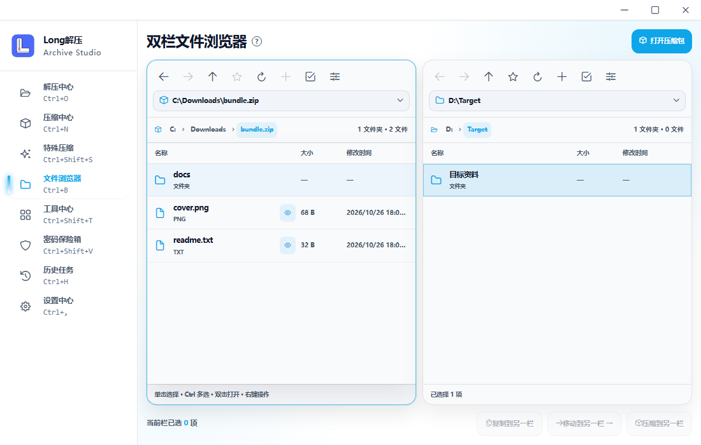
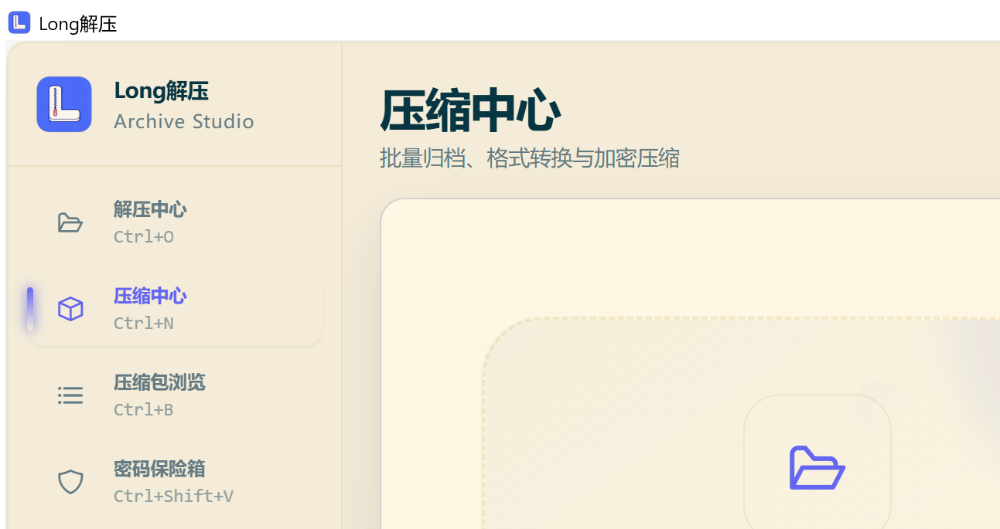
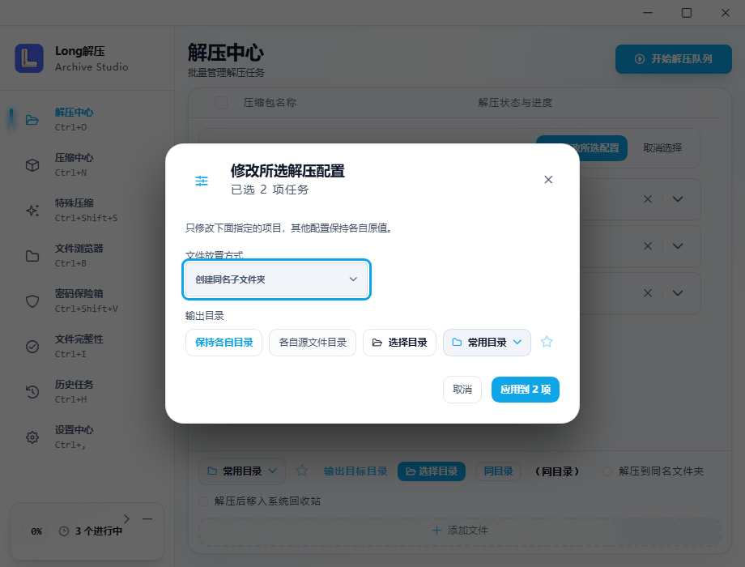
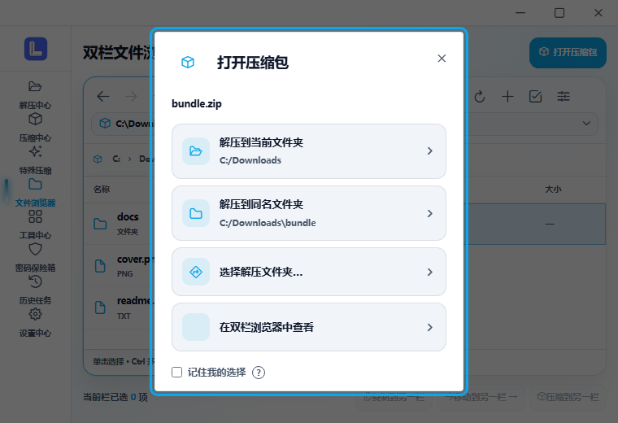
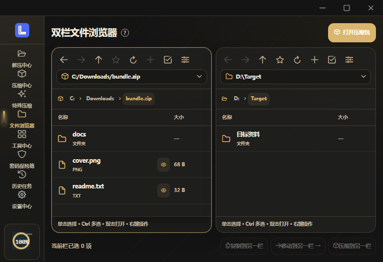
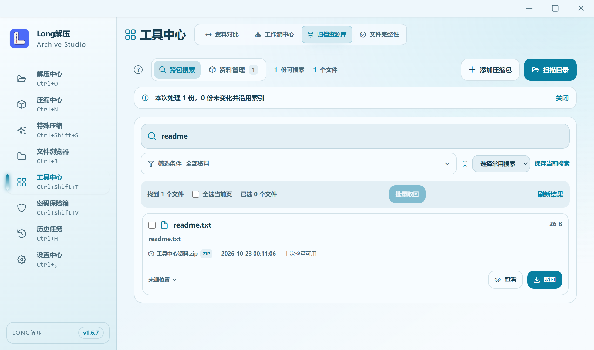

# Long解压 · Archive Studio

**从打开压缩包，到整理文件、找到结果。**

双栏浏览 · 批量压缩与解压 · 图文预览 · 归档编辑 · 本地资料工具

### [↓ 下载 Windows 版](https://github.com/Longyuyeee/long_Decompress/releases/latest)

[软件特点](#features) · [界面一览](#screenshots) · [快速上手](#quick-start) · [格式支持](#formats) · [常见问题](#faq) · [最近更新](#updates)

---

## ✨ 围绕文件，也围绕你的操作

<table>
<tr>
<td width="50%" valign="top">

### 📂 压缩包，就是特殊文件夹

两栏并排浏览，进入压缩包仍保留相同的导航、地址栏、列表和选择方式。在一栏找文件，在另一栏接收；TXT、常见文本和图片可直接预览，图片包支持连续阅读。

</td>
<td width="50%" valign="top">

### ⚡ 多个任务，一起处理

拖入文件开始压缩、解压或转换。单条点击展开，多选集中弹窗配置；修改某条即使用该条配置。左右等宽展示参数与运行信息，完成后就近打开结果，失败后调整再继续。

</td>
</tr>
<tr>
<td width="50%" valign="top">

### 🖱️ 从 Windows 直接开始

在设置中选择默认打开格式，经 Windows 确认后，双击可询问或直接执行：当前目录、同名文件夹、自选目录、双栏浏览。右键常用动作在前，其余收进“更多操作”。

</td>
<td width="50%" valign="top">

### 🧩 找到、整理，再取回

工具中心集中资料对比、归档资源库、工作流与文件完整性。跨包搜索文件名和路径，保存常用搜索；比较两份资料，或整理 ZIP / ZIPX 内容后另存新包。

</td>
</tr>
<tr>
<td width="50%" valign="top">

### 🔐 密码与分卷，接入同一流程

密码保险箱管理常用密码，分卷按整组识别。浏览、预览、解压、转换和结果沿用同一套操作；针对可支持的损坏 ZIP 提供部分抢救，普通 LZOP 可取回已校验的完整前缀成员，TAR.LZO 可取回已确认的内部文件和目录，明确展示部分结果。

</td>
<td width="50%" valign="top">

### 🎨 不止一种工作氛围

多种主题与强调色，适配宽窄窗口。图片、视频、PDF 各有专门的体积优化入口；任务、历史、托盘与带下载进度的应用内更新陪你完成整个过程。

</td>
</tr>
</table>

## 🖼️ 界面一览

包内外保持一致，主要空间留给文件列表。截图使用演示资料。

<table>
<tr>
<td width="50%" align="center">
 <strong>单条展开 · 参数与进度同屏</strong>
</td>
<td width="50%" align="center">
 <strong>批量配置 · 需要时再展开</strong>
</td>
</tr>
</table>

<strong>更多界面：四项打开选择、工具中心与主题</strong>

| 打开压缩包 | 曜石鎏金双栏 |
| --- | --- |
|  |  |

部分功能截图来自较早版本；具体外观以当前安装版本为准。

## 🚀 从这里开始

1. 从 [Releases](https://github.com/Longyuyeee/long_Decompress/releases/latest) 下载 Windows x64 的 `setup.exe` 并安装。
2. 进入解压中心、压缩中心或文件浏览器，拖入文件，确认输出位置后开始。
3. 如需双击压缩包使用本软件，进入 **设置 → 行为 → 默认打开压缩包**，选择格式，再到 Windows 设置确认 Long解压为默认应用。

“打开后”默认每次询问，也可以保存为四种动作之一；选择自选目录时，每次弹出目录选择。首次使用提供一次设置提醒，关闭后不再因升级重复提醒。

| 你想做什么 | 入口 |
| --- | --- |
| 只取出包里的几个文件，或先看 TXT / 图片 | 文件浏览器 → 在当前栏打开压缩包 |
| 修改内容、改名或整理 ZIP / ZIPX | 包内选项 → 编辑内容 → 复核后另存 |
| 改归档格式、密码或分卷大小 | 压缩中心 → 转换压缩包 |
| 查文件在哪个压缩包里 | 工具中心 → 归档资源库 → 建索引后搜索 |
| 比较两份资料 / 重复执行处理方案 / 校验文件 | 工具中心 → 资料对比 / 工作流 / 文件完整性 |
| 压缩图片、视频、PDF | 特殊压缩 → 对应类型 |
| 找以前的输出，或用原配置再次处理 | 历史任务 → 结果位置 / 再次执行 |

<strong>常用快捷键</strong>

| 工作区 | 快捷键 |
| --- | --- |
| 解压中心 / 压缩中心 | `Ctrl+O` / `Ctrl+N` |
| 文件浏览器 / 特殊压缩 | `Ctrl+B` / `Ctrl+Shift+S` |
| 工具中心 | `Ctrl+Shift+T` |
| 资料对比 / 归档资源库 / 工作流 | `Ctrl+Shift+D` / `Ctrl+Shift+L` / `Ctrl+Shift+W` |
| 文件完整性 / 密码保险箱 | `Ctrl+I` / `Ctrl+Shift+V` |
| 历史任务 / 设置 | `Ctrl+H` / `Ctrl+,` |

## 🗃️ 格式能力，一眼看清

| 能力 | 主要支持 |
| --- | --- |
| 创建归档 | ZIP / ZIPX、7Z、RAR¹、ZPAQ、TAR 及常用压缩组合（含 TAR.LZO）、GZ / BZ2 / XZ / ZST / LZ4 / Brotli / LZMA / LZIP / LZOP、WIM / ESD / SWM |
| 浏览与解压 | 上述常用格式，以及 ALZ、EGG、ARJ、CAB、自解压归档和部分磁盘镜像 / 容器² |
| 密码与分卷 | ZIP / 7Z / RAR / ZPAQ 密码和对应分卷；Long 自有 AES 密码容器及数字卷；7Z / RAR 可加密文件名 |
| 压缩方法 | ZIP 的 Deflate / Store / Zstandard / BZip2 / PPMd / LZMA，ZIPX 的 XZ；7Z 多方法与可选 Delta / BCJ 预处理 |
| 浏览与整理 | 按需提取、图文预览、嵌套浏览、连续看图、ZIP / ZIPX 内容编辑与另存；范围随格式而异 |

¹ 创建 RAR 需要用户安装 WinRAR。² “可读取”不代表都能创建、编辑或修复。

完整能力与限制见 [格式支持说明](long-compress-assistant/docs/FORMAT_SUPPORT_LEVELS.md)。设置中的格式数量按本机实际引擎能力显示。

<strong>密码、分卷和兼容性须知</strong>

- 收到分卷时，将完整组放在同一目录。ZIP 可选择数字卷或标准 `.z01/…/.zip`；7Z、RAR 及其他格式使用各自支持的卷型。
- `.aes` 是 Long 自有容器，接收方需使用 Long解压；普通 TAR 和多数单文件流格式没有原生密码。
- ZIP 默认 AES-256，也可选 ZipCrypto。旧工具的非 ASCII 密码可能需要匹配密码编码；保持默认自动兼容，遇到已知编码再调整。
- ZIPX 不等于支持全部专有算法。LZOP 支持一个或多个普通文件，重名自动编号；文件夹和空目录请选择 TAR.LZO。两者支持数字分卷创建与整组读取，不提供原生密码；其他软件需先按序合并切片。多成员名超过 255 字节时请选择 TAR.LZO。
- 缺卷或损坏不保证能完整恢复；救援只输出能够读取并通过对应校验的内容，并标明部分恢复范围。
- DOCX、XLSX、PPTX、EPUB 等文档容器不作为普通归档导入。已充分压缩的文件，继续压缩可能收益很小。

## 💬 常见问题

<strong>保存打开行为后，为什么双击仍由其他软件打开？</strong>

行为设置只决定 Long解压收到文件后怎么处理。在“默认打开压缩包”的同一个弹窗中，可全选或取消格式并确认；Windows 要求的默认应用选择仍需在系统设置完成。返回后会刷新“已默认、待确认、待更换”，不会把候选注册当作已生效。也可通过 Windows 的“打开方式”临时使用本软件。

<strong>Windows 11 右键菜单在哪里？</strong>

在设置中启用资源管理器菜单。当前公开包使用“显示更多选项”中的经典菜单；第一层原生菜单仍取决于可信签名身份包。常用解压与浏览在前，转换、测试、救援等收进“更多操作”。

<strong>升级会保留设置和密码吗？</strong>

正常覆盖安装保留应用数据、常用密码与已配置的默认打开入口。一次性设置提醒独立于版本和“恢复默认”保存，不反复出现；主动删除用户数据后会重新视为首次使用。重要密码可通过保险箱导出备份。

<strong>数据在哪里处理？安装与更新需要什么？</strong>

文件处理、归档浏览、密码匹配和校验在本机完成。应用内更新联网获取版本与安装包，并展示下载进度；诊断与使用选项可在设置查看。当前安装器没有商业 Windows 代码签名，请从本仓库发布页下载；应用内更新包另有签名校验。视频功能暂不保证支持 Windows N。

## 🤝 参与与反馈

发现问题，请 [提交 Issue](https://github.com/Longyuyeee/long_Decompress/issues)，附版本、格式、操作步骤和诊断信息。参与开发可从 [开发说明](long-compress-assistant/README.md)、[产品路线](long-compress-assistant/docs/PRODUCT_ENHANCEMENT_ROADMAP.md)与 [开发交接](long-compress-assistant/docs/DEVELOPMENT_HANDOFF.md)开始。

项目代码采用 [MIT License](LICENSE)；随包引擎遵循各自许可，详见 [第三方组件说明](long-compress-assistant/README.md#third-party)。

## 📝 最近五个版本

| 版本 | 主要更新 | 详情 |
| --- | --- | --- |
| **v1.7.15** | TAR.LZO PAX 0.1 稀疏文件部分取回，核对元数据映射和段数，保留空洞与修改时间 | [说明](long-compress-assistant/docs/RELEASE_NOTES_1.7.15.md) · [下载](https://github.com/Longyuyeee/long_Decompress/releases/tag/v1.7.15) |
| **v1.7.14** | TAR.LZO PAX 1.0 稀疏文件部分取回，识别真实名称和跨块映射，保留空洞与修改时间 | [说明](long-compress-assistant/docs/RELEASE_NOTES_1.7.14.md) · [下载](https://github.com/Longyuyeee/long_Decompress/releases/tag/v1.7.14) |
| **v1.7.13** | TAR.LZO 旧 GNU 稀疏文件部分取回，保留大空洞，区分完整大小与包内数据 | [说明](long-compress-assistant/docs/RELEASE_NOTES_1.7.13.md) · [下载](https://github.com/Longyuyeee/long_Decompress/releases/tag/v1.7.13) |
| **v1.7.12** | TAR.LZO 取回目录保留原修改时间，子项完成后从深到浅处理，结果与历史分别统计 | [说明](long-compress-assistant/docs/RELEASE_NOTES_1.7.12.md) · [下载](https://github.com/Longyuyeee/long_Decompress/releases/tag/v1.7.12) |
| **v1.7.11** | TAR.LZO 取回文件保留原修改时间，范围/精度提示与内容结果分离，接通原历史详情 | [说明](long-compress-assistant/docs/RELEASE_NOTES_1.7.11.md) · [下载](https://github.com/Longyuyeee/long_Decompress/releases/tag/v1.7.11) |

[查看全部历史版本 →](https://github.com/Longyuyeee/long_Decompress/releases)
