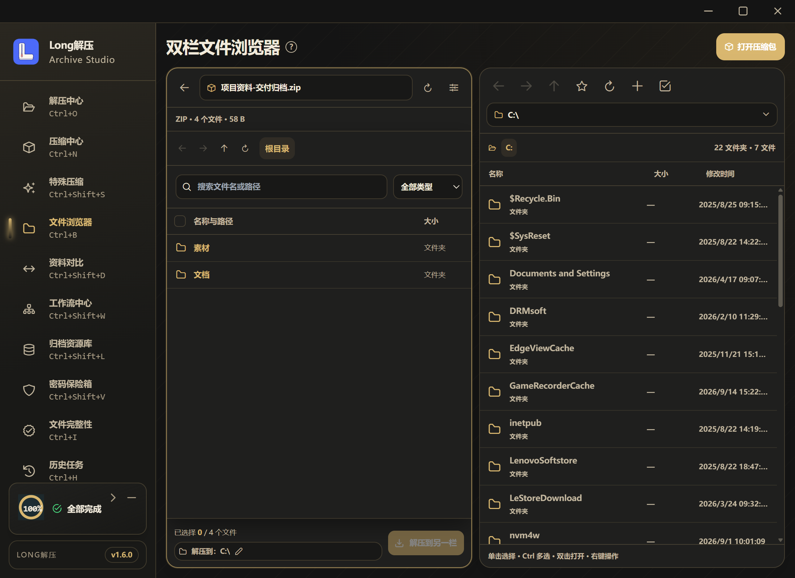
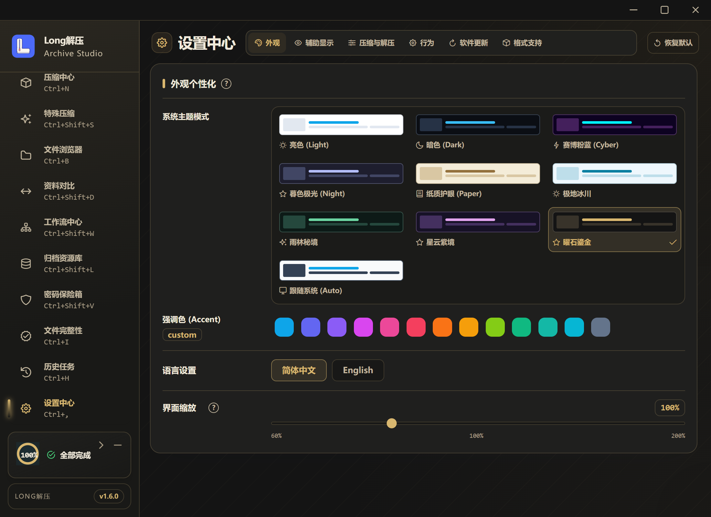

# Long解压

**面向 Windows 的本地归档与媒体压缩工作区**

打包文件 · 解压归档 · 浏览内容 · 管理密码 · 压缩图片、视频与 PDF

   

### [⬇ 下载最新版](https://github.com/Longyuyeee/long_Decompress/releases/latest)

[软件特点](#features) · [界面一览](#screenshots) · [快速上手](#quick-start) · [格式支持](#formats) · [常见问题](#faq) · [更新记录](#updates)

---

Long解压把日常文件处理放在一个顺手的工作区里。收到一批压缩包，可以一起解压；只想找里面某个文件，可以直接浏览；需要分享资料，可以打包、加密和分卷。图片、视频与 PDF 的体积优化也有各自独立的入口。

## ✨ 好用，从少做几步开始

<table>
  <tr>
    <td width="50%" valign="top">
      <h3>📦 一批文件，一次配置</h3>
      
拖入多个文件或压缩包，按状态找到任务；勾选后在原弹窗核对所选清单与修改摘要，一次调整指定参数。单条点击直接展开，各自未修改的设置继续保留。

    </td>
    <td width="50%" valign="top">
      <h3>🧭 先看内容，再决定解压什么</h3>
      
在当前栏像浏览文件夹一样查看压缩包，另一栏的位置与选择保留；搜索、筛选和选择文件。支持本地常用文本与图片预览、部分归档格式的包内预览，也能进入嵌套压缩包、确认 ZPAQ 原生多部分来源、选择和对比历史快照，按版本取出所选变化。ZPAQ 写入中断时，可明确选择完整旧快照另存取回；内容校验失败时可定位受损块与关联文件，明细按需展开，也能勾选已校验文件部分取回，生成独立结果与未取回清单。Store/Deflate/Bzip2/LZMA/Zstandard/PPMd ZIP、ZIPX（XZ） 支持普通包与 AES/ZipCrypto 密码内容编辑，可补入、替换、删除、改名和批量整理，复核后另存新包；未完成修改可从草稿恢复，原包保留。

    </td>
  </tr>
  <tr>
    <td width="50%" valign="top">
      <h3>🔑 常用密码，不必反复找</h3>
      
把常用解压密码放进本地保险箱，按名称、备注和分类整理。解压时可自动尝试已保存的候选，减少来回复制和重复输入。

    </td>
    <td width="50%" valign="top">
      <h3>🔄 改格式，也能改密码和分卷</h3>
      
将现有归档转换为新压缩包，更换或移除密码，重新分卷或合卷。原包保留，输入密码与新包密码分开设置，操作前看清输出位置。

    </td>
  </tr>
  <tr>
    <td width="50%" valign="top">
      <h3>🎞️ 图片、视频、PDF 各有所长</h3>
      
在“特殊压缩”中选择对应工具。图片可调整质量、格式和尺寸，视频可选择压缩预设，PDF 可分析并优化结构，完成后查看实际体积变化。

    </td>
    <td width="50%" valign="top">
      <h3>📂 做完之后，马上找到结果</h3>
      
从任务、历史或全局面板直接打开输出目录、定位文件或复制路径。分卷产物集中查看，也能带入整组生成校验清单；批量打开相同目录只打开一次，失败项也有后续处理入口。

    </td>
  </tr>
  <tr>
    <td width="50%" valign="top">
      <h3>🗂️ 资料分散在多个包，也能一起找</h3>
      
主动加入本地归档，按文件名和路径跨包查找。收藏来源、添加标签、保存常用搜索，跨页选择后在弹窗统一配置，按来源取回所选文件。

    </td>
    <td width="50%" valign="top">
      <h3>🪄 重复处理，存成一套方案</h3>
      
将解压、筛选、压缩和转换按顺序串起来，保存后手动运行。运行前确认来源、目录和密码，每步使用实际产物，进度、日志与结果集中查看。出错后修改参数，从相应步骤继续，核对后的成功产物可以复用。也可绑定目录，资料稳定后自动排队处理，或按单次、每天、每周安排固定资料；下一次时间与最近结果直接可见，错过后选择补跑或跳过。

    </td>
  </tr>
  <tr><td colspan="2" valign="top">
    <h3>↔️ 两份资料放在一起，只取回需要的部分</h3>
    
文件夹与 Store/Deflate/Bzip2/LZMA/Zstandard/PPMd ZIP、ZIPX（XZ） 自由组合，按路径查看差异，再按需核对实际内容，确认相同、不同或仅时间变化。密码和完整分卷接通，核对可停止后继续；左右分别勾选，在弹窗统一配置取回方式，沿原队列查看实际结果。

  </td></tr>
</table>

**工具中心：** 资料对比、工作流中心、归档资源库和文件完整性收纳到同一个入口。顶部切换分类时保留手头的输入、选择和结果；原快捷键和历史入口继续直达。

**还有这些贴近日常的小细节：** 常用目录与书签、资源管理器右键、托盘后台任务、历史搜索与再次执行、冰川/雨林/星云/曜石鎏金特色主题与强调色、界面缩放和减少动效、带下载进度的更新，以及按设置关闭到托盘、重启恢复窗口位置与大小。

## 🖼️ 界面一览

### 工具集中，四类功能按需切换

资料对比、工作流、资源库与完整性工具共享一个入口；原有操作和快捷直达保留。

### 任务就在眼前，单条展开，批量集中调整

<table>
  <tr>
    <td width="50%" valign="top" align="center">
      
      
<strong>清晰的解压任务列表</strong> 查看状态与输出位置，按需打开批量配置

    </td>
    <td width="50%" valign="top" align="center">
      
      
<strong>集中修改所选配置</strong> 在弹窗中调整，主列表保持紧凑

    </td>
  </tr>
</table>

<strong>展开查看：压缩包浏览与密码保险箱</strong>

<table>
  <tr>
    <td width="50%" align="center">
      
      
<strong>压缩包浏览</strong> 先查看，后选择，只解压需要的文件

    </td>
    <td width="50%" align="center">
      
      
<strong>密码保险箱</strong> 名称、备注与常用密码集中管理

    </td>
  </tr>
</table>

浏览与密码保险箱图片为较早版本的界面记录，具体外观以当前安装版本为准。

上方任务与弹窗图片使用演示数据；批量配置弹窗随 v1.4.2 交付，单条详情仍行内展开。点击图片可查看大图。

<strong>展开查看：双栏浏览与特色主题</strong>

## 🚀 三步开始使用

1. **下载安装。** 打开 [Releases](https://github.com/Longyuyeee/long_Decompress/releases/latest)，下载 Windows x64 的 `setup.exe` 安装程序。
2. **选择工作区。** 归档进入解压中心、压缩中心或文件浏览器；图片、视频和 PDF 进入特殊压缩。
3. **添加文件并开始。** 拖入文件，确认输出位置与参数，启动任务；完成后直接打开或定位结果。

| 你想做什么 | 从哪里开始 | 操作要点 |
| --- | --- | --- |
| 连续看图片包 | 文件浏览器 | 继续阅读、找图搜索与跨页选择；按目录/整包翻阅缩放，在弹窗配置后取回所选 |
| 比较两份资料 | 资料对比 | 选择文件夹或 ZIP/完整分卷，查看候选、按需核对内容，再取回或组成新 ZIP |
| 解压一批文件 | 解压中心 | 拖入压缩包，设置目录；常用密码可交给保险箱尝试 |
| 打包文件和文件夹 | 压缩中心 | 按用途选兼容分享、体积优先、加密或分包方案，再微调密码、名称等参数 |
| 继续更新 ZPAQ 备份 | 压缩中心 | 添加新资料，另存完整新包或原生多部分组，保留原件与历史 |
| 只提取包里的几个文件 | 文件浏览器 → 打开压缩包 | 搜索并勾选条目，再解压所选内容 |
| 不记得文件在哪个包里 | 归档资源库 → 添加资料并建索引 | 标签/收藏与保存搜索，跨包查找文件名/路径，多选后统一配置并取回 |
| 整理 ZIP 内容 | 文件浏览器 → 打开普通 ZIP → 编辑内容 | 添加/替换、删除/改名/批量移动，复核后另存新包 |
| 改格式、密码或分卷 | 压缩中心 → 转换压缩包 | 带入原包，选择新包格式与保存位置 |
| 压缩图片、视频或 PDF | 特殊压缩 | 选择文件类型，调整对应参数并查看结果 |
| 失败后调整并继续 | 原任务详情 / 任务栏 | 看原因，带入配置创建新任务，确认后启动；原失败保留 |
| 找回以前的输出 | 历史任务 | 搜索记录，打开结果或恢复配置创建新任务 |

**运行环境：** Windows 10 1809 及以上 / Windows 11，x64。视频功能暂不保证兼容 Windows N。

后续更新可在设置中心检查；正在处理任务时，请先完成或停止任务再安装更新。

<strong>常用快捷键：直接前往工作区</strong>

| 工作区 | 快捷键 |
| --- | --- |
| 解压中心 / 压缩中心 | `Ctrl+O` / `Ctrl+N` |
| 特殊压缩 / 文件浏览器 | `Ctrl+Shift+S` / `Ctrl+B` |
| 工具中心 | `Ctrl+Shift+T` |
| 工具中心 · 资料对比 | `Ctrl+Shift+D` |
| 工具中心 · 归档资源库 | `Ctrl+Shift+L` |
| 工具中心 · 工作流中心 | `Ctrl+Shift+W` |
| 密码保险箱 / 工具中心·文件完整性 | `Ctrl+Shift+V` / `Ctrl+I` |
| 历史任务 / 设置 | `Ctrl+H` / `Ctrl+,` |

在输入框中编辑文字时，不会触发工作区跳转。窄窗口可以悬停导航查看快捷键。

## 🗃️ 常用格式，一张表看清

| 能力 | 主要格式与说明 |
| --- | --- |
| 创建归档 | ZIP（Deflate / Zstandard / BZip2 / PPMd / LZMA）、ZIPX（XZ）、7Z（LZMA2 / LZMA / Bzip2 / Deflate / PPMd）、RAR（需要 WinRAR）、ZPAQ（日志式、原生密码、数字分卷与保留历史的增量更新）、TAR / TGZ / TBZ / TXZ / TZST、TAR.LZ4 / TAR.BR / TAR.LZIP / TAR.LZMA、GZ、BZ2、XZ、ZST、LZ4、Brotli、LZMA、LZIP、WIM（存储/XPRESS/LZX/LZMS/固实）、ESD（LZMS 固实），两者支持数字分卷；SWM（仅存储/XPRESS/LZX 原生资源分包） |
| 读取与解压 | ZIP / ZIPX、7Z、RAR、ZPAQ（流式当前内容/日志式历史快照、原生多部分确认读取、版本对比与变化提取）、ALZ、EGG（基础方法、AZO、固实、传统及 AES/LEA 密码与已验证原生分卷）、自解压 SFX、TAR 系列、GZIP/BZIP2/XZ/Zstandard 多段压缩流、LZIP、LZ4、Brotli、ARJ、Unix `.Z`，原生 SWM（Copy/XPRESS/LZX 整组读取），以及 CAB、ISO、UDF、DMG、VHD / VHDX 等镜像与容器 |
| 密码与分卷 | ZIP 密码数字卷/标准 `.z01/.zip`、7Z 密码数字卷、RAR 原生密码卷、ZPAQ 原生密码数字切卷及原生多部分只读；十七种 Long 自有 AES 格式数字切卷；7Z / RAR 可加密文件名 |
| 转换归档 | ZIP / ZIPX、7Z、RAR、TAR 系列（含 LZ4/Brotli/LZIP 组合及八种 TAR 自有 AES 密码分卷目标及三种新增单文件加密目标）、WIM / ESD / SWM、ZPAQ（含改密与数字分卷）；密码和分卷随目标格式提供 |
| 清单校验 | SFV/MD5/SHA256 逐文件状态与原因、待补列表、按需复查；匹配表示与清单一致 |
| 内部预览 | ZIP/TAR 系列及普通 GZIP/BZIP2/XZ/Zstandard 流、ZPAQ 日志式所选快照中的受支持图片与文本；7Z Bzip2 普通/密码、非固实/固实包支持完整文本 ≤1 MiB、图片 ≤8 MiB，含内容/文件名加密和完整数字卷，共享压缩/解码各 ≤64 MiB；Bzip2 非固实/固实大文本可先看前 1 MiB，前置与开头合计 ≤64 MiB，明确未校验整文件并可提取全文；7Z Deflate64 普通/密码非固实及固实包支持完整文本 ≤1 MiB、图片 ≤8 MiB，含内容/文件名加密和完整数字分卷；固实共享压缩/解码分别 ≤64 MiB；非固实及固实大文本可先看前 1 MiB，固实前置内容与开头合计 ≤64 MiB，明确未校验整文件并可提取全文；7Z Deflate 普通/密码包支持完整图文（文本 ≤1 MiB、图片 ≤8 MiB，含固实、内容/文件名加密与数字分卷；共享压缩/解码各 ≤64 MiB）；大文本可先看前 1 MiB，含固实（前置内容与开头合计 ≤64 MiB），标明未校验整文件并可提取全文；7Z PPMd 普通/密码包均支持非固实及小型固实的完整图文，非固实及固实大文本可读前 1 MiB（明确未校验整文件；固实前置与开头合计 ≤64 MiB，完整块压缩/解码各 ≤64 MiB）；7Z LZMA/LZMA2 的普通或密码包均支持完整小文本、图片及大文本前 1 MiB，兼容非固实与固实包（大文本明确未校验整文件，固实前置范围 ≤64 MiB）；ALZ Store/Deflate/Bzip2 支持完整小文本、大文本前 1 MiB（明确未校验整文件）、8 MiB 以内受支持图片及原连续阅读入口；EGG 非固实小文本和图片可直接预览并沿原入口连续阅读；密码和完整原生卷沿原入口使用，预览超出读取范围时可先提取后打开 |
| 图片压缩 | JPEG、PNG、WebP；质量、尺寸与格式按对应编码能力调整 |
| 视频压缩 | MP4、MOV、AVI、WMV、WebM、MKV、M4V 等受支持输入，输出 MP4 / H.264 |
| PDF 优化 | 分析结构、优化体积；是否适合处理会在分析后显示 |

内置归档引擎，日常解压无需另装 7-Zip。**解压 RAR 不需要 WinRAR；创建 RAR 需要自行安装 WinRAR。**

<strong>更多格式与使用范围</strong>

- 还可读取已支持的应用包、传统归档、文件系统与安装容器，例如 APK、APPX、JAR、DEB、RPM、MSI、LZH、CPIO、XAR、APFS、EXT、HFS/HFSX。具体能力以应用的实际检测和 [格式支持说明](long-compress-assistant/docs/FORMAT_SUPPORT_LEVELS.md)为准。
- ZIP 默认保留 `.zip.001` 数字切卷，可主动选择标准 `.z01/…/.zip`（入口为 `.zip`）；7Z 创建 `.7z.001`，RAR 创建 `.partN.rar`。解压时把整组放在同一目录。普通 TAR/流格式数字切卷的外部兼容能力不同；密码需求可选择对应 `.aes` 组合或 7Z；普通 TAR.LZMA 无原生密码。`.aes` 属于 Long 自有容器，十七种格式可创建密码数字卷；整组同目录可从任意卷打开，接收方请使用 Long解压。
- ZIP/ZIPX 已验证常用 Store、Deflate、Deflate64、BZip2、LZMA、XZ、PPMd 及部分 Zstandard 读取组合；不等于支持所有 ZIPX 专有算法。
- 创建 ZIP 可选 Deflate、Zstandard、BZip2、PPMd、LZMA，ZIPX 固定 XZ；密码、转换与配置保存保持方法，二者均支持数字卷与标准卷。接收方需支持对应方法、密码编码与卷型，ZIPX 标准卷兼容范围见格式说明。PPMd 与 LZMA 字典随等级增长，界面就近显示；LZMA 6级8MiB、9级64MiB，编码总内存更多，不自动替换默认方法。
- 可直接浏览、解压和转换 ZIP/7Z/RAR 自解压 EXE；好压论坛 ZIP 分卷按整组读取，支持已核对的明文与 ZipCrypto 密码样本。收到多个分卷时，把整组放在同一目录即可。具体格式范围见[支持说明](long-compress-assistant/docs/FORMAT_SUPPORT_LEVELS.md)。
- LZIP（单文件）与 TAR.LZIP（目录/多文件）支持创建、浏览、解压、检查和转换，兼容 `.lz`、`.tar.lz`、`.tlz`；支持连续多成员 LZIP 与数字切卷创建，普通格式不提供密码；全部卷需放在同一目录，数字切卷不同于原生成员。
- ZIP 默认 AES-256，可主动选择 ZipCrypto；与 Windows 7-Zip 交换非 ASCII 密码的归档时，可显式选择匹配的 Windows 密码编码。
- EGG 只读支持已验证的 Store、Deflate、Bzip2、LZMA、AZO、固实 Deflate/LZMA、ZipCrypto、AES/LEA 与原生卷，可浏览、所选/整包提取、检查和转换。大 LZMA 已流式读取，字典仍限 256 MiB；v1.5.11 验证二十组普通中文密码组合并补编码失败指引。加密固实、全局/文件名加密、创建和修复不承诺，工具互通边界见[本版说明](long-compress-assistant/docs/RELEASE_NOTES_1.5.11.md)。
- 密码 ZIP 可尝试救回完整文件：目录可读或丢目录后仍能确定本地文件边界时，提供密码救回通过校验的文件；新包沿用填写的密码，统一使用 AES-256 / UTF-8，并显示部分恢复及未恢复原因。
- DOCX、XLSX、PPTX、ODT、ODS、EPUB 属于文档容器，不作为普通压缩包导入。
- 预览、嵌套浏览及压缩参数随格式而异。体积优化效果取决于文件内容，已充分压缩的文件可能没有明显收益。

## 🖱️ 从 Windows 右键直接开始

在设置中启用资源管理器菜单后，可以直接浏览归档、解压到同名文件夹或当前目录、测试完整性、打包为 ZIP/7Z，以及进入转换格式、密码和分卷调整。

Windows 11 请在 **“显示更多选项”** 中使用经典菜单；当前公开包不包含第一层菜单所需的可信签名身份包。

## 🔒 文件留在本机，处理过程看得见

文件处理、归档浏览、密码匹配和完整性校验在本机完成。密码保险箱加密保存常用解压密码，任务展示当前阶段与日志；遇到同名文件可选择覆盖、跳过或保留两份。文件完整性中心还提供校验、ZIP/RAR 诊断与修复；v1.4.8 增加批量处理，恢复结果保存到新位置后可继续加入解压队列。

ZIP 目录损坏时可尝试救回可靠的完整条目；坏文件和未恢复原因会明确列出，原包保留。标准 ZIP `.z01/…/.zip` 缺少首卷或中间卷时，若目录仍完整可读，可以先救出现有连续卷中的完整文件，支持普通、AES 和 ZipCrypto 密码包。已恢复文件和未恢复原因按需展开，新包可直接加入解压队列。

部分恢复不代表全部找回。缺卷救援仍需要完整可读的目录；终卷或目录缺失、未知数字切卷长度及无法确定的加密边界需补齐来源后再处理。具体范围见 [格式支持说明](long-compress-assistant/docs/FORMAT_SUPPORT_LEVELS.md)。

## 💬 常见问题

<strong>升级后，设置和常用密码还在吗？</strong>

正常覆盖安装会保留应用数据。重要密码可以通过保险箱导出备份。

<strong>为什么任务暂时没有百分比变化？</strong>

点击任务行查看当前阶段与日志。归档扫描、密码尝试、校验及大量小文件处理不一定能给出线性进度；如长时间没有新日志，可取消并附上诊断信息反馈。

<strong>密码明明正确，旧 ZIP 为什么仍打不开？</strong>

旧工具可能使用不同的密码编码。v1.4.16 可在“ZIP 密码编码”中明确选择日文 CP932、简体 CP936 或繁体 CP950；只在已知原包编码时指定，通常保持自动兼容。它不改变文件名编码，也不能修复损坏或缺失的数据。转换时原包与新包编码分开设置，新包默认 UTF-8。

<strong>Windows 提示安装程序的发布者未知，怎么办？</strong>

当前安装程序未使用商业 Windows 代码签名证书。请从本仓库 [Releases](https://github.com/Longyuyeee/long_Decompress/releases/latest)下载，核对来源后决定是否继续；应用内更新包另有签名校验。

## 🤝 反馈与参与

发现问题或有使用建议，欢迎 [提交 Issue](https://github.com/Longyuyeee/long_Decompress/issues)。附上软件版本、文件格式、操作步骤和可复制的诊断信息，能帮助更快定位。

想参与开发，可从 [开发说明](long-compress-assistant/README.md)、[产品路线](long-compress-assistant/docs/PRODUCT_ENHANCEMENT_ROADMAP.md)和 [开发交接](long-compress-assistant/docs/DEVELOPMENT_HANDOFF.md)开始。

项目代码使用 [MIT License](LICENSE)。随包归档、视频与 PDF 组件遵循各自许可，详见 [第三方组件说明](long-compress-assistant/README.md#third-party)。

## 📝 更新记录

**v1.6.48 · 7Z PPMd 创建**。原方法选择加入 PPMdH，接通密码、隐藏文件名、固实、数字分卷及 ZIP PPMd8 转换；草稿/模板/历史/工作流保留方法，体积分析使用实际编码。[中文说明](long-compress-assistant/docs/RELEASE_NOTES_1.6.48.md) · [记录](long-compress-assistant/docs/SEVENZ_PPMD_CREATE_FREEZE_1.6.48.md) · [发布下载](https://github.com/Longyuyeee/long_Decompress/releases/tag/v1.6.48)。下一阶段 [7Z 仅归档与不可压缩文件建议](long-compress-assistant/docs/ARCHIVE_ROADMAP_1.6.49.md)仅规划。

**v1.6.47 · 7Z Deflate 创建**。原配置选择 Deflate，接通密码、隐藏文件名、固实、数字分卷和转换，草稿/模板/历史/工作流保留方法，体积分析使用实际编码。[中文说明](long-compress-assistant/docs/RELEASE_NOTES_1.6.47.md) · [记录](long-compress-assistant/docs/SEVENZ_DEFLATE_CREATE_FREEZE_1.6.47.md) · [发布下载](https://github.com/Longyuyeee/long_Decompress/releases/tag/v1.6.47)。7Z PPMd 创建由上方 v1.6.48 接续。

**v1.6.46 · 7Z 压缩方法可选**。原配置中选择 LZMA2（默认）/LZMA/Bzip2，接通密码、隐藏文件名、固实、数字分卷和转换，配置与草稿保留选择，体积分析按实际方法抽样。[中文说明](long-compress-assistant/docs/RELEASE_NOTES_1.6.46.md) · [记录](long-compress-assistant/docs/SEVENZ_COMPRESSION_METHODS_FREEZE_1.6.46.md) · [发布下载](https://github.com/Longyuyeee/long_Decompress/releases/tag/v1.6.46)。7Z Deflate 创建由上方 v1.6.47 接续。

**v1.6.45 · Bzip2 大日志先看开头**。普通/密码、非固实/固实同版先看所选前 1 MiB，接通内容/文件名加密及完整数字卷/非首卷，保留编码/滚动、部分范围和提取全文，达到目标后停止推进。[中文说明](long-compress-assistant/docs/RELEASE_NOTES_1.6.45.md) · [范围与记录](long-compress-assistant/docs/SEVENZ_BZIP2_TEXT_PREFIX_FREEZE_1.6.45.md) · [发布与下载](https://github.com/Longyuyeee/long_Decompress/releases/tag/v1.6.45)。7Z 创建方法由上方 v1.6.46 接续。

**v1.6.44 · 7Z Bzip2 图文直接看**。普通/密码、非固实/固实包同版接回原双栏完整文本与图片，含内容/文件名加密、完整数字卷/非首卷、连续阅读及仅提取当前页。[中文说明](long-compress-assistant/docs/RELEASE_NOTES_1.6.44.md) · [范围与记录](long-compress-assistant/docs/SEVENZ_BZIP2_PREVIEW_FREEZE_1.6.44.md) · [发布与下载](https://github.com/Longyuyeee/long_Decompress/releases/tag/v1.6.44)。Bzip2 大文本开头由上方 v1.6.45 接续。

**v1.6.43 · 固实 Deflate64 大日志先看开头**。普通/密码固实包的后续大文本也能在原双栏先看前 1 MiB，接通内容/文件名加密与完整数字卷/非首卷；流式跳过前置内容，仅保留所选开头，明确部分范围并可提取全文。[中文说明](long-compress-assistant/docs/RELEASE_NOTES_1.6.43.md) · [范围与记录](long-compress-assistant/docs/SEVENZ_SOLID_DEFLATE64_PREFIX_FREEZE_1.6.43.md) · [发布与下载](https://github.com/Longyuyeee/long_Decompress/releases/tag/v1.6.43)。Bzip2 完整图文由上方 v1.6.44 接续。

**v1.6.42 · Deflate64 大日志先看开头**。普通/密码非固实包的大文本可在原双栏窗口先看前 1 MiB，接通内容/文件名加密和完整数字卷/非首卷；保留常见编码、字符边界、滚动和提取全文，明确未校验整文件。[中文说明](long-compress-assistant/docs/RELEASE_NOTES_1.6.42.md) · [范围与记录](long-compress-assistant/docs/SEVENZ_DEFLATE64_TEXT_PREFIX_FREEZE_1.6.42.md) · [发布与下载](https://github.com/Longyuyeee/long_Decompress/releases/tag/v1.6.42)。固实 Deflate64 大文本开头由上方 v1.6.43 接续。

**v1.6.41 · 密码固实 Deflate64 图文直接看**。AES 共享块里的完整小文本和图片接回原双栏与密码入口，含内容/文件名加密、完整数字卷/非首卷、连续阅读和仅提取当前页；保持共享完整校验及完整加密消费。[中文说明](long-compress-assistant/docs/RELEASE_NOTES_1.6.41.md) · [范围与记录](long-compress-assistant/docs/SEVENZ_PASSWORD_SOLID_DEFLATE64_PREVIEW_FREEZE_1.6.41.md) · [发布与下载](https://github.com/Longyuyeee/long_Decompress/releases/tag/v1.6.41)。非固实 Deflate64 大文本开头由上方 v1.6.42 接续。

**v1.6.40 · 固实 Deflate64 图文直接看**。普通共享块里的完整小文本和图片接回原双栏预览、连续阅读与仅提取当前页，支持完整数字卷/非首卷；流式处理前后内容，仅保留所选文件，检查整个共享块结束与全部可用 CRC。[中文说明](long-compress-assistant/docs/RELEASE_NOTES_1.6.40.md) · [范围与记录](long-compress-assistant/docs/SEVENZ_SOLID_DEFLATE64_PREVIEW_FREEZE_1.6.40.md) · [发布与下载](https://github.com/Longyuyeee/long_Decompress/releases/tag/v1.6.40)。密码固实 Deflate64 图文由上方 v1.6.41 接续。

**v1.6.39 · 密码 Deflate64 图文直接看**。非固实 AES 包也能在原双栏直接预览小文本和图片，含内容/文件名加密、完整数字卷/非首卷，沿原手动密码/保险箱、连续阅读与仅提取当前页入口。[中文说明](long-compress-assistant/docs/RELEASE_NOTES_1.6.39.md) · [范围与记录](long-compress-assistant/docs/SEVENZ_PASSWORD_DEFLATE64_PREVIEW_FREEZE_1.6.39.md) · [发布与下载](https://github.com/Longyuyeee/long_Decompress/releases/tag/v1.6.39)。普通固实 Deflate64 图文由上方 v1.6.40 接续。

**v1.6.38 · Deflate64 图文直接看**。普通非固实 7Z 的完整小文本和图片直接接回原双栏预览、连续阅读和仅提取当前页，支持完整数字分卷/非首卷，明确核对真实结束、压缩覆盖与 CRC。[中文说明](long-compress-assistant/docs/RELEASE_NOTES_1.6.38.md) · [范围与记录](long-compress-assistant/docs/SEVENZ_DEFLATE64_PREVIEW_FREEZE_1.6.38.md) · [发布与下载](https://github.com/Longyuyeee/long_Decompress/releases/tag/v1.6.38)。密码 Deflate64 图文由上方 v1.6.39 接续。

**v1.6.37 · 固实 Deflate 大日志先看开头**。普通/密码固实包的后续大文本也能在原双栏窗口先看前 1 MiB，完整数字卷/非首卷、密码入口、编码/滚动和提取全文贯通；流式跳过前置内容，仅保留所选开头，明确未校验整文件。[中文说明](long-compress-assistant/docs/RELEASE_NOTES_1.6.37.md) · [范围与记录](long-compress-assistant/docs/SEVENZ_SOLID_DEFLATE_PREFIX_FREEZE_1.6.37.md) · [发布与下载](https://github.com/Longyuyeee/long_Decompress/releases/tag/v1.6.37)。普通 Deflate64 完整图文由上方 v1.6.38 接续。

**v1.6.36 · Deflate 大日志先看开头**。普通/密码非固实包的大文本可在原双栏窗口先看前 1 MiB，内容/文件名加密、完整数字卷/非首卷和原密码入口贯通；保留编码/滚动、明确部分范围与提取全文。[中文说明](long-compress-assistant/docs/RELEASE_NOTES_1.6.36.md) · [范围与记录](long-compress-assistant/docs/SEVENZ_DEFLATE_TEXT_PREFIX_FREEZE_1.6.36.md) · [发布与下载](https://github.com/Longyuyeee/long_Decompress/releases/tag/v1.6.36)。固实大文本开头预览由上方 v1.6.37 接续。

**v1.6.35 · Deflate 固实图文直接预览**。普通/密码固实包接回原双栏文本、图片与整包阅读，内容/文件名加密、完整数字卷/非首卷、原密码入口与当前页提取贯通；共享块完整读取后只保留所选内容。[中文说明](long-compress-assistant/docs/RELEASE_NOTES_1.6.35.md) · [范围与记录](long-compress-assistant/docs/SEVENZ_SOLID_DEFLATE_PREVIEW_FREEZE_1.6.35.md) · [发布与下载](https://github.com/Longyuyeee/long_Decompress/releases/tag/v1.6.35)。非固实大文本开头预览由上方 v1.6.36 接续。

**v1.6.34 · 密码 Deflate 图文直接预览**。AES 内容/文件名加密与完整数字卷接回原双栏文本、图片和整包阅读，沿原手动密码/保险箱与当前页提取；完整 AES 消费和 Deflate 结束同时确认，保留编码/滚动、取消/来源与下一步入口。[中文说明](long-compress-assistant/docs/RELEASE_NOTES_1.6.34.md) · [范围与记录](long-compress-assistant/docs/SEVENZ_PASSWORD_DEFLATE_PREVIEW_FREEZE_1.6.34.md) · [发布与下载](https://github.com/Longyuyeee/long_Decompress/releases/tag/v1.6.34)。Deflate 固实图文由上方 v1.6.35 接续。

**v1.6.33 · 7Z Deflate 图文原位预览**。普通非固实包沿原双栏窗口完整查看小文本和图片，接通数字分卷、原整包阅读/当前页提取；确认完整流结束、大小、压缩消费和 CRC，保留编码、取消/来源与下一步入口。[中文说明](long-compress-assistant/docs/RELEASE_NOTES_1.6.33.md) · [范围与记录](long-compress-assistant/docs/SEVENZ_DEFLATE_PREVIEW_FREEZE_1.6.33.md) · [发布与下载](https://github.com/Longyuyeee/long_Decompress/releases/tag/v1.6.33)。密码 Deflate 图文由上方 v1.6.34 接续。

**v1.6.32 · 固实 PPMd 大日志直接读开头**。普通/密码固实包沿原窗口显示所选前 1 MiB，接通内容/文件名加密、手动密码/保险箱和完整数字卷；保留编码、滚动及提取入口。只跳过必要前置内容，明确“部分内容 / 未校验整文件”，超出范围给出下一步。[中文说明](long-compress-assistant/docs/RELEASE_NOTES_1.6.32.md) · [范围与记录](long-compress-assistant/docs/SEVENZ_SOLID_PPMD_TEXT_PREFIX_FREEZE_1.6.32.md) · [发布与下载](https://github.com/Longyuyeee/long_Decompress/releases/tag/v1.6.32)。普通非固实 Deflate 图文由上方 v1.6.33 接续。

**v1.6.31 · PPMd 非固实大日志直接读开头**。普通/密码包接入原文本窗口，显示前 1 MiB 并明确“部分内容 / 未校验整文件”；手动密码/保险箱、内容/文件名加密和完整数字卷贯通，保留编码、滚动、取消/来源与提取入口。[中文说明](long-compress-assistant/docs/RELEASE_NOTES_1.6.31.md) · [范围与记录](long-compress-assistant/docs/SEVENZ_PPMD_TEXT_PREFIX_FREEZE_1.6.31.md) · [发布与下载](https://github.com/Longyuyeee/long_Decompress/releases/tag/v1.6.31)。固实 PPMd 大日志由上方 v1.6.32 接续。

**v1.6.30 · 密码固实 PPMd 7Z 直接查看图文**。AES 内容/文件名加密的小型固实包接入原双栏完整小文本、图片与连续阅读；手动密码/保险箱、完整数字卷、取消/来源和准确当前页提取贯通，完整检查 AES 与共享 PPMd 结束。[中文说明](long-compress-assistant/docs/RELEASE_NOTES_1.6.30.md) · [范围与记录](long-compress-assistant/docs/SEVENZ_PASSWORD_SOLID_PPMD_PREVIEW_FREEZE_1.6.30.md) · [发布与下载](https://github.com/Longyuyeee/long_Decompress/releases/tag/v1.6.30)。非固实 PPMd 大日志由上方 v1.6.31 接续。

**v1.6.29 · 固实 PPMd 7Z 直接查看图文**。未加密小型固实包接入原双栏完整小文本、图片与连续阅读；完整检查所选共享块的前后内容与结束，只保留所选文件，沿原数字卷、取消/来源和准确当前页提取。[中文说明](long-compress-assistant/docs/RELEASE_NOTES_1.6.29.md) · [范围与记录](long-compress-assistant/docs/SEVENZ_SOLID_PPMD_PREVIEW_FREEZE_1.6.29.md) · [发布与下载](https://github.com/Longyuyeee/long_Decompress/releases/tag/v1.6.29)。密码固实 PPMd 图文由上方 v1.6.30 接续。

**v1.6.28 · 密码 PPMd 7Z 直接查看图文**。非固实包的 AES 内容/文件名加密接入原双栏完整小文本、图片与连续阅读；沿用手动密码/保险箱、完整数字卷与当前页提取。确认完整 AES 和 PPMd 结束，保留来源/取消及损坏下一步。[中文说明](long-compress-assistant/docs/RELEASE_NOTES_1.6.28.md) · [范围与记录](long-compress-assistant/docs/SEVENZ_PASSWORD_PPMD_PREVIEW_FREEZE_1.6.28.md) · [发布与下载](https://github.com/Longyuyeee/long_Decompress/releases/tag/v1.6.28)。普通固实 PPMd 图文由上方 v1.6.29 接续。

**v1.6.27 · PPMd 7Z 直接查看图文**。未加密非固实包接入原双栏完整小文本、五种图片与原连续阅读；完整数字卷、准确当前页提取、取消与来源贯通。核对 PPMd 实际结束状态，正文可读而尾部损坏仍明确报错。[中文说明](long-compress-assistant/docs/RELEASE_NOTES_1.6.27.md) · [范围与记录](long-compress-assistant/docs/SEVENZ_PPMD_PREVIEW_FREEZE_1.6.27.md) · [发布与下载](https://github.com/Longyuyeee/long_Decompress/releases/tag/v1.6.27)。密码 PPMd 图文由上方 v1.6.28 接续。

**v1.6.26 · 密码固实 7Z 大日志直接读开头**。AES + LZMA/LZMA2 固实大文本接入原双栏，内容/文件名加密、原密码/保险箱和完整数字卷贯通；有界跳过前置内容，准确显示所选前 1 MiB，明确部分内容/未校验整文件，保留取消与“提取后打开”。[中文说明](long-compress-assistant/docs/RELEASE_NOTES_1.6.26.md) · [范围与记录](long-compress-assistant/docs/SEVENZ_ENCRYPTED_SOLID_TEXT_PREFIX_FREEZE_1.6.26.md) · [发布与下载](https://github.com/Longyuyeee/long_Decompress/releases/tag/v1.6.26)。PPMd 非固实图文由上方 v1.6.27 接续。

**v1.6.25 · 固实 7Z 大日志直接读开头**。未加密 LZMA/LZMA2 固实大文本接入原双栏，准确跳过有界前置内容，只保留所选前 1 MiB；明确部分内容/未校验整文件，保留数字卷、编码边界、取消与“提取后打开”。[中文说明](long-compress-assistant/docs/RELEASE_NOTES_1.6.25.md) · [范围与记录](long-compress-assistant/docs/SEVENZ_SOLID_TEXT_PREFIX_FREEZE_1.6.25.md) · [发布与下载](https://github.com/Longyuyeee/long_Decompress/releases/tag/v1.6.25)。密码固实大文本由上方 v1.6.26 接续。

**v1.6.24 · 密码 7Z 大日志直接读开头**。AES + LZMA/LZMA2 非固实大文本接入原双栏，内容/文件名加密、原密码/保险箱和完整数字卷贯通；明确部分内容/未校验整文件，保留编码边界、取消与“提取后打开”。[中文说明](long-compress-assistant/docs/RELEASE_NOTES_1.6.24.md) · [范围与记录](long-compress-assistant/docs/SEVENZ_PASSWORD_TEXT_PREFIX_FREEZE_1.6.24.md) · [发布与下载](https://github.com/Longyuyeee/long_Decompress/releases/tag/v1.6.24)。未加密固实大文本由上方 v1.6.25 接续。

**v1.6.23 · 7Z 大日志直接读开头**。未加密 LZMA/LZMA2 非固实大文本在原双栏显示前 1 MiB，明确部分内容/未校验整文件，保留编码边界、完整数字卷与关闭取消；可沿“提取后打开”查看全文；修复 LZMA2 结束标记损坏时完整检查误报成功。[中文说明](long-compress-assistant/docs/RELEASE_NOTES_1.6.23.md) · [范围与记录](long-compress-assistant/docs/SEVENZ_TEXT_PREFIX_FREEZE_1.6.23.md) · [发布与下载](https://github.com/Longyuyeee/long_Decompress/releases/tag/v1.6.23)。密码大文本由上方 v1.6.24 接续。

**v1.6.22 · 带密码的 7Z 固实相册直接看图**。AES + LZMA/LZMA2 固实图片接入原双栏和阅读器，内容/文件名加密、原密码/保险箱与完整数字分卷贯通。按需翻页、缩放、跳过坏图、定位与准确提取当前页，另一栏位置保持。[中文说明](long-compress-assistant/docs/RELEASE_NOTES_1.6.22.md) · [范围与记录](long-compress-assistant/docs/SEVENZ_ENCRYPTED_SOLID_IMAGE_FREEZE_1.6.22.md) · [发布与下载](https://github.com/Longyuyeee/long_Decompress/releases/tag/v1.6.22)。7Z 非固实大文本开头已由上方 v1.6.23 接续。

**v1.6.21 · 带密码的 7Z 固实说明直接阅读**。在原双栏阅读 AES + LZMA/LZMA2 固实说明与日志，接通原密码/保险箱、文件名加密和完整数字卷。目录只读取文件名信息，选中内容完整检查后显示，保留取消和来源核对。[中文说明](long-compress-assistant/docs/RELEASE_NOTES_1.6.21.md) · [范围与记录](long-compress-assistant/docs/SEVENZ_ENCRYPTED_SOLID_TEXT_FREEZE_1.6.21.md) · [发布与下载](https://github.com/Longyuyeee/long_Decompress/releases/tag/v1.6.21)。7Z 加密固实图片已由上方 v1.6.22 接续。

**v1.6.20 · 7Z 固实相册直接看图**。未加密 LZMA/LZMA2 固实图片接入原双栏弹层和阅读器，完整数字分卷沿原入口；按需翻页、缩放、跳过坏图、定位和准确提取当前页，检查整个共享块后显示，保留取消与来源核对。[中文说明](long-compress-assistant/docs/RELEASE_NOTES_1.6.20.md) · [范围与记录](long-compress-assistant/docs/SEVENZ_SOLID_IMAGE_PREVIEW_FREEZE_1.6.20.md) · [发布与下载](https://github.com/Longyuyeee/long_Decompress/releases/tag/v1.6.20)。7Z 加密固实小文本已由上方 v1.6.21 接续。

**v1.6.19 · 7Z 固实小文本直接阅读**。在原双栏直接打开未加密 LZMA/LZMA2 固实包内的说明、日志与配置，完整数字分卷沿原入口；检查整个共享块后显示，保留滚动、关闭取消和来源核对。只保留选中文本，超限或加密固实仍可先提取。[中文说明](long-compress-assistant/docs/RELEASE_NOTES_1.6.19.md) · [范围与记录](long-compress-assistant/docs/SEVENZ_SOLID_TEXT_PREVIEW_FREEZE_1.6.19.md) · [发布与下载](https://github.com/Longyuyeee/long_Decompress/releases/tag/v1.6.19)。7Z 小型固实图片已由上方 v1.6.20 接续。

**v1.6.18 · 7Z 图片预览与连续阅读**。原双栏直接查看非固实 LZMA/LZMA2 图片，接通密码、文件名加密数字卷与原阅读器；按需翻页、缩放、跳过、定位和准确提取当前页，保持取消/来源核对与左右等宽。[中文说明](long-compress-assistant/docs/RELEASE_NOTES_1.6.18.md) · [范围与记录](long-compress-assistant/docs/SEVENZ_IMAGE_PREVIEW_FREEZE_1.6.18.md) · [发布与下载](https://github.com/Longyuyeee/long_Decompress/releases/tag/v1.6.18)。7Z 小型固实文本已由上方 v1.6.19 接续。

**v1.6.17 · 7Z 小文本原位预览**。在原双栏直接阅读 LZMA/LZMA2 非固实完整小文本，接通密码、保险箱与文件名加密数字卷，完整大小/CRC/解码结束后显示；保留取消、来源刷新与明确提取指引。[中文说明](long-compress-assistant/docs/RELEASE_NOTES_1.6.17.md) · [范围与记录](long-compress-assistant/docs/SEVENZ_TEXT_PREVIEW_FREEZE_1.6.17.md) · [发布与下载](https://github.com/Longyuyeee/long_Decompress/releases/tag/v1.6.17)。7Z 非固实图片已由上方 v1.6.18 接续。

**v1.6.16 · EGG 大文本前缀预览**。原双栏可直接阅读非固实大日志开头，最多前 1 MiB，明确“部分内容 · 未校验整文件”，保留字符边界；密码/原生卷、取消和来源刷新沿旧入口使用，完整操作保持原校验条件。[中文说明](long-compress-assistant/docs/RELEASE_NOTES_1.6.16.md) · [范围与记录](long-compress-assistant/docs/EGG_TEXT_PREFIX_FREEZE_1.6.16.md) · [发布与下载](https://github.com/Longyuyeee/long_Decompress/releases/tag/v1.6.16)。7Z 非固实小文本已由上方 v1.6.17 接续。

**v1.6.15 · EGG 固实图片与连续阅读**。在原双栏查看小型未加密 Deflate / LZMA 固实图片，沿原阅读器翻页、缩放、跳过和准确提取当前页；完整共享依赖检查后显示，按需读取、明确等待，保留有限缓存与取消/来源刷新。[中文说明](long-compress-assistant/docs/RELEASE_NOTES_1.6.15.md) · [范围与记录](long-compress-assistant/docs/EGG_SOLID_IMAGE_PREVIEW_FREEZE_1.6.15.md) · [发布与下载](https://github.com/Longyuyeee/long_Decompress/releases/tag/v1.6.15)。EGG 非固实大文本前缀已由上方 v1.6.16 接续。

**v1.6.14 · EGG 固实包内文本预览**。在原双栏直接查看未加密 Deflate / LZMA 固实包内的小文本；约束完整共享流读取，全部依赖检查通过后显示，损坏/超限/加密固实给下一步。[中文说明](long-compress-assistant/docs/RELEASE_NOTES_1.6.14.md) · [范围与记录](long-compress-assistant/docs/EGG_SOLID_TEXT_PREVIEW_FREEZE_1.6.14.md) · [发布与下载](https://github.com/Longyuyeee/long_Decompress/releases/tag/v1.6.14)。EGG 小型固实图片已由上方 v1.6.15 接续。

**v1.6.13 · EGG 图片预览与连续阅读**。在原双栏直接查看受支持的非固实图片，沿原阅读器翻页、缩放、跳过坏图、定位和提取当前页；接通密码保险箱、显式代码页、完整原生卷、取消与来源刷新。[中文说明](long-compress-assistant/docs/RELEASE_NOTES_1.6.13.md) · [范围与记录](long-compress-assistant/docs/EGG_IMAGE_PREVIEW_FREEZE_1.6.13.md) · [发布与下载](https://github.com/Longyuyeee/long_Decompress/releases/tag/v1.6.13)。EGG 小型固实文本已由上方 v1.6.14 接续。

**v1.6.12 · EGG 包内文本预览**。在原双栏直接查看非固实小文本，接通手动密码、保险箱、显式编码、完整原生卷、取消与来源刷新；完整校验所选内容，固实及超限给提取指引。[中文说明](long-compress-assistant/docs/RELEASE_NOTES_1.6.12.md) · [范围与记录](long-compress-assistant/docs/EGG_TEXT_PREVIEW_FREEZE_1.6.12.md) · [发布与下载](https://github.com/Longyuyeee/long_Decompress/releases/tag/v1.6.12)。EGG 图片已由上方 v1.6.13 接续。

**v1.6.11 · ALZ 大文本前缀预览**。直接在原双栏查看较大日志、说明和配置的开头，最多显示前 1 MiB 并标明未校验整文件；接通密码保险箱、显式编码与完整原生卷，关闭取消、来源变化刷新，完整提取/检查/转换保持原校验条件。[中文说明](long-compress-assistant/docs/RELEASE_NOTES_1.6.11.md) · [范围与记录](long-compress-assistant/docs/ALZ_TEXT_PREFIX_FREEZE_1.6.11.md) · [发布与下载](https://github.com/Longyuyeee/long_Decompress/releases/tag/v1.6.11)。EGG 小文本已由上方 v1.6.12 接续。

**v1.6.10 · ALZ 图片预览与连续阅读**。在原双栏直接看图，接通现有翻页、缩放、坏图跳过、定位和当前页提取；沿用密码保险箱、编码与完整原生卷组，关闭取消、来源变化提示刷新。[中文说明](long-compress-assistant/docs/RELEASE_NOTES_1.6.10.md) · [范围与记录](long-compress-assistant/docs/ALZ_IMAGE_PREVIEW_FREEZE_1.6.10.md) · [发布与下载](https://github.com/Longyuyeee/long_Decompress/releases/tag/v1.6.10)。大文本前缀已由上方 v1.6.11 接续。

**v1.6.9 · ALZ 包内文本预览**。在原双栏直接查看说明、日志与配置，接通现有密码保险箱、显式编码和完整原生卷组；只读所选完整小文件，关闭取消，来源变化提示刷新，大文件给提取指引。保留原弹层和左右等宽布局。[中文说明](long-compress-assistant/docs/RELEASE_NOTES_1.6.9.md) · [范围与记录](long-compress-assistant/docs/ALZ_TEXT_PREVIEW_FREEZE_1.6.9.md) · [发布与下载](https://github.com/Longyuyeee/long_Decompress/releases/tag/v1.6.9)。图片预览已由上方 v1.6.10 接续，大文本前缀另列后续。

**v1.6.8 · ALZ Bzip2 按块读取**。不再先收集整条压缩数据，移除旧 256 MiB 单条限制；保留密码状态、跨块位对齐、完整性和原任务操作。大包边界经明确标注的受控归档与独立回解核对，历史原工具大包仍待取得。[中文说明](long-compress-assistant/docs/RELEASE_NOTES_1.6.8.md) · [范围与记录](long-compress-assistant/docs/ALZ_BOUNDED_FREEZE_1.6.8.md) · [发布与下载](https://github.com/Longyuyeee/long_Decompress/releases/tag/v1.6.8)。小文本预览已由上方 v1.6.9 接续，图片与大文本前缀继续分阶段推进。

**v1.6.7 · 工具中心**。资料对比、工作流中心、归档资源库和文件完整性集中到四个分类页签，侧边栏统一为八个入口；`Ctrl+Shift+T` 打开工具中心，原四种快捷键继续直达。切换分类保留输入、选择、展开和结果，界面沿用原有样式。[中文说明](long-compress-assistant/docs/RELEASE_NOTES_1.6.7.md) · [范围与记录](long-compress-assistant/docs/TOOLS_CENTER_FREEZE_1.6.7.md) · [发布与下载](https://github.com/Longyuyeee/long_Decompress/releases/tag/v1.6.7)。

**v1.6.6 · 窗口位置与大小记忆**。调整好的窗口在重启后自动恢复，最大化保留还原尺寸，最小化/托盘不覆盖正常位置；换屏或降低分辨率时调整到可见区域，无需额外设置。回应 [#248](https://github.com/Longyuyeee/long_Decompress/issues/248)。[中文说明](long-compress-assistant/docs/RELEASE_NOTES_1.6.6.md) · [范围与记录](long-compress-assistant/docs/WINDOW_MEMORY_FREEZE_1.6.6.md) · [发布与下载](https://github.com/Longyuyeee/long_Decompress/releases/tag/v1.6.6)。

**v1.6.5 · ALZ Bzip2 完整性修复**。缺少结束标记或声明压缩范围内夹入尾随数据时，不再把完整解出内容当作检查、解压或转换成功；大小和 CRC 均匹配后给出明确来源损坏原因，沿原失败新任务和历史继续处理。[中文说明](long-compress-assistant/docs/RELEASE_NOTES_1.6.5.md) · [范围与记录](long-compress-assistant/docs/ALZ_BZIP2_INTEGRITY_FREEZE_1.6.5.md) · [发布与下载](https://github.com/Longyuyeee/long_Decompress/releases/tag/v1.6.5)。方法 3 仍待真实原包。

**v1.6.4 · 从受损 ZPAQ 取回已校验文件**。在诊断详情勾选文件，二级弹窗确认后加入原队列；按所选范围验证密码，独立目录保留原路径，结果区分已取回与未取回原因。草稿、补密码、失败新任务及历史保留范围。[中文说明](long-compress-assistant/docs/RELEASE_NOTES_1.6.4.md) · [范围与记录](long-compress-assistant/docs/ZPAQ_RETRIEVAL_FREEZE_1.6.4.md) · [发布与下载](https://github.com/Longyuyeee/long_Decompress/releases/tag/v1.6.4)。正式安装与更新附件已生成。已由上方 v1.6.5 接续；方法 3 [来源调查](long-compress-assistant/docs/ALZ_METHOD3_SOURCE_1.6.5.md)仍保留未完成。

**v1.6.3 · ZPAQ 受损块与文件影响定位**。按所选快照检查共享数据块，分清通过、受影响和未检查；明细、筛选与关联放进二级弹窗，普通/密码及原生组入口接通。本版只诊断定位。[中文说明](long-compress-assistant/docs/RELEASE_NOTES_1.6.3.md) · [范围与记录](long-compress-assistant/docs/ZPAQ_BLOCK_DIAGNOSIS_FREEZE_1.6.3.md) · [发布与下载](https://github.com/Longyuyeee/long_Decompress/releases/tag/v1.6.3)。已由上方 v1.6.4 接续。

**v1.6.2 · 中断备份的完整旧快照取回**。识别 ZPAQ 未完成事务，在当前栏选择完整旧快照另存取回；普通/密码、单包/已确认多部分贯通原队列、草稿与历史，结果明确排除中断更新。[中文说明](long-compress-assistant/docs/RELEASE_NOTES_1.6.2.md) · [范围与记录](long-compress-assistant/docs/ZPAQ_TAIL_RECOVERY_FREEZE_1.6.2.md) · [发布与下载](https://github.com/Longyuyeee/long_Decompress/releases/tag/v1.6.2)。已由上方 v1.6.3 接续。

**v1.6.1 · 原生 ZPAQ 多部分备份继续更新**。添加新资料，另存完整独立新组，保留原件、全部旧快照和未选内容；普通包、密码包、草稿恢复、失败重试和产物清单贯通。[中文说明](long-compress-assistant/docs/RELEASE_NOTES_1.6.1.md) · [范围与记录](long-compress-assistant/docs/ZPAQ_NATIVE_UPDATE_FREEZE_1.6.1.md) · [发布与下载](https://github.com/Longyuyeee/long_Decompress/releases/tag/v1.6.1)。已由上方 v1.6.2 接续。

**v1.6.0 · 界面与操作体验升级**。双栏内浏览归档与常用文本预览，全部页面的信息收纳、四种特色主题、完整导航快捷键、动态格式统计、更新进度和关闭到托盘修正。[中文说明](long-compress-assistant/docs/RELEASE_NOTES_1.6.0.md) · [范围与记录](long-compress-assistant/docs/UI_EXPERIENCE_FREEZE_1.6.0.md) · [发布与下载](https://github.com/Longyuyeee/long_Decompress/releases/tag/v1.6.0)。

**v1.5.64 · ZPAQ 原生多部分与旧快照取回**。明确确认来源组，普通/密码组接通浏览预览、完整检查、精确取回与快照转换，重启及失败重试保留原选择。[中文说明](long-compress-assistant/docs/RELEASE_NOTES_1.5.64.md) · [范围与记录](long-compress-assistant/docs/ZPAQ_NATIVE_MULTIPART_FREEZE_1.5.64.md) · [发布与下载](https://github.com/Longyuyeee/long_Decompress/releases/tag/v1.5.64)。原后续计划已顺延为上方 v1.6.1。

**v1.5.63 · ZIPX（XZ）继续整理与对比**。方法 95 接通原编辑、内容核对、密码分卷取材及精确取回；默认另存后缀和提示更准确，XZ 尾部与大小异常不误报完成，保留原交互。[中文说明](long-compress-assistant/docs/RELEASE_NOTES_1.5.63.md) · [范围与记录](long-compress-assistant/docs/ZIP_XZ_COMPATIBILITY_FREEZE_1.5.63.md) · [发布与下载](https://github.com/Longyuyeee/long_Decompress/releases/tag/v1.5.63)。

**v1.5.62 · PPMd ZIP 继续整理与对比**。方法 98 接入独立普通/密码包编辑、实际内容核对、完整分卷取材与精确取回；修正提前断流判断，异常恢复参数和不完整内容明确提示，保留原交互。[中文说明](long-compress-assistant/docs/RELEASE_NOTES_1.5.62.md) · [范围与记录](long-compress-assistant/docs/ZIP_PPMD_COMPATIBILITY_FREEZE_1.5.62.md) · [发布与下载](https://github.com/Longyuyeee/long_Decompress/releases/tag/v1.5.62)。ZIPX（XZ）工作区接续已由上方 v1.5.63 完成。

**v1.5.61 · Zstandard ZIP 继续整理与对比**。方法 93 接入独立普通/密码包编辑、实际内容核对、完整分卷取材及精确取回；原条目保留方法，新增/替换明确选择，外部字典、窗口或截断问题有处理提示，保留原交互。[中文说明](long-compress-assistant/docs/RELEASE_NOTES_1.5.61.md) · [范围与记录](long-compress-assistant/docs/ZIP_ZSTD_COMPATIBILITY_FREEZE_1.5.61.md) · [发布与下载](https://github.com/Longyuyeee/long_Decompress/releases/tag/v1.5.61)。PPMd 跨流程兼容已由上方 v1.5.62 接续。

**v1.5.60 · LZMA ZIP 继续整理与对比**。方法 14 接入独立普通/密码包编辑、实际内容核对、完整分卷取材及精确取回；结束标记、真实大小与属性异常按实际读取处理，保留原交互。[中文说明](long-compress-assistant/docs/RELEASE_NOTES_1.5.60.md) · [范围与记录](long-compress-assistant/docs/ZIP_LZMA_COMPATIBILITY_FREEZE_1.5.60.md) · [发布与下载](https://github.com/Longyuyeee/long_Decompress/releases/tag/v1.5.60)。Zstandard 跨流程兼容已由上方 v1.5.61 接续。

**v1.5.59 · Bzip2 ZIP 继续整理与对比**。独立普通/密码包编辑另存保留原方法，内容对比、完整分卷取材、精确取回和草稿/历史贯通；原包方法与新增/替换方法说明更清楚，损坏内容不误报可用。[中文说明](long-compress-assistant/docs/RELEASE_NOTES_1.5.59.md) · [范围与记录](long-compress-assistant/docs/ZIP_BZIP2_COMPATIBILITY_FREEZE_1.5.59.md) · [发布与下载](https://github.com/Longyuyeee/long_Decompress/releases/tag/v1.5.59)。LZMA 跨流程兼容已由上方 v1.5.60 接续。

**v1.5.58 · 接着阅读，挑选取回**。文件浏览器可继续最近阅读，保留位置与显示方式；找图面板搜索/分页、跨页勾选、资源库命中往返、弹窗取回及原队列/草稿/历史接续贯通。[中文说明](long-compress-assistant/docs/RELEASE_NOTES_1.5.58.md) · [范围与记录](long-compress-assistant/docs/READING_CONTINUITY_FREEZE_1.5.58.md) · [发布与下载](https://github.com/Longyuyeee/long_Decompress/releases/tag/v1.5.58)。Bzip2 跨流程兼容已由上方 v1.5.59 接续。

**v1.5.57 · 整包图片连续阅读**。按目录或整包自然排序，连续翻页/跳页/键盘、缩略导航、原始大小/缩放；读取/停止/跳过、来源变化刷新、密码分卷和当前图精确提取贯通。[中文说明](long-compress-assistant/docs/RELEASE_NOTES_1.5.57.md) · [范围与记录](long-compress-assistant/docs/IMAGE_READER_FREEZE_1.5.57.md) · [发布与下载](https://github.com/Longyuyeee/long_Decompress/releases/tag/v1.5.57)。阅读记忆、长列表和所选取回由上方 v1.5.58 接续。

**v1.5.56 · 所选资料组成新 ZIP**。在对比多选弹窗选择基础与补充，沿原编辑清单确认冲突、整理最终路径并另存；密码/完整分卷取材、引用草稿恢复与失败继续贯通。[中文说明](long-compress-assistant/docs/RELEASE_NOTES_1.5.56.md) · [范围与记录](long-compress-assistant/docs/COMPARISON_PACKAGE_FREEZE_1.5.56.md) · [发布与下载](https://github.com/Longyuyeee/long_Decompress/releases/tag/v1.5.56)。图片连续阅读由上方 v1.5.57 接续完成。

**v1.5.55 · 资料内容核对与密码分卷 ZIP**。逐侧读取完整内容，确认相同、不同或仅时间变化，显示实际进度，可停止后继续剩余项；接通 AES/ZipCrypto、数字与标准分卷，密码弹窗/保险箱、精确取回和草稿历史贯通。[中文说明](long-compress-assistant/docs/RELEASE_NOTES_1.5.55.md) · [范围与记录](long-compress-assistant/docs/SOURCE_CONTENT_FREEZE_1.5.55.md) · [发布与下载](https://github.com/Longyuyeee/long_Decompress/releases/tag/v1.5.55)。所选资料组包由上方 v1.5.56 接续完成。

**v1.5.54 · 资料对比与所选取回**。两份文件夹或普通 ZIP 按路径查看类型/大小/时间差异，左右独立跨页选择，多选弹窗统一配置后进入原队列取回；来源变化、草稿和历史保留精确范围。内容相同需后续核对。[中文说明](long-compress-assistant/docs/RELEASE_NOTES_1.5.54.md) · [范围与记录](long-compress-assistant/docs/SOURCE_COMPARISON_FREEZE_1.5.54.md) · [发布与下载](https://github.com/Longyuyeee/long_Decompress/releases/tag/v1.5.54)。内容核对和复杂 ZIP 接续由上方 v1.5.55 完成。

版本变化放在这里，完整内容见 [所有 Releases](https://github.com/Longyuyeee/long_Decompress/releases)。

**v1.5.53 · 定时工作流与错过处理**。单次、每天或每周安排固定资料处理，直观看到下一次时间与最近结果；错过后明确补跑或跳过，忙碌时排队/跳过，同来源与目录事件不重复派发。密码、来源变化提醒和原有纠正接续贯通。[中文说明](long-compress-assistant/docs/RELEASE_NOTES_1.5.53.md) · [范围与记录](long-compress-assistant/docs/SCHEDULED_WORKFLOW_FREEZE_1.5.53.md) · [发布与下载](https://github.com/Longyuyeee/long_Decompress/releases/tag/v1.5.53)。工作流模块在声明范围完成，对比首阶段由上方 v1.5.54 接续。

**v1.5.52 · 目录触发与运行队列**。明确启用目录规则，等待复制稳定和分卷到齐后执行已保存方案；支持按文件/项目文件夹处理、暂停与取消，密码只在本次会话使用。队列保留方案快照，失败纠正后直达最新接续结果，重启保留等待与运行关联。[中文说明](long-compress-assistant/docs/RELEASE_NOTES_1.5.52.md) · [范围与记录](long-compress-assistant/docs/DIRECTORY_WORKFLOW_FREEZE_1.5.52.md) · [发布与下载](https://github.com/Longyuyeee/long_Decompress/releases/tag/v1.5.52)。定时与运行管理已由上方 v1.5.53 接续。

**v1.5.51 · 工作流纠正与接续**。从失败或指定步骤重跑，修改本次来源、目录、密码和参数；开始时按实际内容核对成功步骤，只复用仍匹配的产物。新记录关联原运行，重启后可手动继续，整组分卷传递补齐。[中文说明](long-compress-assistant/docs/RELEASE_NOTES_1.5.51.md) · [范围与记录](long-compress-assistant/docs/WORKFLOW_RECOVERY_FREEZE_1.5.51.md) · [发布与下载](https://github.com/Longyuyeee/long_Decompress/releases/tag/v1.5.51)。目录触发与运行队列已由上方 v1.5.52 接续，当前进度以最新记录为准。

**v1.5.50 · 手动顺序工作流**。保存、复制和编辑筛选/解压/压缩/转换方案，复用原参数面板与配置组；在运行弹窗确认来源和密码，按实际产物接续，逐步查看进度、日志和结果。失败或停止不派发后续步骤，重启保留运行摘要。[中文说明](long-compress-assistant/docs/RELEASE_NOTES_1.5.50.md) · [范围与记录](long-compress-assistant/docs/WORKFLOW_FREEZE_1.5.50.md) · [发布与下载](https://github.com/Longyuyeee/long_Decompress/releases/tag/v1.5.50)。失败纠正与指定步骤重跑已由上方 v1.5.51 接续，当前进度以最新记录为准。

**v1.5.49 · 常用资料整理与跨包批量取回**。来源标签/收藏、保存搜索与查找位置接续，跨页勾选后在弹窗统一设置输出、目录结构和同名处理；可用部分先加入原队列，密码/离线/缺卷来源纠正后只继续剩余项，草稿与历史保留所选范围。[中文说明](long-compress-assistant/docs/RELEASE_NOTES_1.5.49.md) · [范围与记录](long-compress-assistant/docs/LIBRARY_RETRIEVAL_FREEZE_1.5.49.md) · [发布与下载](https://github.com/Longyuyeee/long_Decompress/releases/tag/v1.5.49)。工作流第一阶段已由上方 v1.5.50 接续，当前进度以最新记录为准。

**v1.5.48 · 资料库维护、密码包与分卷来源**。资料库接入现有可浏览格式、密码与整组分卷，复用保险箱和原预览/提取；离线资料保留上次索引并标明来源状态，支持重新定位、仅更新变化来源与批次暂停/继续，密码仅在当前会话使用。[中文说明](long-compress-assistant/docs/RELEASE_NOTES_1.5.48.md) · [范围与记录](long-compress-assistant/docs/LIBRARY_MAINTENANCE_FREEZE_1.5.48.md) · [发布与下载](https://github.com/Longyuyeee/long_Decompress/releases/tag/v1.5.48)。分类、收藏与跨包批量取回已由上方 v1.5.49 接续，当前进度以最新记录为准。

**v1.5.47 · 归档资源库与跨包搜索**。主动加入 ZIP/TAR 或扫描指定目录确认候选，手动建库后按文件名/包内路径跨包查找，按来源与类型筛选；命中沿原浏览器定位、预览或单项取回。可停止、重启保留索引，缺失/变化来源先处理，移出只删索引。[中文说明](long-compress-assistant/docs/RELEASE_NOTES_1.5.47.md) · [范围与记录](long-compress-assistant/docs/ARCHIVE_LIBRARY_FREEZE_1.5.47.md) · [发布与下载](https://github.com/Longyuyeee/long_Decompress/releases/tag/v1.5.47)。索引维护、密码包与分卷来源已由上方 v1.5.48 接续，当前进度以最新记录为准。

**v1.5.46 · 密码 ZIP 编辑与草稿恢复**。ZIP 工作区接通 AES/ZipCrypto 密码内容、保留/更换/取消输出加密与只改密码另存；未完成修改自动存为本地草稿，重启后定位缺失或变化的来源，重新填写密码再继续。已保存的草稿返回原结果，失败与原件保留。[中文说明](long-compress-assistant/docs/RELEASE_NOTES_1.5.46.md) · [范围与记录](long-compress-assistant/docs/ZIP_PASSWORD_DRAFTS_FREEZE_1.5.46.md) · [发布与下载](https://github.com/Longyuyeee/long_Decompress/releases/tag/v1.5.46)。编辑工作区三阶段在该版收尾，资源库已由上方 v1.5.47 接续，当前进度以最新记录为准。

**v1.5.45 · ZIP 目录整理与批量修改**。在原编辑入口按目录整理待保存内容，删除、改名、移动与批量名称规则先预览再加入清单，与添加/替换统一撤销和另存；原包保留，失败后可继续，新包沿原浏览/预览/提取使用。[中文说明](long-compress-assistant/docs/RELEASE_NOTES_1.5.45.md) · [范围与记录](long-compress-assistant/docs/ZIP_ORGANIZE_FREEZE_1.5.45.md) · [发布与下载](https://github.com/Longyuyeee/long_Decompress/releases/tag/v1.5.45)。密码 ZIP 和跨次编辑草稿已由上方 v1.5.46 接续，当前进度以最新记录为准。

**v1.5.44 · ZIP 内容编辑第一阶段**。在原浏览器添加文件/目录、拖入或右键替换，明确处理同名项，在修改清单复核、撤销后另存新 ZIP；原包、未改条目与空目录保留，失败/停止可调整继续，新包可直接浏览、预览和提取。首版支持独立、未加密的 Store/Deflate ZIP。[中文说明](long-compress-assistant/docs/RELEASE_NOTES_1.5.44.md) · [范围与记录](long-compress-assistant/docs/ZIP_EDIT_FREEZE_1.5.44.md) · [发布与下载](https://github.com/Longyuyeee/long_Decompress/releases/tag/v1.5.44)。目录整理已由上方 v1.5.45 接续，当前进度以最新记录为准。

**v1.5.43 · 批处理与结果体验**。压缩、解压与转换按状态分类找任务，原多选弹窗显示所选清单与修改摘要；成功结果直接沿原入口操作，无法打开的目录可单独重试。单条展开、多选弹窗、自然继承和等宽布局保持。[中文说明](long-compress-assistant/docs/RELEASE_NOTES_1.5.43.md) · [范围与记录](long-compress-assistant/docs/BATCH_RESULTS_FREEZE_1.5.43.md) · [发布与下载](https://github.com/Longyuyeee/long_Decompress/releases/tag/v1.5.43)。ZIP 编辑已由上方 v1.5.44 接续，当前进度以最新记录为准。

**v1.5.42 · 失败后调整并继续**。当前压缩/转换详情显示原因与下一步；重名时建议新名称，转换分别确认原包和新包密码。任务栏重试带入原配置创建待处理项，保留原失败、原文件和已有结果，由用户确认启动。单条展开、多选弹窗及等宽/窄窗布局保持。[中文说明](long-compress-assistant/docs/RELEASE_NOTES_1.5.42.md) · [范围与记录](long-compress-assistant/docs/FAILURE_RECOVERY_FREEZE_1.5.42.md) · [发布与下载](https://github.com/Longyuyeee/long_Decompress/releases/tag/v1.5.42)。批处理与结果体验已由上方 v1.5.43 接续，当前进度以最新记录为准。

**v1.5.41 · 按用途配置压缩**。兼容分享、体积优先、加密分享、按大小分包四种方案，在原配置位置显示实际参数并确认应用；密码、目录和原包凭据等未指定项保留。压缩与转换共用，单条展开、多选弹窗、自然继承和等宽/窄窗布局保持。[中文说明](long-compress-assistant/docs/RELEASE_NOTES_1.5.41.md) · [范围与记录](long-compress-assistant/docs/PURPOSE_PRESETS_FREEZE_1.5.41.md) · [发布与下载](https://github.com/Longyuyeee/long_Decompress/releases/tag/v1.5.41)。失败纠正已由上方 v1.5.42 接续，后续进度以最新记录为准。

**v1.5.40 · 原生 SWM 创建**。新增仅存储、XPRESS、LZX 非固实资源分包，生成 name.swm、name2.swm 等整组结果；接通密码原包转换、任意成员读取和补卷接续，保留单条展开、多选弹窗与等宽/窄窗布局。单个资源可能超过目标卷大小，无原生密码，不保证系统部署。[中文说明](long-compress-assistant/docs/RELEASE_NOTES_1.5.40.md) · [范围与记录](long-compress-assistant/docs/NATIVE_SWM_CREATE_FREEZE_1.5.40.md) · [发布与下载](https://github.com/Longyuyeee/long_Decompress/releases/tag/v1.5.40)。用途配置已由上方 v1.5.41 接续，后续进度以最新记录为准。

**v1.5.39 · 固实 WIM / ESD**。WIM 增加 LZMS 固实选择，ESD 固定真实固实归档；数字分卷、密码原包双向转换、浏览预览、提取与补卷接续。方法随配置组、模板、草稿、历史和多选保存，原交互与等宽/窄窗布局保持。[中文说明](long-compress-assistant/docs/RELEASE_NOTES_1.5.39.md) · [范围与记录](long-compress-assistant/docs/WIM_SOLID_FREEZE_1.5.39.md) · [发布与下载](https://github.com/Longyuyeee/long_Decompress/releases/tag/v1.5.39)。原生 SWM 创建已由上方 v1.5.40 接续，当前进度以最新记录为准。 [近期排期 v1.5.40～43](long-compress-assistant/docs/ARCHIVE_ROADMAP_1.5.40_TO_1.5.43.md) · [五模块分阶段路线与主线回归 v1.5.44～59](long-compress-assistant/docs/ARCHIVE_ROADMAP_1.5.44_TO_1.5.59.md)。

**v1.5.38 · ZIP LZMA 创建**。增加可选方法，按强度显示字典，接通密码、数字/标准卷、转换、浏览提取与补卷流程。真实编码采样、暂停停止、草稿/历史/模板和多选保留方法，原交互与等宽/窄窗布局保持。[中文说明](long-compress-assistant/docs/RELEASE_NOTES_1.5.38.md) · [范围与记录](long-compress-assistant/docs/ZIP_LZMA_FREEZE_1.5.38.md) · [发布与下载](https://github.com/Longyuyeee/long_Decompress/releases/tag/v1.5.38)。下一版 [v1.5.39 固实 WIM / ESD](long-compress-assistant/docs/ARCHIVE_ROADMAP_1.5.39.md)已由 v1.5.39 接续，当前进度以上方最新记录为准。

**v1.5.37 · ZPAQ 快照对比与变化提取**。查看两版之间的新增、候选、元数据和移除，按需核对内容，再按版本创建所选提取任务。密码数字卷、草稿、补卷重试和历史重做保持范围与来源，原交互和布局不变。[中文说明](long-compress-assistant/docs/RELEASE_NOTES_1.5.37.md) · [范围与记录](long-compress-assistant/docs/ZPAQ_DIFF_FREEZE_1.5.37.md) · [发布与下载](https://github.com/Longyuyeee/long_Decompress/releases/tag/v1.5.37)。下一版 [v1.5.38 ZIP LZMA创建](long-compress-assistant/docs/ARCHIVE_ROADMAP_1.5.38.md)已由 v1.5.38 接续，当前进度以上方最新记录为准。

**v1.5.36 · ZPAQ 增量更新**。往已有备份添加与更新内容，显示归档内位置，保留原件、未选内容与全部历史；普通/密码及数字卷、草稿/重做/失败纠正和新旧快照读取贯通。未变化时明确说明未新增快照，保持原交互与布局。[中文说明](long-compress-assistant/docs/RELEASE_NOTES_1.5.36.md) · [范围与记录](long-compress-assistant/docs/ZPAQ_INCREMENTAL_FREEZE_1.5.36.md) · [发布与下载](https://github.com/Longyuyeee/long_Decompress/releases/tag/v1.5.36)。下一版 [v1.5.37 快照对比与变化提取](long-compress-assistant/docs/ARCHIVE_ROADMAP_1.5.37.md)已由 v1.5.37 接续，当前进度以上方最新记录为准。

**v1.5.35 · ZIP PPMd 创建**。为文本资料归档增加可选方法，就近显示内存预算，接通密码、数字/标准卷、转换与补卷后续流程。实际体积分析、暂停恢复、草稿/历史和多选保持方法，原交互与等宽/窄窗布局不变。[中文说明](long-compress-assistant/docs/RELEASE_NOTES_1.5.35.md) · [范围与记录](long-compress-assistant/docs/ZIP_PPMD_FREEZE_1.5.35.md) · [发布与下载](https://github.com/Longyuyeee/long_Decompress/releases/tag/v1.5.35)。下一版 [v1.5.36 ZPAQ增量更新](long-compress-assistant/docs/ARCHIVE_ROADMAP_1.5.36.md)已由 v1.5.36 接续，当前进度以上方最新记录为准。

**v1.5.34 · ZIP BZip2 创建**。常用 ZIP 增加 BZip2，接通普通/AES-256/ZipCrypto、数字/标准卷、转换与后续提取/补卷。体积分析和强度显示跟随实际方法，转换方法与格式并排；修复较长路径下分卷结果提交失败。原交互与等宽/窄窗布局保持。[中文说明](long-compress-assistant/docs/RELEASE_NOTES_1.5.34.md) · [范围与记录](long-compress-assistant/docs/ZIP_BZIP2_FREEZE_1.5.34.md) · [发布与下载](https://github.com/Longyuyeee/long_Decompress/releases/tag/v1.5.34)。下一版 [v1.5.35 ZIP PPMd创建](long-compress-assistant/docs/ARCHIVE_ROADMAP_1.5.35.md)已由 v1.5.35 接续，当前进度以上方最新记录为准。

**v1.5.33 · WIM LZMS 非固实创建**。现有方法选择增加 LZMS，小块与单线程控制编码资源；文件目录、密码原包转换、数字卷与后续提取/补卷/结果接通。方法跟随配置组、草稿和历史，转换时方法与目标格式并排，减少寻找与滚动。保留原交互和等宽布局。[中文说明](long-compress-assistant/docs/RELEASE_NOTES_1.5.33.md) · [范围与记录](long-compress-assistant/docs/WIM_LZMS_FREEZE_1.5.33.md) · [发布与下载](https://github.com/Longyuyeee/long_Decompress/releases/tag/v1.5.33)。下一版 [v1.5.34 ZIP BZip2创建](long-compress-assistant/docs/ARCHIVE_ROADMAP_1.5.34.md)已由 v1.5.34 接续，当前进度以上方最新记录为准。

**v1.5.32 · WIM LZX 体积优先创建**。现有方法选择增加 LZX，接通文件/目录、密码原包转换、数字分卷与后续浏览、预览、检查、提取、补卷和统一结果；配置组/模板、草稿、历史保留方法，混合批量修改不改变无关任务的继承关系。原交互与等宽/窄窗布局保持。[中文说明](long-compress-assistant/docs/RELEASE_NOTES_1.5.32.md) · [范围与记录](long-compress-assistant/docs/WIM_LZX_FREEZE_1.5.32.md) · [发布与下载](https://github.com/Longyuyeee/long_Decompress/releases/tag/v1.5.32)。下一版 [v1.5.33 LZMS非固实创建](long-compress-assistant/docs/ARCHIVE_ROADMAP_1.5.33.md)已由 v1.5.33 接续，当前进度以上方最新记录为准。

**v1.5.31 · WIM XPRESS 压缩创建**。在 WIM 方法中选择快速压缩，批量配置、配置组/模板、草稿、历史重做和转换保留方法；密码原包可转为 XPRESS WIM 数字卷，完成源数据与压缩比统计接通。保留原交互与等宽/窄窗布局。[中文说明](long-compress-assistant/docs/RELEASE_NOTES_1.5.31.md) · [范围与记录](long-compress-assistant/docs/WIM_XPRESS_FREEZE_1.5.31.md) · [发布与下载](https://github.com/Longyuyeee/long_Decompress/releases/tag/v1.5.31)。下一版 [v1.5.32 WIM LZX创建](long-compress-assistant/docs/ARCHIVE_ROADMAP_1.5.32.md)已由 v1.5.32 接续，当前进度以上方最新记录为准。

**v1.5.30 · ZPAQ 历史快照**。按时间选择旧版，预览、检查和取回后来删除的文件；密码数字卷、转换、草稿和失败重试保留各自快照，来源变化明确提示。单条展开、多选弹窗与等宽/窄窗布局保持。[中文说明](long-compress-assistant/docs/RELEASE_NOTES_1.5.30.md) · [范围与记录](long-compress-assistant/docs/ZPAQ_SNAPSHOTS_FREEZE_1.5.30.md) · [发布与下载](https://github.com/Longyuyeee/long_Decompress/releases/tag/v1.5.30)。下一版 [v1.5.31 WIM XPRESS创建](long-compress-assistant/docs/ARCHIVE_ROADMAP_1.5.31.md)已由 v1.5.31 接续，当前进度以上方最新记录为准。

**v1.5.29 · 原生 SWM 只读**。从 install.swm、install2.swm 等任意成员浏览多镜像、预览、检查和提取；Copy/XPRESS/LZX 直接跨卷读取。缺首/中/尾卷显示具体文件名，补齐后建新任务，内容可转换为密码 ZIP。保留单条展开、多选弹窗与等宽/窄窗布局，不新增 SWM 创建、WIM 密码或系统部署。[中文说明](long-compress-assistant/docs/RELEASE_NOTES_1.5.29.md) · [范围与记录](long-compress-assistant/docs/NATIVE_SWM_FREEZE_1.5.29.md) · [发布与下载](https://github.com/Longyuyeee/long_Decompress/releases/tag/v1.5.29)。下一版 [v1.5.30 ZPAQ 历史快照读取](long-compress-assistant/docs/ARCHIVE_ROADMAP_1.5.30.md)已由 v1.5.30 接续，当前进度以上方最新记录为准。

**v1.5.28 · 资源管理器校验入口**。从经典右键带入文件生成清单，或带入 SFV/MD5/SHA256 逐份核对；确认后才读取，已有工作可保留、替换或合并。长路径优先显示清单名称，文件读取失败不再提示绿色成功。保留原有交互与窄窗滚动。[中文说明](long-compress-assistant/docs/RELEASE_NOTES_1.5.28.md) · [范围与记录](long-compress-assistant/docs/EXPLORER_CHECKSUMS_FREEZE_1.5.28.md) · [发布与下载](https://github.com/Longyuyeee/long_Decompress/releases/tag/v1.5.28)。本轮三版按范围收口；[v1.5.29 原生 SWM 只读计划](long-compress-assistant/docs/ARCHIVE_ROADMAP_1.5.29.md)已由 v1.5.29 接续，当前进度以上方最新记录为准。

**v1.5.27 · WIM 数字分卷**。按指定大小拆卷，从任意成员浏览多镜像目录、预览文本/图片、检查和提取；支持密码 ZIP 双向转换、补卷新任务和整组结果清单。新建 WIM 明确为存储与去重，停用无效强度选项；WIM 无原生密码，数字卷不是 SWM。保留单条展开、多选弹窗和等宽/窄窗布局。[中文说明](long-compress-assistant/docs/RELEASE_NOTES_1.5.27.md) · [范围与记录](long-compress-assistant/docs/WIM_VOLUMES_FREEZE_1.5.27.md) · [发布与下载](https://github.com/Longyuyeee/long_Decompress/releases/tag/v1.5.27)。下一步按[既定路线](long-compress-assistant/docs/ARCHIVE_ROADMAP_1.5.26_TO_1.5.28.md)推进 v1.5.28 资源管理器校验入口，已由上方版本接续。

**v1.5.26 · ZPAQ 密码数字分卷**。按指定大小拆卷，从任意成员浏览、预览、检查和提取；密码 ZIP 双向转换、补卷新任务和整组结果清单接通。修复继承分卷与多选格式配置，单条展开、多选弹窗和等宽/窄窗布局保持。[中文说明](long-compress-assistant/docs/RELEASE_NOTES_1.5.26.md) · [范围与记录](long-compress-assistant/docs/ZPAQ_VOLUMES_FREEZE_1.5.26.md) · [发布与下载](https://github.com/Longyuyeee/long_Decompress/releases/tag/v1.5.26)。下一步按[既定路线](long-compress-assistant/docs/ARCHIVE_ROADMAP_1.5.26_TO_1.5.28.md)推进 WIM 数字卷；已由 v1.5.27 接续，当前进度以上方最新记录为准。

**v1.5.25 · 从结果生成校验清单**。完成任务、历史和转换结果可带入整组实际产物，主动计算并导出相对路径清单；同名文件保留子目录，中断项不写入，导出后可直接核对。保留单条展开、多选弹窗和等宽/窄窗布局。[中文说明](long-compress-assistant/docs/RELEASE_NOTES_1.5.25.md) · [范围与记录](long-compress-assistant/docs/RESULT_CHECKSUMS_FREEZE_1.5.25.md) · [发布与下载](https://github.com/Longyuyeee/long_Decompress/releases/tag/v1.5.25)。本轮三版计划按范围收口，下一阶段 [v1.5.26～v1.5.28](long-compress-assistant/docs/ARCHIVE_ROADMAP_1.5.26_TO_1.5.28.md) 已规划，ZPAQ 数字卷由 v1.5.26 接续；当前进度以上方最新记录为准。

**v1.5.24 · 多文件 LZMA 与密码组合**。新增 TAR.LZMA、LZMA.AES 和 TAR.LZMA.AES，接通数字分卷、认证后浏览/预览、检查、所选/整包提取及密码 ZIP 互转；多选弹窗保留各条密码与分卷，单条展开和等宽/窄窗布局保持。[中文说明](long-compress-assistant/docs/RELEASE_NOTES_1.5.24.md) · [范围与记录](long-compress-assistant/docs/TAR_LZMA_AES_FREEZE_1.5.24.md) · [发布与下载](https://github.com/Longyuyeee/long_Decompress/releases/tag/v1.5.24)。结果生成相对路径校验清单已由 v1.5.25 接续；当前进度以上方最新记录为准。

**v1.5.23 · LZMA 数字分卷**。LZMA 单文件支持数字切卷创建，从任意成员浏览、有界预览、检查和提取；密码 ZIP 与单文件 LZMA 分卷转换、补卷新任务及结果接通。保留单条展开、多选弹窗、自然继承、等宽与窄窗布局。[中文说明](long-compress-assistant/docs/RELEASE_NOTES_1.5.23.md) · [范围与记录](long-compress-assistant/docs/LZMA_VOLUMES_FREEZE_1.5.23.md) · [发布与下载](https://github.com/Longyuyeee/long_Decompress/releases/tag/v1.5.23)。下一步按[既定路线](long-compress-assistant/docs/ARCHIVE_ROADMAP_1.5.23_TO_1.5.25.md)推进 TAR.LZMA 与 Long AES 组合，已由 v1.5.24 接续；v1.5.25 结果生成校验清单尚未开发，当前进度以上方最新记录为准。

**v1.5.22 · 校验进度与继续未完成项**。计算摘要与核对清单显示真实字节和当前文件，可停止后主动继续；完成观察留在工作区，中断项不计匹配，清单变化作废旧结果。保持原有交互和窄窗显示。[中文说明](long-compress-assistant/docs/RELEASE_NOTES_1.5.22.md) · [范围与记录](long-compress-assistant/docs/CHECKSUM_PROGRESS_FREEZE_1.5.22.md) · [发布与下载](https://github.com/Longyuyeee/long_Decompress/releases/tag/v1.5.22)。后续 [v1.5.23～v1.5.25](long-compress-assistant/docs/ARCHIVE_ROADMAP_1.5.23_TO_1.5.25.md) 已规划：LZMA 数字卷已由 v1.5.23 接续，TAR/Long AES 组合及结果生成校验清单尚未开发；当前进度以上方最新记录为准。

**v1.5.21 · 六种新 Long AES 组合**。LZ4/Brotli/LZIP 及对应 TAR 组合支持密码、数字分卷、认证后浏览/预览、检查、提取、转换与结果；批量弹窗与补卷新任务接通，普通 LZIP 完整性分派修正。保持原有交互、等宽及窄窗布局。[中文说明](long-compress-assistant/docs/RELEASE_NOTES_1.5.21.md) · [范围与记录](long-compress-assistant/docs/AES_CODECS_FREEZE_1.5.21.md) · [发布与下载](https://github.com/Longyuyeee/long_Decompress/releases/tag/v1.5.21)。下一步按[既定路线](long-compress-assistant/docs/ARCHIVE_ROADMAP_1.5.20_TO_1.5.22.md)推进校验进度、停止与继续，已由 v1.5.22 接续，当前进度以上方最新记录为准。

**v1.5.20 · LZIP 数字分卷**。LZIP/TAR.LZIP 支持拆卷创建，从任意卷浏览、预览、检查与提取；密码 ZIP 和 TAR.LZIP 分卷转换接通。批量改格式保留分卷设置，补卷后沿原入口创建新任务；单条展开、多选弹窗、左右等宽和窄窗滚动保持。[中文说明](long-compress-assistant/docs/RELEASE_NOTES_1.5.20.md) · [范围与记录](long-compress-assistant/docs/LZIP_VOLUMES_FREEZE_1.5.20.md) · [发布与下载](https://github.com/Longyuyeee/long_Decompress/releases/tag/v1.5.20)。下一版按[既定路线](long-compress-assistant/docs/ARCHIVE_ROADMAP_1.5.20_TO_1.5.22.md)Long AES 内层扩展已由 v1.5.21 接续，当前进度以上方最新记录为准。

**v1.5.19 · 看清哪一卷需要补回**。校验清单逐项显示匹配、缺失、内容不符和读取原因；单条展开完整路径及等宽摘要，复制待补列表，按需复查所选或问题项。清单变化会作废旧结果，未检查项不计匹配；可接续原诊断与失败新任务，保留原交互和窄窗滚动。[中文说明](long-compress-assistant/docs/RELEASE_NOTES_1.5.19.md) · [范围与记录](long-compress-assistant/docs/CHECKSUM_DETAILS_FREEZE_1.5.19.md) · [发布与下载](https://github.com/Longyuyeee/long_Decompress/releases/tag/v1.5.19)。原三项计划按范围收口，下一阶段[v1.5.20～v1.5.22](long-compress-assistant/docs/ARCHIVE_ROADMAP_1.5.20_TO_1.5.22.md)已规划，LZIP 数字分卷已由 v1.5.20 接续，当前进度以上方最新记录为准。

**v1.5.18 · 自有 AES 密码分卷**。九种自有 AES 格式可以拆卷创建，从任意一卷进入浏览、预览和提取；密码 ZIP 与 TAR.AES 转换接通重新拆卷或合并。缺卷/后段内容异常提示更明确，补卷后通过原弹窗创建新任务，旧记录保留；修复 TAR.AES 多源目录与空目录。单条展开、多选弹窗、自然继承、左右等宽及窄窗滚动保持。[中文说明](long-compress-assistant/docs/RELEASE_NOTES_1.5.18.md) · [实施与范围](long-compress-assistant/docs/AES_VOLUMES_1.5.18.md) · [发布与下载](https://github.com/Longyuyeee/long_Decompress/releases/tag/v1.5.18)。已由 v1.5.19 接续，当前下一步以上方最新记录为准。

**v1.5.17 · 多段压缩流完整读取**。补齐 GZIP/BZIP2/XZ 连续流与跨段 TAR 末尾内容；后段损坏明确提示，普通压缩文件可以直接浏览和预览。从数字分卷中间卷进入也能查看末尾文件，补卷后的新任务与密码 ZIP 转换接续原流程。单条展开、多选弹窗、自然配置继承、左右等宽及窄窗滚动保持。[中文更新说明](long-compress-assistant/docs/RELEASE_NOTES_1.5.17.md) · [实施与范围](long-compress-assistant/docs/MULTISTREAM_1.5.17.md) · [发布与下载](https://github.com/Longyuyeee/long_Decompress/releases/tag/v1.5.17)。当时后续路线已由 v1.5.18 接续，当前下一步以上方最新记录为准。

**v1.5.16 · 读写故障与任务接续**。处理中盘满、文件占用和权限问题保留真正原因；后续卷被撤回或替换时明确提示来源变化，不发布本次不完整结果。修复提交失败后旧暂存无法接续的问题，恢复条件后通过原纠正入口创建新任务，保留旧失败历史。单条展开、多选弹窗、左右等宽与窄窗滚动保持。[中文更新说明](long-compress-assistant/docs/RELEASE_NOTES_1.5.16.md) · [实施与范围](long-compress-assistant/docs/IO_RECOVERY_1.5.16.md) · [发布与下载](https://github.com/Longyuyeee/long_Decompress/releases/tag/v1.5.16)。真实 VHD 盘满补测未执行，未计通过；下一阶段已写入[开发路线](long-compress-assistant/docs/ARCHIVE_ROADMAP_1.5.17_TO_1.5.19.md)：多段压缩流、自有 AES 容器分卷、逐文件校验原因。

**v1.5.15 · ZIP64 大文件与密码分卷修复**。压缩/转换保留独立空文件夹，明确 ZIP64 目录损坏，救援密码问题不再盖过结构损坏原因。超过 4 GiB 的真实文件覆盖普通/AES/传统密码、单包/数字卷/标准卷及跨卷数据描述符，实际改密码转换与独立完整回解通过。保留单条展开、多选弹窗与原布局。[中文更新说明](long-compress-assistant/docs/RELEASE_NOTES_1.5.15.md) · [封板快照](long-compress-assistant/docs/ZIP64_VOLUMES_FREEZE_1.5.15.md) · [发布与下载](https://github.com/Longyuyeee/long_Decompress/releases/tag/v1.5.15)。该项已由 v1.5.16 接续；ALZ 方法 3、EGG 加密固实的未完成状态保留。

此前 **v1.5.14 已正式发布**，[下载安装包](https://github.com/Longyuyeee/long_Decompress/releases/tag/v1.5.14)。统一交付 GNU/PAX 稀疏 TAR 的真实名称、完整内容、稀疏计量和失败原因，并修正真实 ZIP/TAR 被误后缀带偏的浏览、预览、检查及提取路由。二十原件独立回解、203 Rust、170 前端、36 桌面记录、18 张实看页面和普通生产通过；正式四附件及中文更新说明已回下载核对。见[审计](long-compress-assistant/docs/TAR_ROUTING_1.5.14.md)、[封板发布](long-compress-assistant/docs/TAR_ROUTING_FREEZE_1.5.14.md)及[中文说明](long-compress-assistant/docs/RELEASE_NOTES_1.5.14.md)。v1.5.13 已撤回未发布，原标签不移动。图标与原截图保留；Windows 为普通填零输出，不承诺 NTFS 稀疏分配或 Linux 元数据。此为 v1.5.14 交付快照，当前状态以上方最新版本和开发交接为准。

此前 **v1.5.12 已正式发布**，[下载安装包](https://github.com/Longyuyeee/long_Decompress/releases/tag/v1.5.12)。修复 ALZ Deflate 在声明压缩范围尚有尾部数据时误报完整成功；加密条目全部内容大小/CRC 匹配后明确报尾部损坏并停止试密，未匹配仍保留不确定类别。八组原厂普通/中文密码、单包/原生卷独立回解通过，八派生故障不再错误成功；105 Rust、170 前端、二十二桌面记录、十四张实看页面及普通生产通过。正式四资产、中文说明、包内引擎二十组原件/八故障/124 份许可已核对。见[审计](long-compress-assistant/docs/ALZ_STREAM_INTEGRITY_1.5.12.md)、[封板记录](long-compress-assistant/docs/ALZ_STREAM_INTEGRITY_FREEZE_1.5.12.md)和[更新说明](long-compress-assistant/docs/RELEASE_NOTES_1.5.12.md)。原计划 Obfuscated Deflate（方法 3）未取得原厂正面包，仍不支持且保留未完成；不冒称新增该方法。图标和原截图保留；此为前版交付快照，最新状态与下一步以上方 v1.5.14 及开发交接为准。

此前 **v1.5.11 已正式发布**，[下载安装包](https://github.com/Longyuyeee/long_Decompress/releases/tag/v1.5.11)。补齐二十组原中文 ALZip 密码 EGG 的 ZipCrypto/AES/LEA、Deflate/LZMA、单包与原生卷验证，改善密码编码不匹配后的最终原因和重试指引；用户主动选择 CP936 后以新任务继续，旧失败保留。101 Rust、170 前端、二十五桌面记录和十二张实看页面通过；正式四资产、中文说明、包内引擎五十五组原包与 103 份许可已核对。见[审计](long-compress-assistant/docs/EGG_PASSWORD_COMBINATIONS_1.5.11.md)、[封板记录](long-compress-assistant/docs/EGG_PASSWORD_COMBINATIONS_FREEZE_1.5.11.md)和[更新说明](long-compress-assistant/docs/RELEASE_NOTES_1.5.11.md)。加密固实无真实正面原包，不承诺支持；两组 LEA/LZMA 原生卷由原厂回解核对，不承诺本机 Bandizip 互通。默认编码和 helper 不变，图标与原截图保留；十版路线已交付六版、剩四版，下一版 v1.5.12 补 ALZ 方法兼容。

此前 **v1.5.10 已正式发布**，[下载安装包](https://github.com/Longyuyeee/long_Decompress/releases/tag/v1.5.10)。大 EGG LZMA 改为有界流式读取，超过旧 256 MiB 压缩输入的普通、固实和传统密码原生四卷已验证；完整 CRC、缺卷最终原因和事务输出保持。99 项 Rust、152 项前端、三组大原包、七条桌面流程和十六张实看页面通过，实际写出后暂停/恢复/取消及历史最终原因已核对。见[审计](long-compress-assistant/docs/EGG_LARGE_LZMA_1.5.10.md)、[封板记录](long-compress-assistant/docs/EGG_LARGE_LZMA_FREEZE_1.5.10.md)和[更新说明](long-compress-assistant/docs/RELEASE_NOTES_1.5.10.md)。正式四资产、中文说明、包内引擎的 35 组原包和 103 份许可已核对。EGG 不创建，LZMA 字典仍限 256 MiB，未验证密码组合不外推。图标和原截图保留；十版路线已交付五版、剩五版，下一版 v1.5.11 补特殊 EGG 密码组合。

此前 **v1.5.9 已正式发布**，[下载安装包](https://github.com/Longyuyeee/long_Decompress/releases/tag/v1.5.9)。加密 RAR 缺卷保留实际卷名和补回位置；前段密码通过后的后续数据异常不再一概当错密，诊断也不再给出不适用的修复工具提示。十二组真原包、96 项 Rust、152 项前端、39 桌面记录及十四张实看页面通过，补回原卷新任务、旧失败保留与转换独立回解已核对。见[审计](long-compress-assistant/docs/RAR_FINAL_CAUSES_1.5.9.md)、[封板记录](long-compress-assistant/docs/RAR_FINAL_CAUSES_FREEZE_1.5.9.md)与[更新说明](long-compress-assistant/docs/RELEASE_NOTES_1.5.9.md)。正式四资产、中文更新说明和包内主程序/四份说明已回下载核对。前段密码通过不等于整包完整；不新增 RAR 创建或修复，不执行输入 EXE。图标和原截图保留。

此前 **v1.5.7 已正式发布**，[下载安装包](https://github.com/Longyuyeee/long_Decompress/releases/tag/v1.5.7)。补齐 7Z 中 PPMdH、Deflate、Deflate64、Bzip2 的原生读取，贯通密码、固实、数字分卷、所选提取及转换；改进损坏、方法不支持和输出错误的最终原因。61 项 Rust、150 项前端、25 个真实桌面场景与 8 张实看页面通过；正式四资产、中文说明及包内主程序/四份说明已回下载核对。见[审计](long-compress-assistant/docs/SEVENZ_METHODS_1.5.7.md)、[封板记录](long-compress-assistant/docs/SEVENZ_METHODS_FREEZE_1.5.7.md)和[更新说明](long-compress-assistant/docs/RELEASE_NOTES_1.5.7.md)。不改变默认压缩算法，软件图标和原截图保留。

此前 **v1.5.6 已正式发布**，[下载安装包](https://github.com/Longyuyeee/long_Decompress/releases/tag/v1.5.6)。RAR 进度改用实际解码字节，修正跨卷总量、暂停计时、同目录产出统计和停止误报失败。49 项 Rust、133 项前端、12 个真实桌面场景与 8 张实看页面通过；正式四资产、中文说明及包内主程序已回下载核对。见[本版审计](long-compress-assistant/docs/RAR_PROGRESS_1.5.6.md)、[封板发布记录](long-compress-assistant/docs/RAR_PROGRESS_FREEZE_1.5.6.md)与[更新说明](long-compress-assistant/docs/RELEASE_NOTES_1.5.6.md)。后续十版路线已交付一版，下一版补齐真实 7Z 方法兼容；原图标和截图保留。

此前 **v1.5.5** 已正式发布，[下载安装包](https://github.com/Longyuyeee/long_Decompress/releases/tag/v1.5.5)。补齐真实 RAR4/5 外置卷 SFX 与固定 7-Zip 24.09 GUI 加载器读取，修复 RAR 空文件密码误判、块内控制和取消后的文件锁，并接通文件管理器中卷入口。94 项 Rust、214 项前端、十五组原包、24 个桌面场景和 18 张实看页面通过；正式四资产、中文说明及包内资源已回下载核对。见[实施审计](long-compress-assistant/docs/SFX_VOLUMES_1.5.5.md)、[封板记录](long-compress-assistant/docs/SFX_VOLUMES_FREEZE_1.5.5.md)与[更新说明](long-compress-assistant/docs/RELEASE_NOTES_1.5.5.md)。SFX 只读、不执行输入 EXE，不创建/修复或处理恢复卷，不承诺所有模块。后续按[十版路线](long-compress-assistant/docs/ARCHIVE_ROADMAP_1.5.6_TO_1.5.15.md)继续补格式、密码分卷和流程容错。

此前 **v1.5.4** 新增 EGG AZO、AES/LEA 和固实只读，保留基础方法、传统密码和原生分卷，修复批量 ALZ/EGG 密码编码未应用，见[审计](long-compress-assistant/docs/EGG_COMPLEX_1.5.4.md)与[更新说明](long-compress-assistant/docs/RELEASE_NOTES_1.5.4.md)。EGG 不提供创建、文件名/全局加密或修复，未验证组合不外推。软件图标和既有截图保留。

| 版本 | 主要变化 | 详情 |
| --- | --- | --- |
| **v1.5.19** | 逐文件校验原因、复制待补列表、选择性复查与原任务处理接续 | [更新说明](long-compress-assistant/docs/RELEASE_NOTES_1.5.19.md) · [发布页](https://github.com/Longyuyeee/long_Decompress/releases/tag/v1.5.19) |
| **v1.5.18** | 自有 AES 数字分卷、任意卷浏览提取、密码 ZIP 转换与 TAR.AES 目录修复 | [更新说明](long-compress-assistant/docs/RELEASE_NOTES_1.5.18.md) · [发布页](https://github.com/Longyuyeee/long_Decompress/releases/tag/v1.5.18) |
| **v1.5.17** | 多段压缩流与跨段 TAR 完整读取、普通流预览及后段损坏提示 | [更新说明](long-compress-assistant/docs/RELEASE_NOTES_1.5.17.md) · [发布页](https://github.com/Longyuyeee/long_Decompress/releases/tag/v1.5.17) |
| **v1.5.16** | 盘满/占用/权限原因、处理中卷组变化与失败新任务接续 | [更新说明](long-compress-assistant/docs/RELEASE_NOTES_1.5.16.md) · [发布页](https://github.com/Longyuyeee/long_Decompress/releases/tag/v1.5.16) |
| **v1.5.15** | ZIP64 结构原因、密码救援主次提示与独立空目录保留；真实大文件密码分卷及转换 | [更新说明](long-compress-assistant/docs/RELEASE_NOTES_1.5.15.md) · [发布页](https://github.com/Longyuyeee/long_Decompress/releases/tag/v1.5.15) |
| **v1.5.14** | GNU/PAX 稀疏 TAR 完整内容、计量与真实格式路由；v1.5.13 候选撤回未发布 | [更新说明](long-compress-assistant/docs/RELEASE_NOTES_1.5.14.md) · [发布页](https://github.com/Longyuyeee/long_Decompress/releases/tag/v1.5.14) |
| **v1.5.12** | ALZ Deflate 尾部完整性与确定损坏最终原因；方法 3 仍不支持 | [更新说明](long-compress-assistant/docs/RELEASE_NOTES_1.5.12.md) · [发布页](https://github.com/Longyuyeee/long_Decompress/releases/tag/v1.5.12) |
| **v1.5.11** | 中文密码 EGG 组合验证、编码失败接续与历史重做 | [更新说明](long-compress-assistant/docs/RELEASE_NOTES_1.5.11.md) · [发布页](https://github.com/Longyuyeee/long_Decompress/releases/tag/v1.5.11) |
| **v1.5.10** | 大 EGG LZMA 流式读取、原生密码卷与固实末条提取；完整校验和失败接续 | [更新说明](long-compress-assistant/docs/RELEASE_NOTES_1.5.10.md) · [发布页](https://github.com/Longyuyeee/long_Decompress/releases/tag/v1.5.10) |
| **v1.5.9** | 加密 RAR 缺卷具体名称、前段密码已通过与后续数据异常明确分开；真实补卷接续和最终历史 | [更新说明](long-compress-assistant/docs/RELEASE_NOTES_1.5.9.md) · [发布页](https://github.com/Longyuyeee/long_Decompress/releases/tag/v1.5.9) |
| **v1.5.8** | 原厂 7-Zip 更多 GUI 独立加载器；密码分卷、缺卷接续及 RAR 6.24 模块回归 | [更新说明](long-compress-assistant/docs/RELEASE_NOTES_1.5.8.md) · [发布页](https://github.com/Longyuyeee/long_Decompress/releases/tag/v1.5.8) |
| **v1.5.7** | 7Z PPMdH、Deflate/64、Bzip2 原生读取；密码固实分卷与最终错误原因 | [更新说明](long-compress-assistant/docs/RELEASE_NOTES_1.5.7.md) · [发布页](https://github.com/Longyuyeee/long_Decompress/releases/tag/v1.5.7) |
| **v1.5.6** | RAR 实际解码进度、续卷逻辑总量、暂停扣时、同目录实际产出与停止状态修正 | [更新说明](long-compress-assistant/docs/RELEASE_NOTES_1.5.6.md) · [发布页](https://github.com/Longyuyeee/long_Decompress/releases/tag/v1.5.6) |
| **v1.5.5** | 真实外置卷 SFX/旧 RAR4 只读、密码与缺卷接续、原生 RAR 暂停取消与文件锁修复、中卷入口及页面提示纠偏 | [更新说明](long-compress-assistant/docs/RELEASE_NOTES_1.5.5.md) · [发布页](https://github.com/Longyuyeee/long_Decompress/releases/tag/v1.5.5) |
| **v1.5.4** | EGG AZO、AES/LEA、固实只读与所选提取，中文 AES 原生卷接续，批量来源编码修复 | [更新说明](long-compress-assistant/docs/RELEASE_NOTES_1.5.4.md) · [发布页](https://github.com/Longyuyeee/long_Decompress/releases/tag/v1.5.4) |
| **v1.5.3** | EGG 基础只读、传统密码、原生分卷、明确密码编码、浏览/检查/转换及失败接续 | [更新说明](long-compress-assistant/docs/RELEASE_NOTES_1.5.3.md) · [发布页](https://github.com/Longyuyeee/long_Decompress/releases/tag/v1.5.3) |
| **v1.5.2** | ALZ 只读、传统密码与原生分卷，编码选择、浏览/检查/转换及失败接续 | [更新说明](long-compress-assistant/docs/RELEASE_NOTES_1.5.2.md) · [发布页](https://github.com/Longyuyeee/long_Decompress/releases/tag/v1.5.2) |
| **v1.5.1** | ZPAQ 创建、原生密码、配置与历史重做、转换输出；I/O 失败原因、实际暂停及窄窗弹窗修正 | [更新说明](long-compress-assistant/docs/RELEASE_NOTES_1.5.1.md) · [下载安装包](https://github.com/Longyuyeee/long_Decompress/releases/tag/v1.5.1) |
| **v1.5.0** | ZPAQ 当前文件与原生密码读取、所选/完整提取、检查及转换输入；重试目录明确原因 | [更新说明](long-compress-assistant/docs/RELEASE_NOTES_1.5.0.md) · [下载安装包](https://github.com/Longyuyeee/long_Decompress/releases/tag/v1.5.0) |
| **v1.4.20** | 好压论坛 ZIP 缺卷抢救；逐文件区分已恢复、缺卷、校验失败和未知，恢复副本继续解压 | [更新说明](long-compress-assistant/docs/RELEASE_NOTES_1.4.20.md) · [下载安装包](https://github.com/Longyuyeee/long_Decompress/releases/tag/v1.4.20) |
| **v1.4.19** | RAR4 旧式恢复卷、缺末卷与多次密码提示修复；无效恢复卷明确说明，修复后继续解压 | [更新说明](long-compress-assistant/docs/RELEASE_NOTES_1.4.19.md) · [下载安装包](https://github.com/Longyuyeee/long_Decompress/releases/tag/v1.4.19) |
| **v1.4.18** | ZIPX 标准多卷的读取、密码创建、改密/重新分卷/合卷与缺卷补回；窄窗控件及中卷双击入口修正 | [更新说明](long-compress-assistant/docs/RELEASE_NOTES_1.4.18.md) · [下载安装包](https://github.com/Longyuyeee/long_Decompress/releases/tag/v1.4.18) |
| **v1.4.17** | 好压论坛 7Z 内容/文件名密码分卷，任意成员读取、缺卷/损坏最终原因及补回继续，输出名称与窄窗错误卡片修正 | [更新说明](long-compress-assistant/docs/RELEASE_NOTES_1.4.17.md) · [下载安装包](https://github.com/Longyuyeee/long_Decompress/releases/tag/v1.4.17) |
| **v1.4.16** | 日文/简体/繁体旧 ZIP 密码编码，原包与新包独立设置，单条/批量修复结果重开接续及窄窗口表单修正 | [更新说明](long-compress-assistant/docs/RELEASE_NOTES_1.4.16.md) · [下载安装包](https://github.com/Longyuyeee/long_Decompress/releases/tag/v1.4.16) |
| **v1.4.15** | ZIP 重复预检优化、TAR.LZ4 / TAR.BR 流式创建、RAR 暂停取消、矮窗口列表修正；合并交付 ZIP Zstandard / ZIPX（XZ）创建与密码分卷配置链 | [更新说明](long-compress-assistant/docs/RELEASE_NOTES_1.4.15.md) · [下载安装包](https://github.com/Longyuyeee/long_Decompress/releases/tag/v1.4.15) |
| **v1.4.13** | 标准 ZIP 缺卷部分抢救、AES / ZipCrypto 密码包、按需展开的恢复文件与原因清单 | [更新说明](long-compress-assistant/docs/RELEASE_NOTES_1.4.13.md) · [下载安装包](https://github.com/Longyuyeee/long_Decompress/releases/tag/v1.4.13) |
| **v1.4.12** | LZIP / TAR.LZIP 创建与读取、`.tlz` 别名及多成员、批量配置和转换、浏览失败原因保留 | [更新说明](long-compress-assistant/docs/RELEASE_NOTES_1.4.12.md) · [下载安装包](https://github.com/Longyuyeee/long_Decompress/releases/tag/v1.4.12) |
| **v1.4.11** | 自解压包直接读取、好压论坛 ZIP 密码分卷、正确密码兼容与缺卷补回继续处理 | [更新说明](long-compress-assistant/docs/RELEASE_NOTES_1.4.11.md) · [下载安装包](https://github.com/Longyuyeee/long_Decompress/releases/tag/v1.4.11) |
| **v1.4.10** | ZIP 所选内容独立解锁与读取、旧 ZIP 方法兼容、Zstandard 密码分卷和真实 ZIP64 大包回解 | [更新说明](long-compress-assistant/docs/RELEASE_NOTES_1.4.10.md) · [下载安装包](https://github.com/Longyuyeee/long_Decompress/releases/tag/v1.4.10) |
| **v1.4.9** | 批量检查修复切页/重启接续、RAR 管道密码兼容、大文件校验中途取消 | [更新说明](long-compress-assistant/docs/RELEASE_NOTES_1.4.9.md) · [下载安装包](https://github.com/Longyuyeee/long_Decompress/releases/tag/v1.4.9) |
| **v1.4.8** | ZIP 分卷救援扩展、RAR 恢复卷创建、批量检查修复与统一入队，修正 RAR 结果体积统计 | [更新说明](long-compress-assistant/docs/RELEASE_NOTES_1.4.8.md) · [下载安装包](https://github.com/Longyuyeee/long_Decompress/releases/tag/v1.4.8) |
| **v1.4.7** | RAR 修复与 .rev 补卷、可选恢复保护、Windows 右键检查修复入口 | [更新说明](long-compress-assistant/docs/RELEASE_NOTES_1.4.7.md) · [下载安装包](https://github.com/Longyuyeee/long_Decompress/releases/tag/v1.4.7) |
| **v1.4.6** | 失败任务行内纠正、缺卷处理、密码 ZIP 丢目录救援、恢复新包继续解压、等宽详情与日志显示优化 | [更新说明](long-compress-assistant/docs/RELEASE_NOTES_1.4.6.md) · [下载安装包](https://github.com/Longyuyeee/long_Decompress/releases/tag/v1.4.6) |
| **v1.4.5** | 密码 ZIP 完整文件救援、ARJ / Unix `.Z` / UDF 读取、双栏与右键入口统一、结果密码提示与定位 | [更新说明](long-compress-assistant/docs/RELEASE_NOTES_1.4.5.md) · [下载安装包](https://github.com/Longyuyeee/long_Decompress/releases/tag/v1.4.5) |
| **v1.4.4** | 标准 ZIP 分卷创建、PPMd/加密 ZIPX 与卷入口兼容、ZIP 目录重建与完整条目救援 | [更新说明](long-compress-assistant/docs/RELEASE_NOTES_1.4.4.md) · [下载安装包](https://github.com/Longyuyeee/long_Decompress/releases/tag/v1.4.4) |
| v1.4.3 | 标准 ZIP 多卷浏览/密码/转换、RAR 密码分卷、LZ4/Brotli、TAR 数字切卷与实际操作修正 | [更新说明](long-compress-assistant/docs/RELEASE_NOTES_1.4.3.md) · [下载安装包](https://github.com/Longyuyeee/long_Decompress/releases/tag/v1.4.3) |
| **v1.4.2** | 多包批量转换、待处理草稿恢复、多选弹窗配置、设置界面优化 | [发布说明](long-compress-assistant/docs/RELEASE_NOTES_1.4.2.md) · [下载安装包](https://github.com/Longyuyeee/long_Decompress/releases/tag/v1.4.2) |
| **v1.4.1** | 批量修改配置、统一结果操作、Windows 压缩包右键增强 | [发布说明](https://github.com/Longyuyeee/long_Decompress/releases/tag/v1.4.1) |
| v1.4.0 | ZIP/7Z 密码分卷、归档转换、密码兼容与界面整理 | [发布说明](https://github.com/Longyuyeee/long_Decompress/releases/tag/v1.4.0) |
| v1.3.9 | 文件冲突处理、历史再次执行、常用位置与日常性能优化 | [发布说明](https://github.com/Longyuyeee/long_Decompress/releases/tag/v1.3.9) |

v1.4.14 候选的改进统一随 v1.4.15 交付，不单独发布 v1.4.14；[原始实施与互通证据](long-compress-assistant/docs/ZIP_OUTPUT_METHODS_1.4.14.md)保留。

<strong>展开较早版本记录</strong>

以下保留各版本当时的变化，当前功能与交互以本文上方介绍为准。

### v1.3.8 恢复行内配置

- 解压任务点击后在行下方展开，直接配置和查看日志；全局解压选项恢复页面内显示。
- 两个中心移除强制“全局 / 单独”模式选择，编辑某条后自动保留该条配置，未编辑任务继续跟随全局。
- 修正单项压缩编辑影响全局对象、同目录被全局目录覆盖的问题；保留此前新增的历史、预览和结果功能。
- [发布说明与下载](https://github.com/Longyuyeee/long_Decompress/releases/tag/v1.3.8)。

### v1.3.7 解压前后更方便

- 批次汇总与失败项纠正，只为所选失败项目创建新任务；成功结果集中查看、打开目录和复制路径。
- 历史支持全库搜索与筛选，完整归档再次解压可恢复已保存的输出目录和子目录选择。
- 任务详情预览输出位置、提示目录已有内容及共用目录；完成后的失效目录有就地反馈。
- 主列表保持紧凑，设置与详细信息进入二级窗口，适配小窗口和深浅主题。
- [发布说明与下载](https://github.com/Longyuyeee/long_Decompress/releases/tag/v1.3.7) · [发布记录](long-compress-assistant/docs/RELEASE_AUDIT_1.3.7.md) · [开发路线](long-compress-assistant/docs/PRODUCT_ENHANCEMENT_ROADMAP.md)。

### v1.3.6 历史保留与更早记录

- 保存新任务不再静默删除第 500 条之外的历史，保留到用户主动删除或清空；记录会占用本机磁盘，旧版已删除的数据无法恢复。
- 新增“加载更早记录”，使用稳定游标分页；加载失败保留现有列表，可再次尝试。
- 明确筛选、统计和趋势只覆盖当前已加载记录，全库搜索尚未实现；刷新/清空时不会被迟到的查询结果覆盖。
- [发布说明与下载](https://github.com/Longyuyeee/long_Decompress/releases/tag/v1.3.6) · [本版审计](long-compress-assistant/docs/RELEASE_AUDIT_1.3.6.md) · [下一版计划](long-compress-assistant/docs/NEXT_VERSION_AFTER_1.3.6.md)。

### v1.3.5 失败后的下一步

- 历史任务按已记录的损坏、缺卷、权限、输出冲突和来源问题展示后续指引，复用重新选文件、选输出目录和诊断导出入口。
- 未知原因不猜测，权限指引区分确证阶段和最后观测阶段；查看指引不会重跑任务或改写历史。
- 从历史创建解压草稿仍需确认来源和输出，真实缺卷会阻止创建，完整来源的新任务由用户手动启动。
- [发布说明与下载](https://github.com/Longyuyeee/long_Decompress/releases/tag/v1.3.5) · [本版审计](long-compress-assistant/docs/RELEASE_AUDIT_1.3.5.md) · [下一版计划](long-compress-assistant/docs/NEXT_VERSION_AFTER_1.3.5.md)。

### v1.3.4 视频/PDF 跨页控制与取消清理

- 视频/PDF 切换页面后仍可取消原批次，规划与历史保存期间防止重复启动。
- PDF 文件列表、已确认配置和输出目录在本次运行中保留；离开页面会清空未提交密码，不自动恢复或执行任务。
- 修复视频结果验证期间取消后 Windows 文件句柄尚未释放导致的暂存残留。
- [发布说明与下载](https://github.com/Longyuyeee/long_Decompress/releases/tag/v1.3.4) · [本版审计](long-compress-assistant/docs/RELEASE_AUDIT_1.3.4.md) · [下一版计划](long-compress-assistant/docs/NEXT_VERSION_AFTER_1.3.4.md)。

### v1.3.3 解压诊断、历史找回与跨页面任务控制

- 损坏或截断 ZIP 给出中文最终原因；同名文件等待选择时不再提前记作失败。
- 历史筛选无结果可重置找回已加载记录；从历史创建新解压草稿，保留原失败记录且不自动执行。
- 压缩中心取消/清除仅影响归档，尊重未保存历史；图片批次切换页面后仍保留进度和取消控制。
- [查看 v1.3.3 发布说明](https://github.com/Longyuyeee/long_Decompress/releases/tag/v1.3.3)。
- [发布审计与验证边界](long-compress-assistant/docs/RELEASE_AUDIT_1.3.3.md) · [下一版开发顺序](long-compress-assistant/docs/NEXT_VERSION_AFTER_1.3.3.md)。

### v1.2.7 任务布局、完整提示与固定双栏

- 解压任务名称、状态与进度重新分配为稳定网格；多文件使用中文数字自然排序，存储预检恢复关键容量和介质信息，低高度侧栏继续显示版本号。
- 所有真实被省略的单行文字可在悬停或键盘聚焦时查看全文；解压、压缩、特殊压缩标题与上下留白统一收紧，把空间还给中间任务区。
- 双栏文件浏览器在 920、760、390 px 下始终保持左右布局，窄窗口只隐藏低优先级列和按钮文字，不再变形成上下两栏。
- 真实 Windows Tauri 已逐图验证 920×620、760×520 的任务详情和双栏布局；前端单元、Chromium 和真实桌面门禁均通过。
- [查看 v1.2.7 发布说明](https://github.com/Longyuyeee/long_Decompress/releases/tag/v1.2.7)

### v1.2.6 解压运行态、卷根事务与原生窗口交互

- 重构解压任务摘要、折叠行与展开详情，控制长路径和指标换行，精简存储预检，并修复终态异常速度；显示百分比增加平滑过渡。
- Windows 卷根目录的事务暂存固定落在目标卷，避免最终发布时触发跨卷 `os error 17`。
- 标题栏拖动和八方向缩放改由 Windows 原生非客户区循环处理；真实系统输入验证窗口移动、缩放及松键后停止。
- 920×620、760×520 的真实 Tauri 响应式门禁与隔离卷根产品 IPC 解压均已通过。
- [查看 v1.2.6 发布说明](https://github.com/Longyuyeee/long_Decompress/releases/tag/v1.2.6)

### v1.1.13 解压主流程可信度修复

- 密码保险箱、导入词表和内置字典尝试期间，解压进度严格保持 0；只有引擎实际开始写出内容后才显示字节进度。
- 修复正确 RAR 密码可能因固定短超时被误判的问题，并以固定官方加密 RAR 验证错误密码拒绝、正确密码解压和逐文件 SHA-256。
- 事务暂存目录创建后立即隐藏并在清理后刷新 Explorer；文件冲突复用同一份暂存逐项提交，不再从头重复解压。
- Windows 容量预检增加原生后备，新任务历史保存实际识别格式，长密码候选日志保留关键阶段并有界采样。
- [查看 v1.1.13 发布说明](https://github.com/Longyuyeee/long_Decompress/releases/tag/v1.1.13)

### v1.1.12 显式开机自启动

- 设置中心恢复“开机自动启动”，只有用户亲自点击开关时才写入或删除当前用户的 Windows 启动项。
- 应用启动、设置加载、状态检查和版本更新都不会自动注册、修复或反复改写启动项；启用状态会在更新时保留，卸载时清理。
- 登录启动携带专用 `--autostart` 参数并保持主窗口隐藏，应用静默驻留托盘；重复启动不会把已有窗口强制弹到前台。
- 真实 Windows 桌面门禁覆盖注册、只读检查、幂等启用、关闭清理和隐藏启动。安全边界与验证记录见 [开机自启动安全审计](long-compress-assistant/docs/AUTOSTART_SECURITY_AUDIT.md)。
- [查看 v1.1.12 发布说明](https://github.com/Longyuyeee/long_Decompress/releases/tag/v1.1.12)

### v1.1.11 分卷解压收口

- 修复大型未加密分卷在加密检测阶段看似停滞、继而误入密码字典流程的问题。
- 分卷解压持续展示两位小数进度、当前文件、已产出体积、预计展开大小和速度；压缩任务同步展示真实输出大小、压缩比和空间变化。
- 密码保险箱、导入词表和内置字典明确展示候选来源、序号、结果和耗时，同时继续隐藏密码明文。
- 新增“解压后移入系统回收站”，仅在完整事务成功后处理整组源分卷；失败、取消和部分解压均保留源文件。
- 真实五卷 ZIP、Windows Tauri 可见遥测和 v1.1.10 → v1.1.11 安装态 43 项门禁全部通过。
- [查看 v1.1.11 发布说明](https://github.com/Longyuyeee/long_Decompress/releases/tag/v1.1.11)

### v1.1.9 修复收口

- 停用未签名构建中的开机自启动能力，主程序不再读写 Windows `Run` 持久化项。
- 修复旧设置加载时每次启动都重复写入自启动注册表的问题。
- 安装与更新会一次性清理 v1.1.7 及更早版本遗留的自启动值，不删除密码保险箱和任务数据。
- 修复解压服务读取不到文件型密码保险箱的问题；真实加密归档命中后会同步当天及长期调用统计。
- 历史任务详情改为不透明表面，状态与完成时间不再换行；压缩和解压的目标存储预检在窄窗口中保持可读。
- 密码统计改为解压场景的调用、归档线索和使用趋势，不再展示传统账户密码的强度、轮换或到期结论。
- [查看 v1.1.9 发布说明](https://github.com/Longyuyeee/long_Decompress/releases/tag/v1.1.9)

### v1.1.6 更新重点

- 统一密码解压状态机，未加密归档不再进入密码破解流程或产生虚假成功日志；密码本、导入字典和推荐字典按明确授权依次尝试。
- 批量压缩与解压接通有界并发，同一输出目录强制串行；默认并发仍为 1，避免在未经验证的存储介质上激进调度。
- 使用引擎真实处理字节展示速度和预计剩余时间，不支持字节回调的路线不再显示模拟吞吐。
- 7Z 固实压缩落实为原生单压缩块并支持 AES 密码往返；分卷创建能力按真实实现收敛为无密码 ZIP 普通文件。
- 非原生密码格式转为 AES-256 7Z 时会提前显示最终扩展名，并在创建任务前要求确认。
- 新增 Windows Release 可见桌面和安装态门禁，覆盖并发、串行、取消、右键菜单、覆盖安装、卸载清理和用户数据恢复。

完整记录见 [v1.1.6 Release](https://github.com/Longyuyeee/long_Decompress/releases/tag/v1.1.6) 和 [发布说明](long-compress-assistant/docs/RELEASE_NOTES_1.1.6.md)。

### v1.1.5 更新重点

- 解压中心与压缩中心的详情面板在窄窗口下继续保持“左侧配置、右侧状态与日志”，不再切换成上下结构。
- 详情区域只进行纵向滚动，统一使用强调色细滚动条，并移除 Windows 原生滚动箭头和横向滚动。
- README 改用五张完整的 Windows 实际运行截图，补充密码保险箱与生命周期分析展示。
- 整理仓库根目录，将历史发布记录、工具、样例和旧开发文档归入 `archive/legacy-root`。

完整记录见 [v1.1.5 Release](https://github.com/Longyuyeee/long_Decompress/releases/tag/v1.1.5) 和 [发布说明](long-compress-assistant/docs/RELEASE_NOTES_1.1.5.md)。

