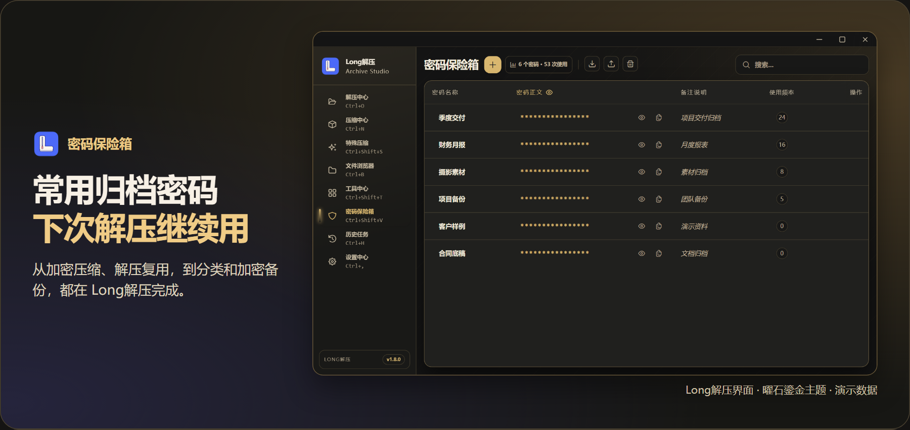
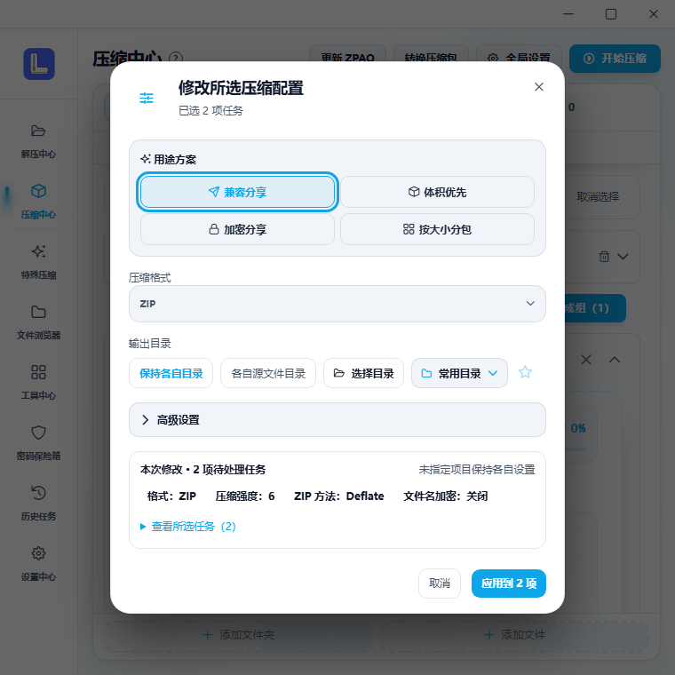
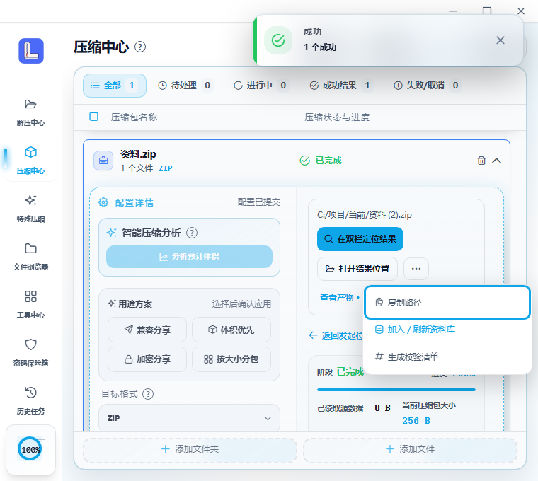
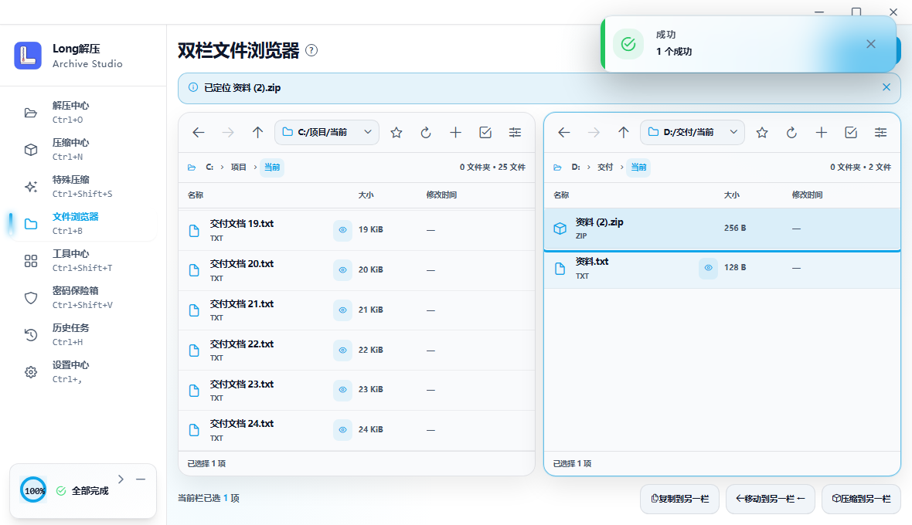
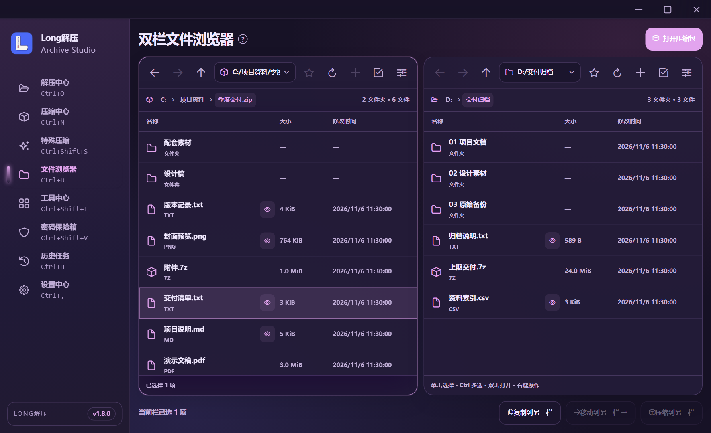
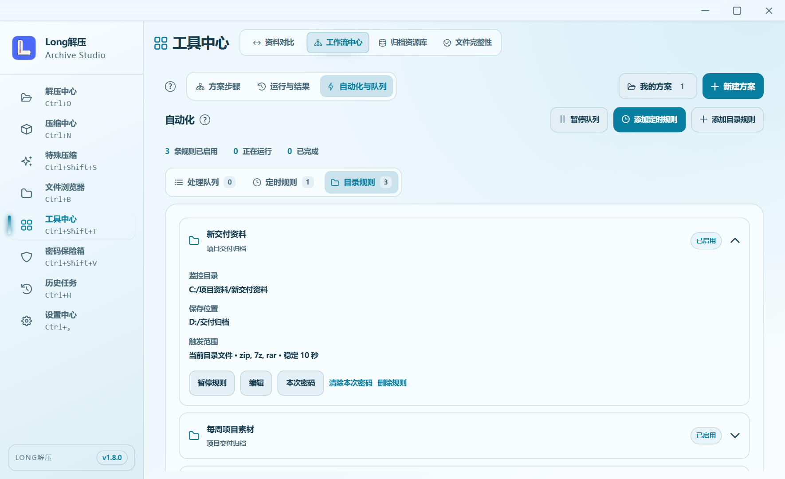

  
  <h1>Long解压</h1>
  
<strong>一站式管理归档密码的 Windows 解压缩工具</strong>

    

  [密码管理](#password-vault) · [操作指南](#quick-start) · [功能亮点](#features) · [格式支持](#formats) · [最近更新](#updates)

## 一站式密码管理

压缩时可生成新密码，解压时可复用保险箱里的常用密码，也可自动收录本次成功的密码。通过分类、收藏和使用记录整理归档密码，换电脑时可以加密导出后再导入。密码匹配在本机完成。

## 操作指南

下载并运行发布页中的 `setup.exe`，支持 **Windows 10 / 11 x64**。[下载最新安装包](https://github.com/Longyuyeee/long_Decompress/releases/latest)

### 第一次使用密码保险箱

1. 打开「密码保险箱」并点「＋」添加常用密码，已有备份可选择「导入」。
2. 把加密包拖入「解压中心」。解压时可使用保险箱候选密码，也可以为当前任务填写新密码。
3. 在「设置中心 → 行为」开启「自动保存成功密码」，以后解压成功即可在保险箱复用。备份时从保险箱的「导出」选择加密，并设置导出密码。

### 从多选配置到查看结果

<table>
  <tr>
    <td width="50%" align="center">
      
      
<strong>多选后按用途设置</strong>

    </td>
    <td width="50%" align="center">
      
      
<strong>完成后点「⋯」展开更多操作</strong>

    </td>
  </tr>
</table>

勾选多个待处理任务，点「修改所选配置」。选择用途后核对改动摘要，再点「应用到 N 项」。需要指定算法或编码时展开「高级设置」。单条任务可以直接点行展开。压缩或解压完成后就近打开结果，复制路径等操作在「⋯」里。

### 从双栏发起压缩并定位新包

在「文件浏览器」的一栏选文件，另一栏放到目标目录，再点「压缩到另一栏」。运行中可返回发起位置继续整理，完成后点「在双栏定位结果」，软件会恢复原来的浏览位置并选中新包或首卷。

<strong>预览包内文件、Windows 右键和工作流</strong>

| 想做什么 | 从哪里开始 |
| --- | --- |
| 预览或提取包内文件 | 在「文件浏览器」双击压缩包。点眼睛预览图片或文本，选中文件后可提取到另一栏，或按 `Ctrl+C` 后粘贴到 Windows 文件夹 |
| 编辑 ZIP / ZIPX | 在包内选项点「编辑内容」，整理后另存新包 |
| 按时间或目录变化处理 | 进「工具中心 → 工作流中心」保存方案，再在「自动化与队列」添加定时规则或目录规则。应用运行或驻留托盘时触发 |
| 设置双击打开或右键 | 进「设置中心 → 行为」设置默认打开方式并到 Windows 设置确认。Windows 11 的完整右键入口在「显示更多选项 → Long解压」 |
| 切换主题 | 在「设置中心 → 外观」选主题或自选强调色 |

## 功能亮点

<table>
  <tr>
    <td width="50%" valign="top">
      <h3>🗜️ 多格式压缩与解压</h3>
      
从 ZIP、7Z、RAR 到 TAR 系列和 WIM，覆盖日常归档、旧包读取及格式转换。常见密码包与分卷可直接处理，受支持的损坏包可检查并尝试取回完整成员。

    </td>
    <td width="50%" valign="top">
      <h3>⚡ 批量处理与自动化</h3>
      
多选任务一次配置，单条任务可展开单独调整。把筛选、解压、压缩和转换保存为工作流，按目录变化或时间触发，逐步查看运行结果。

    </td>
  </tr>
  <tr>
    <td width="50%" valign="top">
      <h3>🎞️ 图片、视频和 PDF 优化</h3>
      
在「特殊压缩」按文件类型调节质量和输出体积。图片可批量转换或缩放，视频与 PDF 使用各自的参数。

    </td>
    <td width="50%" valign="top">
      <h3>📂 一站式文件管理</h3>
      
像打开文件夹一样进入压缩包，直接预览图文、提取所选文件或复制到 Windows。跨包搜索、资料对比、ZIP / ZIPX 内容编辑和文件校验都有各自的入口。

    </td>
  </tr>
</table>

<table>
  <tr>
    <td width="50%" align="center">
      
      
<strong>包内浏览</strong> · 星云紫境

    </td>
    <td width="50%" align="center">
      
      
<strong>目录自动化</strong> · 极地冰川

    </td>
  </tr>
</table>

<strong>常用快捷键</strong>

| 打开工作区 | 快捷键 |
| --- | --- |
| 解压中心 / 压缩中心 | `Ctrl+O` / `Ctrl+N` |
| 文件浏览器 / 特殊压缩 | `Ctrl+B` / `Ctrl+Shift+S` |
| 工具中心 / 工作流 | `Ctrl+Shift+T` / `Ctrl+Shift+W` |
| 密码保险箱 / 历史任务 / 设置 | `Ctrl+Shift+V` / `Ctrl+H` / `Ctrl+,` |

## 格式支持

| 操作 | 代表格式与能力 |
| --- | --- |
| **创建与转换** | ZIP、ZIPX、7Z、RAR¹、ZPAQ、TAR 及常见压缩组合，GZ、BZ2、XZ、ZST、LZ4、Brotli、LZMA、LZIP、LZOP、WIM / ESD / SWM |
| **浏览与解压** | 常见归档格式，以及 ALZ、EGG、ARJ、CAB、自解压归档与部分磁盘镜像 |
| **加密与分卷** | ZIP、7Z、RAR、ZPAQ 的密码和相应卷型，支持 Long AES 容器及数字切片 |
| **检查与取回** | 归档完整性检查、校验清单，以及受支持的 ZIP / ZIPX、LZOP / TAR.LZO 部分取回 |

¹ 创建 RAR 需要安装 WinRAR。各格式能否创建、浏览、提取、编辑或恢复，以功能清单为准。 [查看完整格式清单](long-compress-assistant/docs/FORMAT_SUPPORT_LEVELS.md)

## 常见问题

<strong>升级会保留设置和密码吗？</strong>

正常覆盖安装保留设置、应用数据和常用密码。迁移到其他设备时，可通过密码保险箱加密导出备份。

<strong>文件和密码在哪里处理？</strong>

归档、媒体、校验和密码匹配在本机执行。应用内更新通过网络检查版本、下载安装包并显示进度。

## 反馈与开发

提交问题时请附软件版本、文件格式、操作步骤及诊断信息。项目采用 MIT License，随包引擎适用各自许可证。 [提交 Issue](https://github.com/Longyuyeee/long_Decompress/issues) · [开发说明](long-compress-assistant/README.md) · [产品路线](long-compress-assistant/docs/PRODUCT_ENHANCEMENT_ROADMAP.md) · [许可证](LICENSE)

## 最近五个版本

| 版本 | 更新 |
| --- | --- |
| [v1.9.0](https://github.com/Longyuyeee/long_Decompress/releases/tag/v1.9.0) | 降低大目录、压缩包预览和后台监控的资源占用 |
| [v1.8.1](https://github.com/Longyuyeee/long_Decompress/releases/tag/v1.8.1) | 双栏返回与定位产物，批量用途预览，紧凑的结果菜单 |
| [v1.8.0](https://github.com/Longyuyeee/long_Decompress/releases/tag/v1.8.0) | 经典右键分类与修复，小窗口弹窗适配，任务列表精简 |
| [v1.7.40](https://github.com/Longyuyeee/long_Decompress/releases/tag/v1.7.40) | 包内文件复制到 Windows 剪贴板，右键快捷操作 |
| [v1.7.38](https://github.com/Longyuyeee/long_Decompress/releases/tag/v1.7.38) | ZIPX（XZ）丢目录时部分取回完整成员 |

[查看全部版本](https://github.com/Longyuyeee/long_Decompress/releases)
