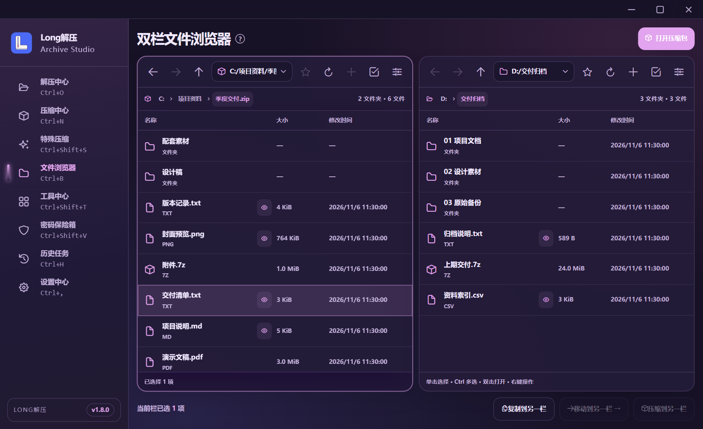
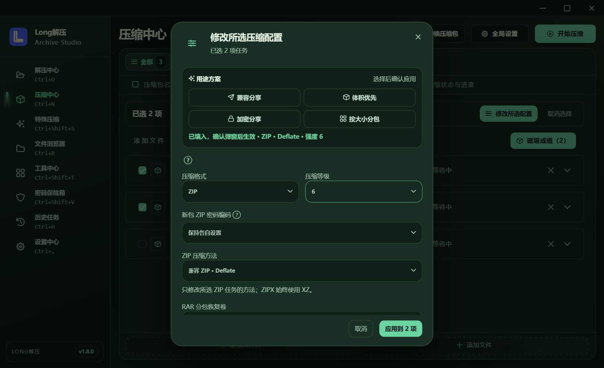
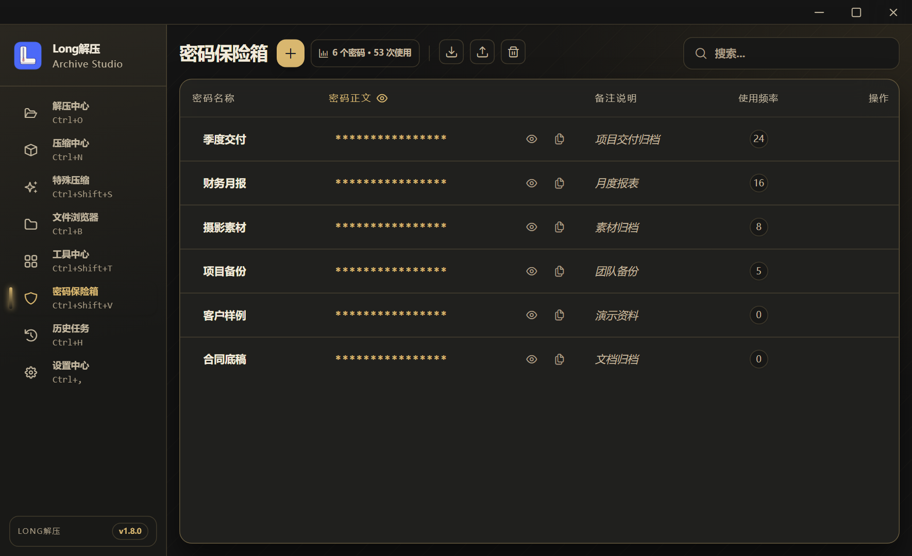
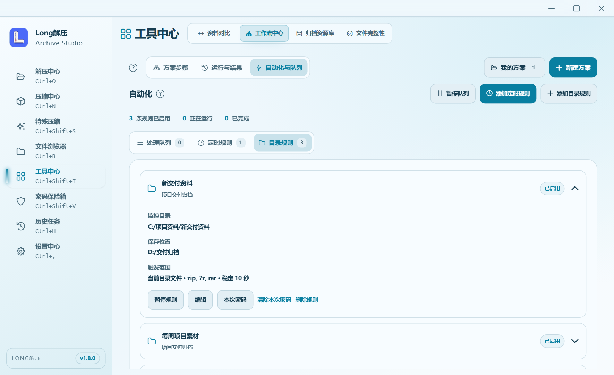

  
  <h1>Long解压 · Archive Studio</h1>
  
<strong>做最好用的 Windows 解压缩软件</strong>

  
从打开压缩包到交付文件，在同一个工作区完成压缩、解压、自动化和文件管理。

    

  [功能亮点](#features) · [界面一览](#screenshots) · [操作指南](#quick-start) · [格式支持](#formats) · [最近更新](#updates)

  
  
双栏文件浏览器 · 星云紫境主题 · 左栏浏览包内文件，右栏保留目标目录

## 功能亮点

<table>
  <tr>
    <td width="50%" valign="top">
      <h3>🗜️ 多格式压缩与解压</h3>
      
从 ZIP、7Z、RAR 到 TAR 系列和 WIM，覆盖日常归档、旧包读取及格式转换。常见密码包与分卷可直接处理，受支持的损坏包可检查并尝试取回完整成员。

    </td>
    <td width="50%" valign="top">
      <h3>⚡ 批量处理与自动化</h3>
      
多选任务一次配置，单条任务可展开单独调整。把筛选、解压、压缩和转换保存为工作流，按目录变化或时间触发，逐步查看运行结果。

    </td>
  </tr>
  <tr>
    <td width="50%" valign="top">
      <h3>🔐 全生命周期密码管理</h3>
      
压缩时可生成密码，解压时可尝试保险箱中的候选并保存成功密码。用分类、收藏和使用记录整理常用密码，通过导入和加密导出迁移备份。

    </td>
    <td width="50%" valign="top">
      <h3>📂 一站式文件管理</h3>
      
像打开文件夹一样进入压缩包，直接预览图文、提取所选文件或复制到 Windows。跨包搜索、资料对比、ZIP / ZIPX 内容编辑和文件校验都有各自的入口。

    </td>
  </tr>
</table>

**图片、视频和 PDF 也能单独优化体积。** 在「特殊压缩」选择对应类型，按各自的质量和体积要求处理。

## 界面一览

在「设置中心 → 外观」切换主题或自选强调色。点击截图可看大图，所有条目均为演示资料。

<table>
  <tr>
    <td width="50%" align="center">
       
      <strong>批量配置</strong> · 雨林秘境
    </td>
    <td width="50%" align="center">
       
      <strong>密码保险箱</strong> · 曜石鎏金
    </td>
  </tr>
</table>

工作流中心 · 极地冰川主题 · 按目录变化触发自动归档

## 操作指南

在 **Windows 10 / 11 x64** 下载并运行发布页中的 `setup.exe`。安装后可直接把压缩包拖进「解压中心」，或从「文件浏览器」打开。 [下载最新安装包](https://github.com/Longyuyeee/long_Decompress/releases/latest)

<strong>批量压缩或解压</strong>

1. 压缩时打开「压缩中心」并加入文件或文件夹。解压时打开「解压中心」并加入压缩包。遇到分卷，先把整组文件放在同一目录。
2. 点任务行展开单条设置，或勾选多个待处理任务后点击「修改所选配置」。确认输出目录，压缩时按需选格式、密码和分卷。
3. 点击开始。完成后到「成功结果」打开输出目录或复制路径，也可以在「历史任务」找到单条记录并再次执行。

<strong>先查看包内文件，再提取或整理</strong>

1. 在「文件浏览器」双击压缩包，当前栏进入包内，另一栏选定目标目录。
2. 用文件旁的预览按钮查看图片或文本。勾选文件后可提取到另一栏，也可按 `Ctrl+C` 后在 Windows 文件夹中粘贴。
3. 要整理 ZIP / ZIPX，可打开包内选项进入「编辑内容」，复核后另存新包。要跨包查文件，可在「工具中心 → 归档资源库」添加来源并建立索引。

<strong>让固定流程自动运行</strong>

1. 进入「工具中心 → 工作流中心」，点击「新建方案」，选择「解压后重新打包」等模板，或自行组合步骤。确认参数后保存方案。
2. 进入「自动化与队列」，添加目录规则或定时规则，选择方案与输出目录。
3. 保持应用运行或驻留托盘。去「处理队列」看触发状态，到「运行与结果」查看各步产物和失败详情。

<strong>管理常用归档密码</strong>

1. 在「密码保险箱」添加或导入常用密码，为条目设置名称、分类和备注。
2. 解压加密包时可直接填写密码，也可让保险箱尝试已保存的候选。需要复用成功密码时，在「设置中心 → 行为」开启「自动保存成功密码」。
3. 从保险箱的使用统计查看命中记录。需要迁移或备份时，选择导出并设置导出密码。

<strong>从 Windows 双击或右键开始</strong>

- **双击打开**前，进入「设置中心 → 行为 → 默认打开压缩包」，选择格式，在 Windows 设置中确认 Long解压。回到应用设置「打开后」的行为，可选询问、解压到当前目录、解压到同名目录、自选目录或双栏查看。
- **文件右键**需启用「设置中心 → 行为 → Windows 文件右键菜单」。Windows 11 的完整入口位于「显示更多选项 → Long解压」，按文件类型提供压缩、解压、图片优化和校验操作。菜单缺失时可在设置里点击「修复菜单」。

<strong>常用快捷键</strong>

| 打开工作区 | 快捷键 |
| --- | --- |
| 解压中心 / 压缩中心 | `Ctrl+O` / `Ctrl+N` |
| 文件浏览器 / 特殊压缩 | `Ctrl+B` / `Ctrl+Shift+S` |
| 工具中心 / 工作流 | `Ctrl+Shift+T` / `Ctrl+Shift+W` |
| 密码保险箱 / 历史任务 / 设置 | `Ctrl+Shift+V` / `Ctrl+H` / `Ctrl+,` |

## 格式支持

| 操作 | 代表格式与能力 |
| --- | --- |
| **创建与转换** | ZIP、ZIPX、7Z、RAR¹、ZPAQ、TAR 及常见压缩组合，GZ、BZ2、XZ、ZST、LZ4、Brotli、LZMA、LZIP、LZOP、WIM / ESD / SWM |
| **浏览与解压** | 常见归档格式，以及 ALZ、EGG、ARJ、CAB、自解压归档与部分磁盘镜像 |
| **加密与分卷** | ZIP、7Z、RAR、ZPAQ 的密码和相应卷型，支持 Long AES 容器及数字切片 |
| **检查与取回** | 归档完整性检查、校验清单，以及受支持的 ZIP / ZIPX、LZOP / TAR.LZO 部分取回 |

¹ 创建 RAR 需要安装 WinRAR。各格式能否创建、浏览、提取、编辑或恢复，以功能清单为准。 [查看完整格式清单](long-compress-assistant/docs/FORMAT_SUPPORT_LEVELS.md)

## 常见问题

<strong>升级会保留设置和密码吗？</strong>

正常覆盖安装保留设置、应用数据和常用密码。迁移到其他设备时，可通过密码保险箱加密导出备份。

<strong>文件和密码在哪里处理？</strong>

归档、媒体、校验和密码匹配在本机执行。应用内更新通过网络检查版本、下载安装包并显示进度。

## 反馈与开发

提交问题时请附软件版本、文件格式、操作步骤及诊断信息。项目采用 MIT License，随包引擎适用各自许可证。 [提交 Issue](https://github.com/Longyuyeee/long_Decompress/issues) · [开发说明](long-compress-assistant/README.md) · [产品路线](long-compress-assistant/docs/PRODUCT_ENHANCEMENT_ROADMAP.md) · [许可证](LICENSE)

## 最近五个版本

| 版本 | 更新 |
| --- | --- |
| [v1.8.0](https://github.com/Longyuyeee/long_Decompress/releases/tag/v1.8.0) | 经典右键分类与修复，小窗口弹窗适配，任务列表精简 |
| [v1.7.40](https://github.com/Longyuyeee/long_Decompress/releases/tag/v1.7.40) | 包内文件复制到 Windows 剪贴板，右键快捷操作 |
| [v1.7.38](https://github.com/Longyuyeee/long_Decompress/releases/tag/v1.7.38) | ZIPX（XZ）丢目录时部分取回完整成员 |
| [v1.7.37](https://github.com/Longyuyeee/long_Decompress/releases/tag/v1.7.37) | 多帧 Zstandard ZIP 部分取回 |
| [v1.7.36](https://github.com/Longyuyeee/long_Decompress/releases/tag/v1.7.36) | 单帧 Zstandard ZIP 部分取回 |

[查看全部版本](https://github.com/Longyuyeee/long_Decompress/releases)
