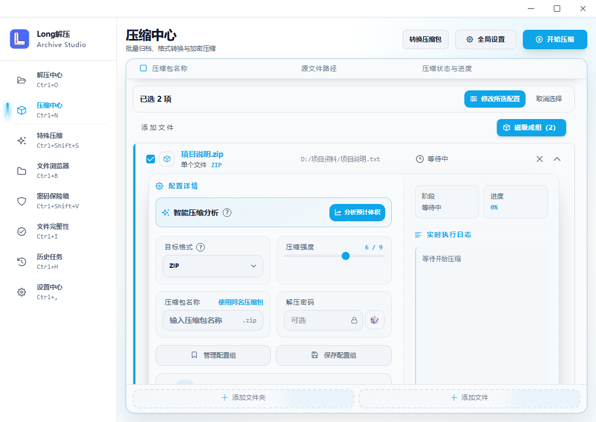
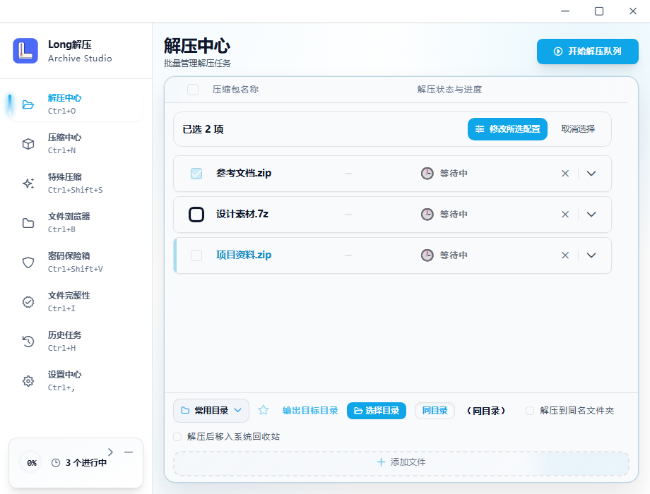
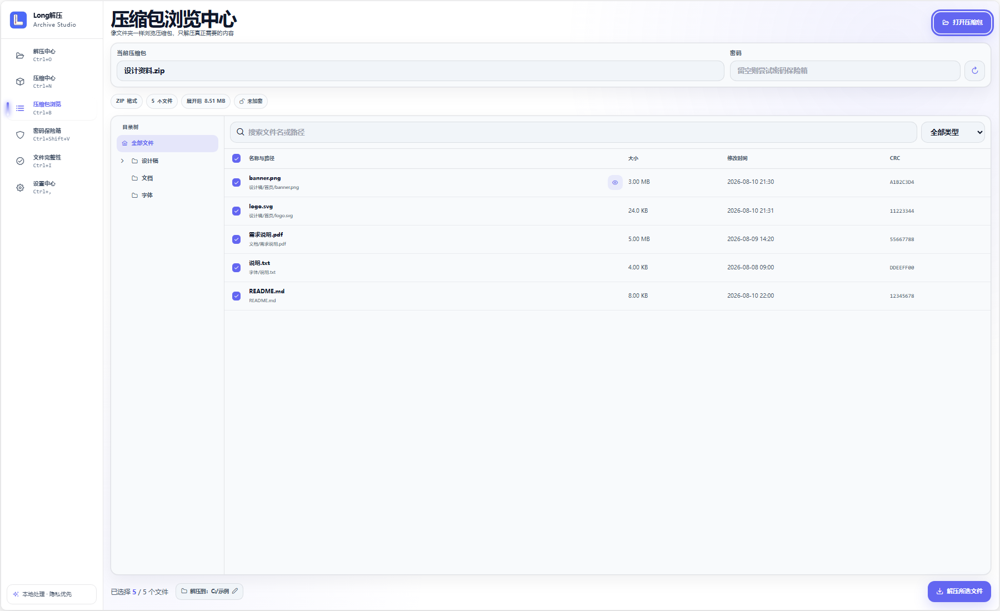
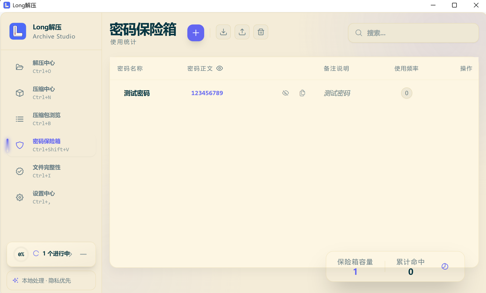

# Long解压

**面向 Windows 的本地归档与媒体压缩工作区**

打包文件 · 解压归档 · 浏览内容 · 管理密码 · 压缩图片、视频与 PDF

   

### [⬇ 下载最新版](https://github.com/Longyuyeee/long_Decompress/releases/latest)

[软件特点](#features) · [界面一览](#screenshots) · [快速上手](#quick-start) · [格式支持](#formats) · [常见问题](#faq) · [更新记录](#updates)

---

Long解压把日常文件处理放在一个顺手的工作区里。收到一批压缩包，可以一起解压；只想找里面某个文件，可以直接浏览；需要分享资料，可以打包、加密和分卷。图片、视频与 PDF 的体积优化也有各自独立的入口。

## ✨ 好用，从少做几步开始

<table>
  <tr>
    <td width="50%" valign="top">
      <h3>📦 一批文件，一次配置</h3>
      
拖入多个文件或压缩包，勾选需要调整的任务，一次修改指定参数。单条任务点击后直接展开编辑，各自的密码、名称和其他设置继续保留。

    </td>
    <td width="50%" valign="top">
      <h3>🧭 先看内容，再决定解压什么</h3>
      
像浏览文件夹一样查看压缩包，搜索、筛选和选择文件。支持部分格式的图片与文本预览，也能进入嵌套压缩包，只取出真正需要的内容。

    </td>
  </tr>
  <tr>
    <td width="50%" valign="top">
      <h3>🔑 常用密码，不必反复找</h3>
      
把常用解压密码放进本地保险箱，按名称、备注和分类整理。解压时可自动尝试已保存的候选，减少来回复制和重复输入。

    </td>
    <td width="50%" valign="top">
      <h3>🔄 改格式，也能改密码和分卷</h3>
      
将现有归档转换为新压缩包，更换或移除密码，重新分卷或合卷。原包保留，输入密码与新包密码分开设置，操作前看清输出位置。

    </td>
  </tr>
  <tr>
    <td width="50%" valign="top">
      <h3>🎞️ 图片、视频、PDF 各有所长</h3>
      
在“特殊压缩”中选择对应工具。图片可调整质量、格式和尺寸，视频可选择压缩预设，PDF 可分析并优化结构，完成后查看实际体积变化。

    </td>
    <td width="50%" valign="top">
      <h3>📂 做完之后，马上找到结果</h3>
      
从任务、历史或全局面板直接打开输出目录、定位文件或复制路径。分卷产物集中查看，批量打开相同目录只打开一次，失败项也有后续处理入口。

    </td>
  </tr>
</table>

**还有这些贴近日常的小细节：** 常用目录与书签、资源管理器右键、托盘后台任务、历史搜索与再次执行、多主题与强调色、界面缩放和减少动效。

## 🖼️ 界面一览

### 任务就在眼前，单条展开，批量集中调整

<table>
  <tr>
    <td width="50%" valign="top" align="center">
      
      
<strong>清晰的解压任务列表</strong> 查看状态与输出位置，按需打开批量配置

    </td>
    <td width="50%" valign="top" align="center">
      
      
<strong>集中修改所选配置</strong> 在弹窗中调整，主列表保持紧凑

    </td>
  </tr>
</table>

<strong>展开查看：压缩包浏览与密码保险箱</strong>

<table>
  <tr>
    <td width="50%" align="center">
      
      
<strong>压缩包浏览</strong> 先查看，后选择，只解压需要的文件

    </td>
    <td width="50%" align="center">
      
      
<strong>密码保险箱</strong> 名称、备注与常用密码集中管理

    </td>
  </tr>
</table>

浏览与密码保险箱图片为较早版本的界面记录，具体外观以当前安装版本为准。

上方任务与弹窗图片使用演示数据；批量配置弹窗随 v1.4.2 交付，单条详情仍行内展开。点击图片可查看大图。

## 🚀 三步开始使用

1. **下载安装。** 打开 [Releases](https://github.com/Longyuyeee/long_Decompress/releases/latest)，下载 Windows x64 的 `setup.exe` 安装程序。
2. **选择工作区。** 归档进入解压中心、压缩中心或文件浏览器；图片、视频和 PDF 进入特殊压缩。
3. **添加文件并开始。** 拖入文件，确认输出位置与参数，启动任务；完成后直接打开或定位结果。

| 你想做什么 | 从哪里开始 | 操作要点 |
| --- | --- | --- |
| 解压一批文件 | 解压中心 | 拖入压缩包，设置目录；常用密码可交给保险箱尝试 |
| 打包文件和文件夹 | 压缩中心 | 选择 ZIP/7Z 等格式，按需设置密码、分卷和名称 |
| 只提取包里的几个文件 | 文件浏览器 → 打开压缩包 | 搜索并勾选条目，再解压所选内容 |
| 改格式、密码或分卷 | 压缩中心 → 转换压缩包 | 带入原包，选择新包格式与保存位置 |
| 压缩图片、视频或 PDF | 特殊压缩 | 选择文件类型，调整对应参数并查看结果 |
| 找回以前的输出 | 历史任务 | 搜索记录，打开结果或恢复配置创建新任务 |

**运行环境：** Windows 10 1809 及以上 / Windows 11，x64。视频功能暂不保证兼容 Windows N。

后续更新可在设置中心检查；正在处理任务时，请先完成或停止任务再安装更新。

## 🗃️ 常用格式，一张表看清

| 能力 | 主要格式与说明 |
| --- | --- |
| 创建归档 | ZIP（Deflate / Zstandard）、ZIPX（XZ）、7Z、RAR（需要 WinRAR）、TAR / TGZ / TBZ / TXZ / TZST、TAR.LZ4 / TAR.BR / TAR.LZIP、GZ、BZ2、XZ、ZST、LZ4、Brotli、LZMA、LZIP、WIM |
| 读取与解压 | ZIP / ZIPX、7Z、RAR、自解压 SFX、TAR 系列、LZIP、LZ4、Brotli、ARJ、Unix `.Z`，以及 CAB、ISO、UDF、DMG、VHD / VHDX 等镜像与容器 |
| 密码与分卷 | ZIP 支持密码数字切卷与标准 `.z01/.zip` 分卷；7Z 支持密码数字卷；RAR 支持原生密码分卷；7Z / RAR 可加密文件名 |
| 转换归档 | ZIP / ZIPX、7Z、RAR、TAR 系列（含 LZ4/Brotli/LZIP 组合和既有 AES 包装）、WIM；密码和分卷随目标格式提供 |
| 图片压缩 | JPEG、PNG、WebP；质量、尺寸与格式按对应编码能力调整 |
| 视频压缩 | MP4、MOV、AVI、WMV、WebM、MKV、M4V 等受支持输入，输出 MP4 / H.264 |
| PDF 优化 | 分析结构、优化体积；是否适合处理会在分析后显示 |

内置归档引擎，日常解压无需另装 7-Zip。**解压 RAR 不需要 WinRAR；创建 RAR 需要自行安装 WinRAR。**

<strong>更多格式与使用范围</strong>

- 还可读取已支持的应用包、传统归档、文件系统与安装容器，例如 APK、APPX、JAR、DEB、RPM、MSI、LZH、CPIO、XAR、APFS、EXT、HFS/HFSX。具体能力以应用的实际检测和 [格式支持说明](long-compress-assistant/docs/FORMAT_SUPPORT_LEVELS.md)为准。
- ZIP 默认保留 `.zip.001` 数字切卷，可主动选择标准 `.z01/…/.zip`（入口为 `.zip`）；7Z 创建 `.7z.001`，RAR 创建 `.partN.rar`。解压时把整组放在同一目录。普通 TAR/流格式数字切卷的外部兼容能力不同；它们使用密码时可改用 7Z 容器，既有 `.aes` 属于本应用包装。
- ZIP/ZIPX 已验证常用 Store、Deflate、Deflate64、BZip2、LZMA、XZ、PPMd 及部分 Zstandard 读取组合；不等于支持所有 ZIPX 专有算法。
- 创建 ZIP 时可选 Zstandard，创建 ZIPX 时使用 XZ；密码、转换与配置保存保持所选方法。ZIP Zstandard 支持数字卷与标准卷，ZIPX 暂只提供数字卷；接收方需要支持对应压缩方法。
- 可直接浏览、解压和转换 ZIP/7Z/RAR 自解压 EXE；好压论坛 ZIP 分卷按整组读取，支持已核对的明文与 ZipCrypto 密码样本。收到多个分卷时，把整组放在同一目录即可。具体格式范围见[支持说明](long-compress-assistant/docs/FORMAT_SUPPORT_LEVELS.md)。
- LZIP（单文件）与 TAR.LZIP（目录/多文件）支持创建、浏览、解压、检查和转换，兼容 `.lz`、`.tar.lz`、`.tlz`；支持连续多成员 LZIP，不提供这两种格式的密码或分卷创建。
- ZIP 默认 AES-256，可主动选择 ZipCrypto；与 Windows 7-Zip 交换非 ASCII 密码的归档时，可显式选择匹配的 Windows 密码编码。
- 密码 ZIP 可尝试救回完整文件：目录可读或丢目录后仍能确定本地文件边界时，提供密码救回通过校验的文件；新包沿用填写的密码，统一使用 AES-256 / UTF-8，并显示部分恢复及未恢复原因。
- DOCX、XLSX、PPTX、ODT、ODS、EPUB 属于文档容器，不作为普通压缩包导入。
- 预览、嵌套浏览及压缩参数随格式而异。体积优化效果取决于文件内容，已充分压缩的文件可能没有明显收益。

## 🖱️ 从 Windows 右键直接开始

在设置中启用资源管理器菜单后，可以直接浏览归档、解压到同名文件夹或当前目录、测试完整性、打包为 ZIP/7Z，以及进入转换格式、密码和分卷调整。

Windows 11 请在 **“显示更多选项”** 中使用经典菜单；当前公开包不包含第一层菜单所需的可信签名身份包。

## 🔒 文件留在本机，处理过程看得见

文件处理、归档浏览、密码匹配和完整性校验在本机完成。密码保险箱加密保存常用解压密码，任务展示当前阶段与日志；遇到同名文件可选择覆盖、跳过或保留两份。文件完整性中心还提供校验、ZIP/RAR 诊断与修复；v1.4.8 增加批量处理，恢复结果保存到新位置后可继续加入解压队列。

ZIP 目录损坏时可尝试救回可靠的完整条目；坏文件和未恢复原因会明确列出，原包保留。标准 ZIP `.z01/…/.zip` 缺少首卷或中间卷时，若目录仍完整可读，可以先救出现有连续卷中的完整文件，支持普通、AES 和 ZipCrypto 密码包。已恢复文件和未恢复原因按需展开，新包可直接加入解压队列。

部分恢复不代表全部找回。缺卷救援仍需要完整可读的目录；终卷或目录缺失、未知数字切卷长度及无法确定的加密边界需补齐来源后再处理。具体范围见 [格式支持说明](long-compress-assistant/docs/FORMAT_SUPPORT_LEVELS.md)。

<strong>常用快捷键</strong>

| 快捷键 | 工作区 |
| --- | --- |
| `Ctrl+O` | 解压中心 |
| `Ctrl+N` | 压缩中心 |
| `Ctrl+Shift+S` | 特殊压缩 |
| `Ctrl+B` | 文件浏览器 |
| `Ctrl+Shift+V` | 密码保险箱 |
| `Ctrl+I` | 文件完整性 |
| `Ctrl+H` | 历史任务 |
| `Ctrl+,` | 设置中心 |

## 💬 常见问题

<strong>升级后，设置和常用密码还在吗？</strong>

正常覆盖安装会保留应用数据。重要密码可以通过保险箱导出备份。

<strong>为什么任务暂时没有百分比变化？</strong>

点击任务行查看当前阶段与日志。归档扫描、密码尝试、校验及大量小文件处理不一定能给出线性进度；如长时间没有新日志，可取消并附上诊断信息反馈。

<strong>密码明明正确，旧 ZIP 为什么仍打不开？</strong>

旧工具可能使用不同的密码编码。v1.4.16 可在“ZIP 密码编码”中明确选择日文 CP932、简体 CP936 或繁体 CP950；只在已知原包编码时指定，通常保持自动兼容。它不改变文件名编码，也不能修复损坏或缺失的数据。转换时原包与新包编码分开设置，新包默认 UTF-8。

<strong>Windows 提示安装程序的发布者未知，怎么办？</strong>

当前安装程序未使用商业 Windows 代码签名证书。请从本仓库 [Releases](https://github.com/Longyuyeee/long_Decompress/releases/latest)下载，核对来源后决定是否继续；应用内更新包另有签名校验。

## 🤝 反馈与参与

发现问题或有使用建议，欢迎 [提交 Issue](https://github.com/Longyuyeee/long_Decompress/issues)。附上软件版本、文件格式、操作步骤和可复制的诊断信息，能帮助更快定位。

想参与开发，可从 [开发说明](long-compress-assistant/README.md)、[产品路线](long-compress-assistant/docs/PRODUCT_ENHANCEMENT_ROADMAP.md)和 [开发交接](long-compress-assistant/docs/DEVELOPMENT_HANDOFF.md)开始。

项目代码使用 [MIT License](LICENSE)。随包归档、视频与 PDF 组件遵循各自许可，详见 [第三方组件说明](long-compress-assistant/README.md#third-party)。

## 📝 更新记录

版本变化放在这里，完整内容见 [所有 Releases](https://github.com/Longyuyeee/long_Decompress/releases)。

| 版本 | 主要变化 | 详情 |
| --- | --- | --- |
| **v1.4.17** | 好压论坛 7Z 内容/文件名密码分卷，任意成员读取、缺卷/损坏最终原因及补回继续，输出名称与窄窗错误卡片修正 | [更新说明](long-compress-assistant/docs/RELEASE_NOTES_1.4.17.md) · [下载安装包](https://github.com/Longyuyeee/long_Decompress/releases/tag/v1.4.17) |
| **v1.4.16** | 日文/简体/繁体旧 ZIP 密码编码，原包与新包独立设置，单条/批量修复结果重开接续及窄窗口表单修正 | [更新说明](long-compress-assistant/docs/RELEASE_NOTES_1.4.16.md) · [下载安装包](https://github.com/Longyuyeee/long_Decompress/releases/tag/v1.4.16) |
| **v1.4.15** | ZIP 重复预检优化、TAR.LZ4 / TAR.BR 流式创建、RAR 暂停取消、矮窗口列表修正；合并交付 ZIP Zstandard / ZIPX（XZ）创建与密码分卷配置链 | [更新说明](long-compress-assistant/docs/RELEASE_NOTES_1.4.15.md) · [下载安装包](https://github.com/Longyuyeee/long_Decompress/releases/tag/v1.4.15) |
| **v1.4.13** | 标准 ZIP 缺卷部分抢救、AES / ZipCrypto 密码包、按需展开的恢复文件与原因清单 | [更新说明](long-compress-assistant/docs/RELEASE_NOTES_1.4.13.md) · [下载安装包](https://github.com/Longyuyeee/long_Decompress/releases/tag/v1.4.13) |
| **v1.4.12** | LZIP / TAR.LZIP 创建与读取、`.tlz` 别名及多成员、批量配置和转换、浏览失败原因保留 | [更新说明](long-compress-assistant/docs/RELEASE_NOTES_1.4.12.md) · [下载安装包](https://github.com/Longyuyeee/long_Decompress/releases/tag/v1.4.12) |
| **v1.4.11** | 自解压包直接读取、好压论坛 ZIP 密码分卷、正确密码兼容与缺卷补回继续处理 | [更新说明](long-compress-assistant/docs/RELEASE_NOTES_1.4.11.md) · [下载安装包](https://github.com/Longyuyeee/long_Decompress/releases/tag/v1.4.11) |
| **v1.4.10** | ZIP 所选内容独立解锁与读取、旧 ZIP 方法兼容、Zstandard 密码分卷和真实 ZIP64 大包回解 | [更新说明](long-compress-assistant/docs/RELEASE_NOTES_1.4.10.md) · [下载安装包](https://github.com/Longyuyeee/long_Decompress/releases/tag/v1.4.10) |
| **v1.4.9** | 批量检查修复切页/重启接续、RAR 管道密码兼容、大文件校验中途取消 | [更新说明](long-compress-assistant/docs/RELEASE_NOTES_1.4.9.md) · [下载安装包](https://github.com/Longyuyeee/long_Decompress/releases/tag/v1.4.9) |
| **v1.4.8** | ZIP 分卷救援扩展、RAR 恢复卷创建、批量检查修复与统一入队，修正 RAR 结果体积统计 | [更新说明](long-compress-assistant/docs/RELEASE_NOTES_1.4.8.md) · [下载安装包](https://github.com/Longyuyeee/long_Decompress/releases/tag/v1.4.8) |
| **v1.4.7** | RAR 修复与 .rev 补卷、可选恢复保护、Windows 右键检查修复入口 | [更新说明](long-compress-assistant/docs/RELEASE_NOTES_1.4.7.md) · [下载安装包](https://github.com/Longyuyeee/long_Decompress/releases/tag/v1.4.7) |
| **v1.4.6** | 失败任务行内纠正、缺卷处理、密码 ZIP 丢目录救援、恢复新包继续解压、等宽详情与日志显示优化 | [更新说明](long-compress-assistant/docs/RELEASE_NOTES_1.4.6.md) · [下载安装包](https://github.com/Longyuyeee/long_Decompress/releases/tag/v1.4.6) |
| **v1.4.5** | 密码 ZIP 完整文件救援、ARJ / Unix `.Z` / UDF 读取、双栏与右键入口统一、结果密码提示与定位 | [更新说明](long-compress-assistant/docs/RELEASE_NOTES_1.4.5.md) · [下载安装包](https://github.com/Longyuyeee/long_Decompress/releases/tag/v1.4.5) |
| **v1.4.4** | 标准 ZIP 分卷创建、PPMd/加密 ZIPX 与卷入口兼容、ZIP 目录重建与完整条目救援 | [更新说明](long-compress-assistant/docs/RELEASE_NOTES_1.4.4.md) · [下载安装包](https://github.com/Longyuyeee/long_Decompress/releases/tag/v1.4.4) |
| v1.4.3 | 标准 ZIP 多卷浏览/密码/转换、RAR 密码分卷、LZ4/Brotli、TAR 数字切卷与实际操作修正 | [更新说明](long-compress-assistant/docs/RELEASE_NOTES_1.4.3.md) · [下载安装包](https://github.com/Longyuyeee/long_Decompress/releases/tag/v1.4.3) |
| **v1.4.2** | 多包批量转换、待处理草稿恢复、多选弹窗配置、设置界面优化 | [发布说明](long-compress-assistant/docs/RELEASE_NOTES_1.4.2.md) · [下载安装包](https://github.com/Longyuyeee/long_Decompress/releases/tag/v1.4.2) |
| **v1.4.1** | 批量修改配置、统一结果操作、Windows 压缩包右键增强 | [发布说明](https://github.com/Longyuyeee/long_Decompress/releases/tag/v1.4.1) |
| v1.4.0 | ZIP/7Z 密码分卷、归档转换、密码兼容与界面整理 | [发布说明](https://github.com/Longyuyeee/long_Decompress/releases/tag/v1.4.0) |
| v1.3.9 | 文件冲突处理、历史再次执行、常用位置与日常性能优化 | [发布说明](https://github.com/Longyuyeee/long_Decompress/releases/tag/v1.3.9) |

v1.4.14 候选的改进统一随 v1.4.15 交付，不单独发布 v1.4.14；[原始实施与互通证据](long-compress-assistant/docs/ZIP_OUTPUT_METHODS_1.4.14.md)保留。

<strong>展开较早版本记录</strong>

以下保留各版本当时的变化，当前功能与交互以本文上方介绍为准。

### v1.3.8 恢复行内配置

- 解压任务点击后在行下方展开，直接配置和查看日志；全局解压选项恢复页面内显示。
- 两个中心移除强制“全局 / 单独”模式选择，编辑某条后自动保留该条配置，未编辑任务继续跟随全局。
- 修正单项压缩编辑影响全局对象、同目录被全局目录覆盖的问题；保留此前新增的历史、预览和结果功能。
- [发布说明与下载](https://github.com/Longyuyeee/long_Decompress/releases/tag/v1.3.8)。

### v1.3.7 解压前后更方便

- 批次汇总与失败项纠正，只为所选失败项目创建新任务；成功结果集中查看、打开目录和复制路径。
- 历史支持全库搜索与筛选，完整归档再次解压可恢复已保存的输出目录和子目录选择。
- 任务详情预览输出位置、提示目录已有内容及共用目录；完成后的失效目录有就地反馈。
- 主列表保持紧凑，设置与详细信息进入二级窗口，适配小窗口和深浅主题。
- [发布说明与下载](https://github.com/Longyuyeee/long_Decompress/releases/tag/v1.3.7) · [发布记录](long-compress-assistant/docs/RELEASE_AUDIT_1.3.7.md) · [开发路线](long-compress-assistant/docs/PRODUCT_ENHANCEMENT_ROADMAP.md)。

### v1.3.6 历史保留与更早记录

- 保存新任务不再静默删除第 500 条之外的历史，保留到用户主动删除或清空；记录会占用本机磁盘，旧版已删除的数据无法恢复。
- 新增“加载更早记录”，使用稳定游标分页；加载失败保留现有列表，可再次尝试。
- 明确筛选、统计和趋势只覆盖当前已加载记录，全库搜索尚未实现；刷新/清空时不会被迟到的查询结果覆盖。
- [发布说明与下载](https://github.com/Longyuyeee/long_Decompress/releases/tag/v1.3.6) · [本版审计](long-compress-assistant/docs/RELEASE_AUDIT_1.3.6.md) · [下一版计划](long-compress-assistant/docs/NEXT_VERSION_AFTER_1.3.6.md)。

### v1.3.5 失败后的下一步

- 历史任务按已记录的损坏、缺卷、权限、输出冲突和来源问题展示后续指引，复用重新选文件、选输出目录和诊断导出入口。
- 未知原因不猜测，权限指引区分确证阶段和最后观测阶段；查看指引不会重跑任务或改写历史。
- 从历史创建解压草稿仍需确认来源和输出，真实缺卷会阻止创建，完整来源的新任务由用户手动启动。
- [发布说明与下载](https://github.com/Longyuyeee/long_Decompress/releases/tag/v1.3.5) · [本版审计](long-compress-assistant/docs/RELEASE_AUDIT_1.3.5.md) · [下一版计划](long-compress-assistant/docs/NEXT_VERSION_AFTER_1.3.5.md)。

### v1.3.4 视频/PDF 跨页控制与取消清理

- 视频/PDF 切换页面后仍可取消原批次，规划与历史保存期间防止重复启动。
- PDF 文件列表、已确认配置和输出目录在本次运行中保留；离开页面会清空未提交密码，不自动恢复或执行任务。
- 修复视频结果验证期间取消后 Windows 文件句柄尚未释放导致的暂存残留。
- [发布说明与下载](https://github.com/Longyuyeee/long_Decompress/releases/tag/v1.3.4) · [本版审计](long-compress-assistant/docs/RELEASE_AUDIT_1.3.4.md) · [下一版计划](long-compress-assistant/docs/NEXT_VERSION_AFTER_1.3.4.md)。

### v1.3.3 解压诊断、历史找回与跨页面任务控制

- 损坏或截断 ZIP 给出中文最终原因；同名文件等待选择时不再提前记作失败。
- 历史筛选无结果可重置找回已加载记录；从历史创建新解压草稿，保留原失败记录且不自动执行。
- 压缩中心取消/清除仅影响归档，尊重未保存历史；图片批次切换页面后仍保留进度和取消控制。
- [查看 v1.3.3 发布说明](https://github.com/Longyuyeee/long_Decompress/releases/tag/v1.3.3)。
- [发布审计与验证边界](long-compress-assistant/docs/RELEASE_AUDIT_1.3.3.md) · [下一版开发顺序](long-compress-assistant/docs/NEXT_VERSION_AFTER_1.3.3.md)。

### v1.2.7 任务布局、完整提示与固定双栏

- 解压任务名称、状态与进度重新分配为稳定网格；多文件使用中文数字自然排序，存储预检恢复关键容量和介质信息，低高度侧栏继续显示版本号。
- 所有真实被省略的单行文字可在悬停或键盘聚焦时查看全文；解压、压缩、特殊压缩标题与上下留白统一收紧，把空间还给中间任务区。
- 双栏文件浏览器在 920、760、390 px 下始终保持左右布局，窄窗口只隐藏低优先级列和按钮文字，不再变形成上下两栏。
- 真实 Windows Tauri 已逐图验证 920×620、760×520 的任务详情和双栏布局；前端单元、Chromium 和真实桌面门禁均通过。
- [查看 v1.2.7 发布说明](https://github.com/Longyuyeee/long_Decompress/releases/tag/v1.2.7)

### v1.2.6 解压运行态、卷根事务与原生窗口交互

- 重构解压任务摘要、折叠行与展开详情，控制长路径和指标换行，精简存储预检，并修复终态异常速度；显示百分比增加平滑过渡。
- Windows 卷根目录的事务暂存固定落在目标卷，避免最终发布时触发跨卷 `os error 17`。
- 标题栏拖动和八方向缩放改由 Windows 原生非客户区循环处理；真实系统输入验证窗口移动、缩放及松键后停止。
- 920×620、760×520 的真实 Tauri 响应式门禁与隔离卷根产品 IPC 解压均已通过。
- [查看 v1.2.6 发布说明](https://github.com/Longyuyeee/long_Decompress/releases/tag/v1.2.6)

### v1.1.13 解压主流程可信度修复

- 密码保险箱、导入词表和内置字典尝试期间，解压进度严格保持 0；只有引擎实际开始写出内容后才显示字节进度。
- 修复正确 RAR 密码可能因固定短超时被误判的问题，并以固定官方加密 RAR 验证错误密码拒绝、正确密码解压和逐文件 SHA-256。
- 事务暂存目录创建后立即隐藏并在清理后刷新 Explorer；文件冲突复用同一份暂存逐项提交，不再从头重复解压。
- Windows 容量预检增加原生后备，新任务历史保存实际识别格式，长密码候选日志保留关键阶段并有界采样。
- [查看 v1.1.13 发布说明](https://github.com/Longyuyeee/long_Decompress/releases/tag/v1.1.13)

### v1.1.12 显式开机自启动

- 设置中心恢复“开机自动启动”，只有用户亲自点击开关时才写入或删除当前用户的 Windows 启动项。
- 应用启动、设置加载、状态检查和版本更新都不会自动注册、修复或反复改写启动项；启用状态会在更新时保留，卸载时清理。
- 登录启动携带专用 `--autostart` 参数并保持主窗口隐藏，应用静默驻留托盘；重复启动不会把已有窗口强制弹到前台。
- 真实 Windows 桌面门禁覆盖注册、只读检查、幂等启用、关闭清理和隐藏启动。安全边界与验证记录见 [开机自启动安全审计](long-compress-assistant/docs/AUTOSTART_SECURITY_AUDIT.md)。
- [查看 v1.1.12 发布说明](https://github.com/Longyuyeee/long_Decompress/releases/tag/v1.1.12)

### v1.1.11 分卷解压收口

- 修复大型未加密分卷在加密检测阶段看似停滞、继而误入密码字典流程的问题。
- 分卷解压持续展示两位小数进度、当前文件、已产出体积、预计展开大小和速度；压缩任务同步展示真实输出大小、压缩比和空间变化。
- 密码保险箱、导入词表和内置字典明确展示候选来源、序号、结果和耗时，同时继续隐藏密码明文。
- 新增“解压后移入系统回收站”，仅在完整事务成功后处理整组源分卷；失败、取消和部分解压均保留源文件。
- 真实五卷 ZIP、Windows Tauri 可见遥测和 v1.1.10 → v1.1.11 安装态 43 项门禁全部通过。
- [查看 v1.1.11 发布说明](https://github.com/Longyuyeee/long_Decompress/releases/tag/v1.1.11)

### v1.1.9 修复收口

- 停用未签名构建中的开机自启动能力，主程序不再读写 Windows `Run` 持久化项。
- 修复旧设置加载时每次启动都重复写入自启动注册表的问题。
- 安装与更新会一次性清理 v1.1.7 及更早版本遗留的自启动值，不删除密码保险箱和任务数据。
- 修复解压服务读取不到文件型密码保险箱的问题；真实加密归档命中后会同步当天及长期调用统计。
- 历史任务详情改为不透明表面，状态与完成时间不再换行；压缩和解压的目标存储预检在窄窗口中保持可读。
- 密码统计改为解压场景的调用、归档线索和使用趋势，不再展示传统账户密码的强度、轮换或到期结论。
- [查看 v1.1.9 发布说明](https://github.com/Longyuyeee/long_Decompress/releases/tag/v1.1.9)

### v1.1.6 更新重点

- 统一密码解压状态机，未加密归档不再进入密码破解流程或产生虚假成功日志；密码本、导入字典和推荐字典按明确授权依次尝试。
- 批量压缩与解压接通有界并发，同一输出目录强制串行；默认并发仍为 1，避免在未经验证的存储介质上激进调度。
- 使用引擎真实处理字节展示速度和预计剩余时间，不支持字节回调的路线不再显示模拟吞吐。
- 7Z 固实压缩落实为原生单压缩块并支持 AES 密码往返；分卷创建能力按真实实现收敛为无密码 ZIP 普通文件。
- 非原生密码格式转为 AES-256 7Z 时会提前显示最终扩展名，并在创建任务前要求确认。
- 新增 Windows Release 可见桌面和安装态门禁，覆盖并发、串行、取消、右键菜单、覆盖安装、卸载清理和用户数据恢复。

完整记录见 [v1.1.6 Release](https://github.com/Longyuyeee/long_Decompress/releases/tag/v1.1.6) 和 [发布说明](long-compress-assistant/docs/RELEASE_NOTES_1.1.6.md)。

### v1.1.5 更新重点

- 解压中心与压缩中心的详情面板在窄窗口下继续保持“左侧配置、右侧状态与日志”，不再切换成上下结构。
- 详情区域只进行纵向滚动，统一使用强调色细滚动条，并移除 Windows 原生滚动箭头和横向滚动。
- README 改用五张完整的 Windows 实际运行截图，补充密码保险箱与生命周期分析展示。
- 整理仓库根目录，将历史发布记录、工具、样例和旧开发文档归入 `archive/legacy-root`。

完整记录见 [v1.1.5 Release](https://github.com/Longyuyeee/long_Decompress/releases/tag/v1.1.5) 和 [发布说明](long-compress-assistant/docs/RELEASE_NOTES_1.1.5.md)。

