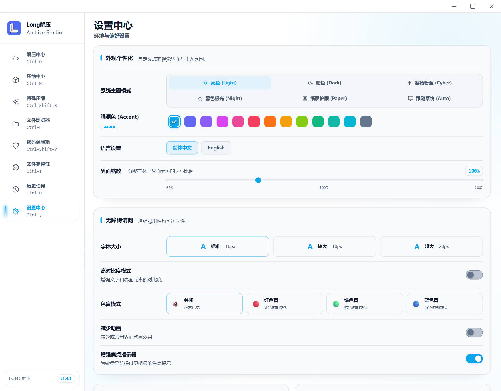
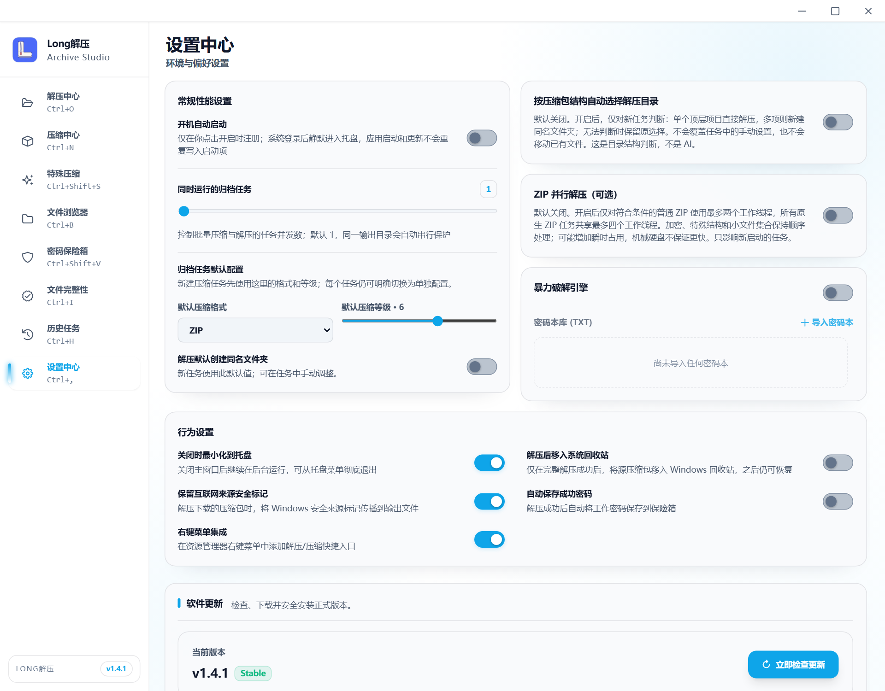

# 设置页样式统一 · 静态示意

2026-10-12：整体重构已取消，仅将设置页统一到软件当前其他页面的风格。正式产品源码没有修改。

示意基于当前 `SettingsView.vue` 和 `AccessibilitySettings.vue`，保留全部设置及现有侧栏，只注入本目录的样式草案。原生调用以模拟数据呈现，不执行实际注册、文件操作或更新检查。不提供可点击原型。

## 外观与无障碍设置

## 性能与行为设置

## 调整要点

- 沿用当前蓝色强调色、浅色背景、圆角卡片和导航，标题尺寸与其他页面一致。
- 分组标题集中、配置名称对齐，减少过大留白和重复外框。
- 主题、色块、字体与色觉选项更紧凑，开关右对齐，说明文字保持清楚。
- 性能区双列排版减少空白，行为区统一行距；更新与格式信息沿用相同样式。

图片按 1280×1000 窗口、1.5 倍像素渲染，为当前静态视觉草案。产品实现与窄窗口细化接续用户反馈；未展示的更新、格式、重置与条件状态仍保留在当前组件。

`settings-preview.css` 仅由 `render-preview.mjs` 注入浏览器，应用没有引用。现有 Vite 服务运行于 `127.0.0.1:1438` 时可执行 `node design/settings-style/render-preview.mjs` 重新出图。两张 `*-reference.png` 为本次对照的原页面。

范围与下一步见 [设置页计划](../../docs/UI_VISUAL_REFRESH_PLAN.md)。
