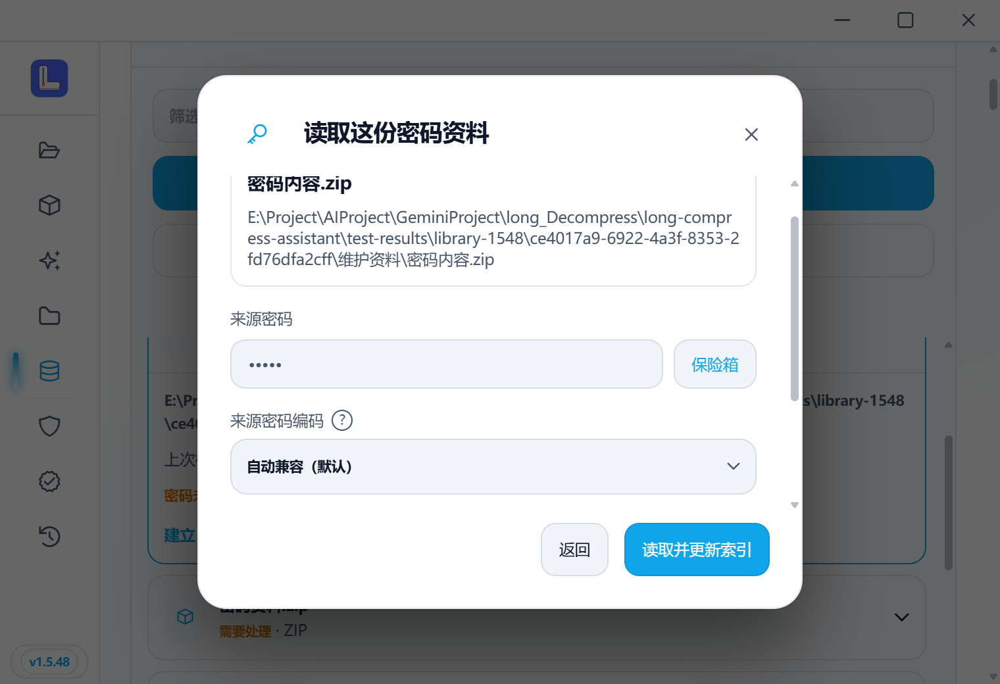
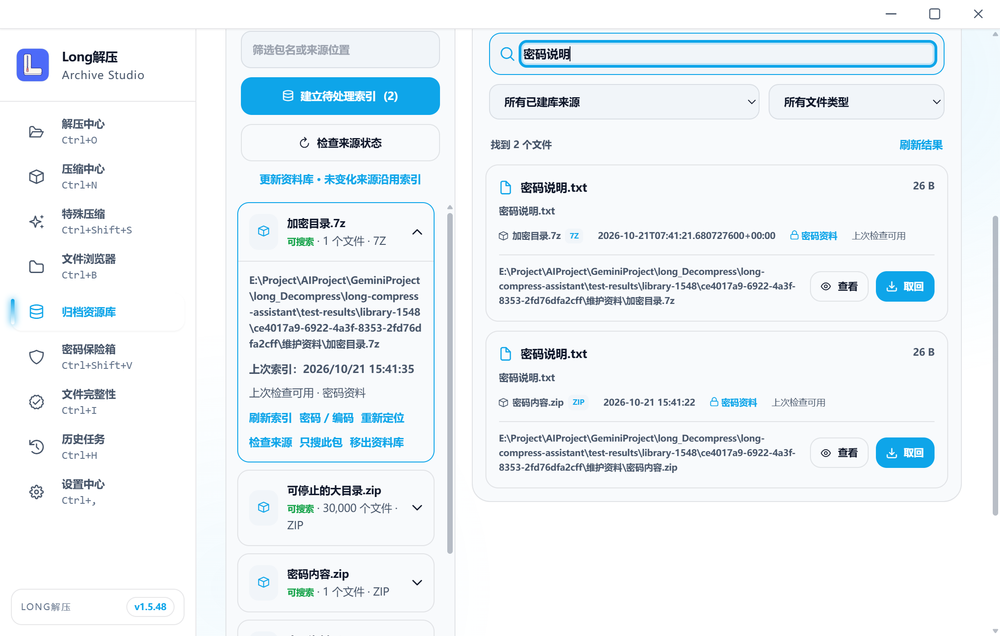
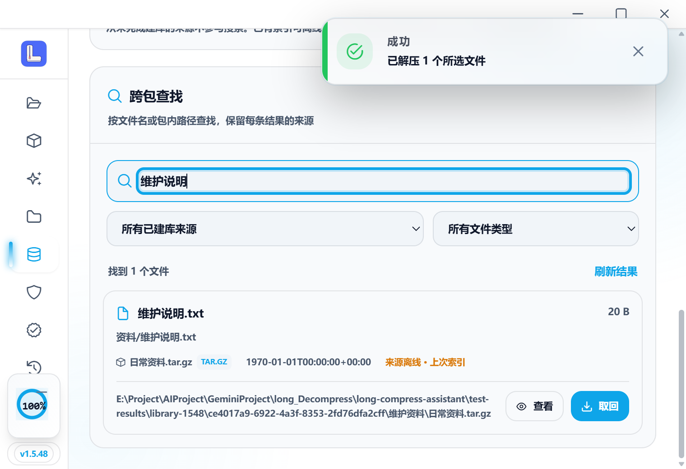
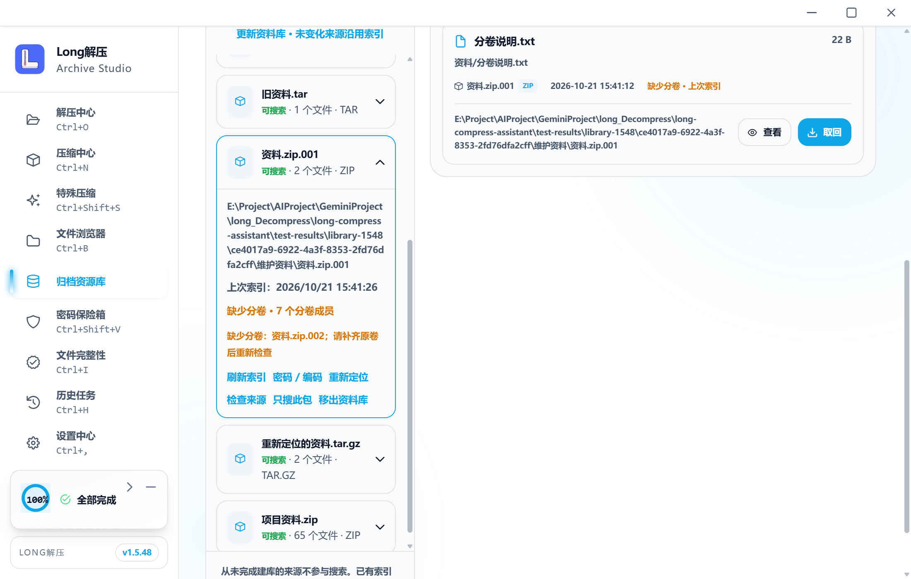
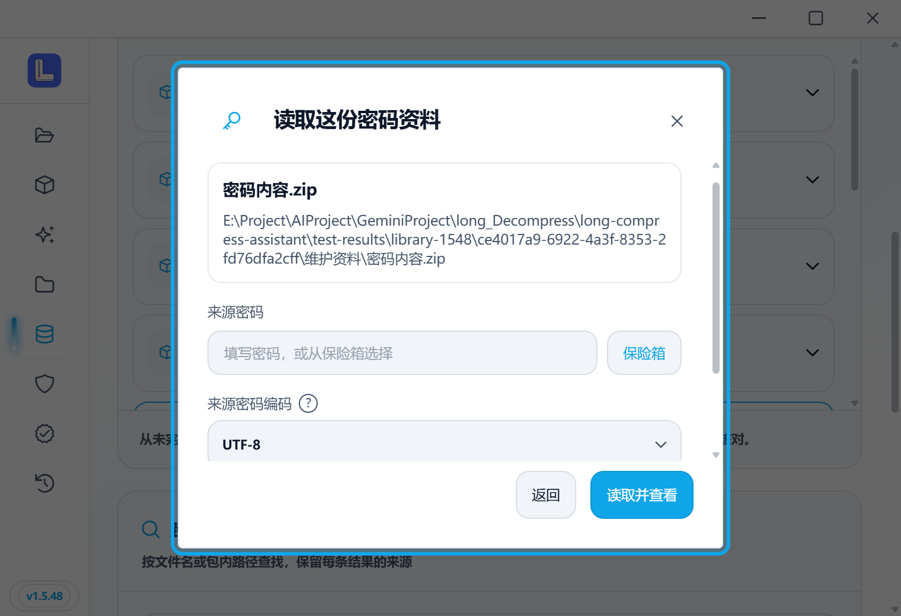
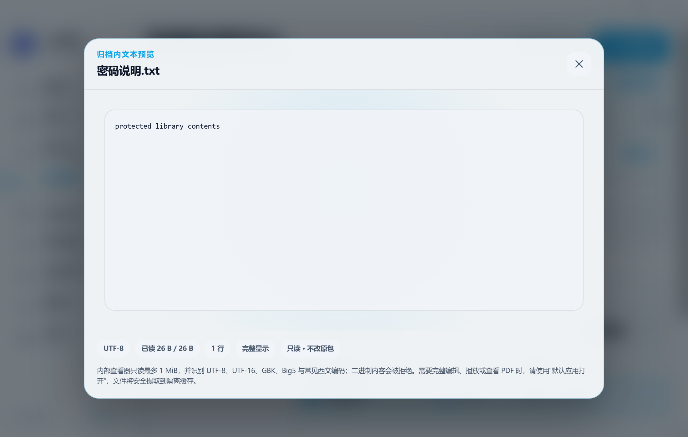
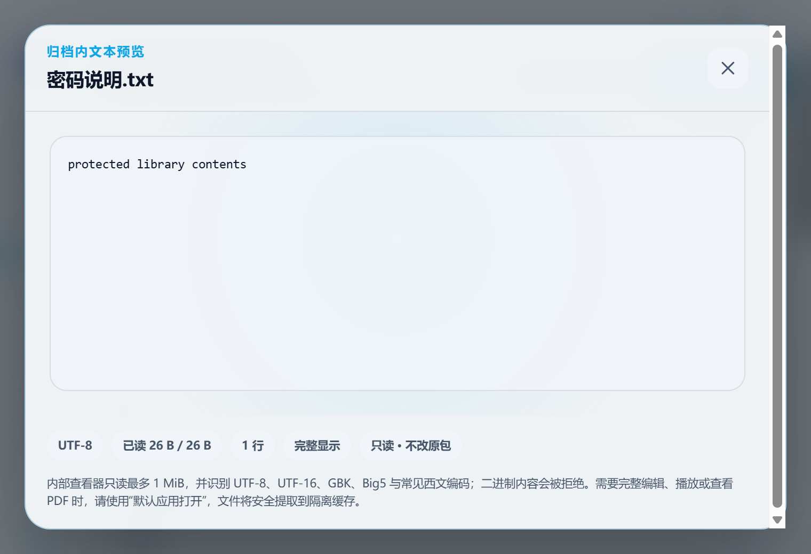

# v1.5.48 资料库维护记录

[检查汇总](checks.json) · [实际桌面原始收据](desktop.json) · [封板范围](../../LIBRARY_MAINTENANCE_FREEZE_1.5.48.md)。

56 项不同前端、19 项相关 Rust、五条实际桌面流程通过。旧真实个人库快照测试按 opt-in 忽略；本次只用独立测试目录，升级从已关闭的 v1.5.47 测试库复制，保留原 65 条项目索引。密码 ZIP、加密目录 7Z、压缩 TAR、七个数字卷、离线/定位/变化、十万项暂停继续及正常关闭重启均有定向依据。密码不写入本记录或索引。

16 条 1100×700 / 760×520 布局无横向溢出，下列八张代表图已实看。窄窗顺排、长路径换行、来源列表和弹窗可滚动，页脚操作可达。

前四条桌面流程保留此前程序身份；最终程序只补 ALZ/EGG 编码字段的来源属性，两项定向前端通过后，接续第五条与对应六条布局。自动脚本曾在添加来源未完成时点击尚禁用的建库按钮；修正为等待来源与按钮就绪，仅接续未完成步骤，没有重跑此前通过流程。每条收据均标明实际程序哈希，不宣称全部流程在最终程序重复运行。

原包哈希、实际取回的单个 26 字节文件哈希和有意更新的 TAR 前后哈希见检查汇总。正式候选、合入、标签与安装附件在本版 PR 接续，不将本地 E2E 程序当作正式安装包。

