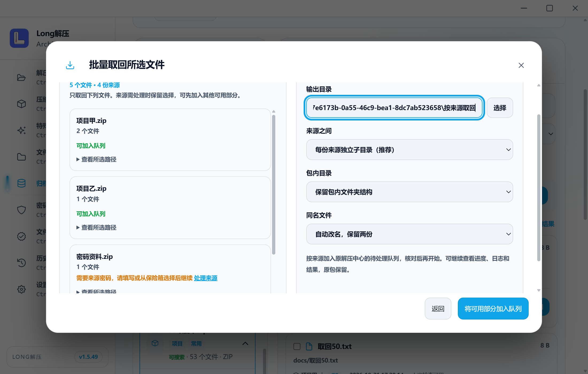
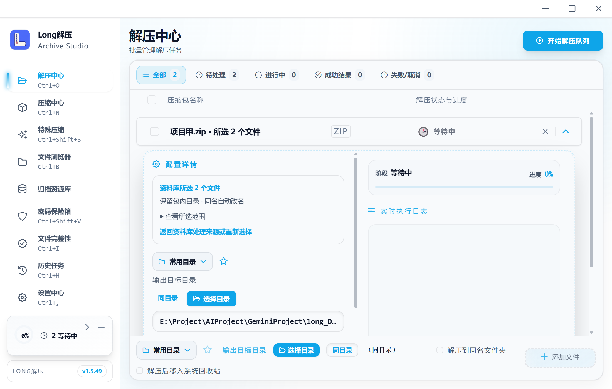
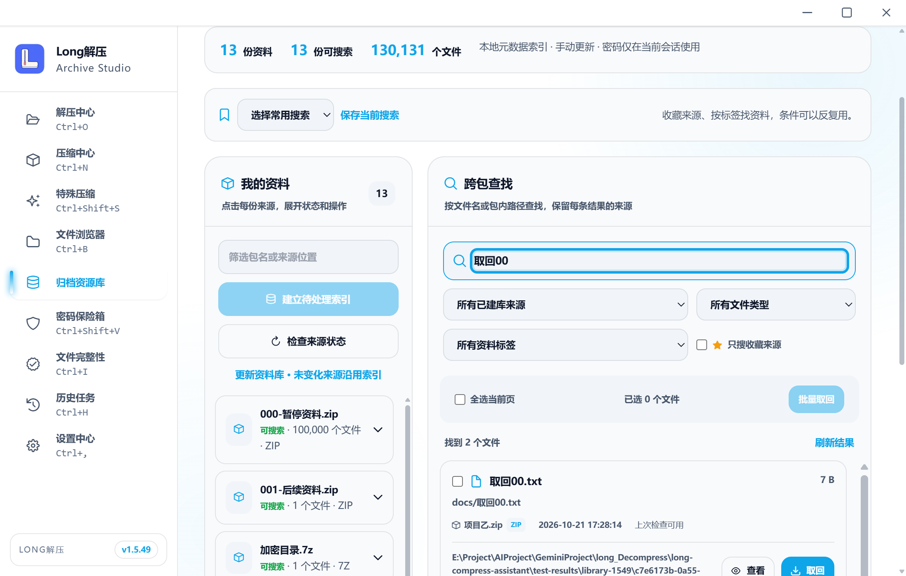
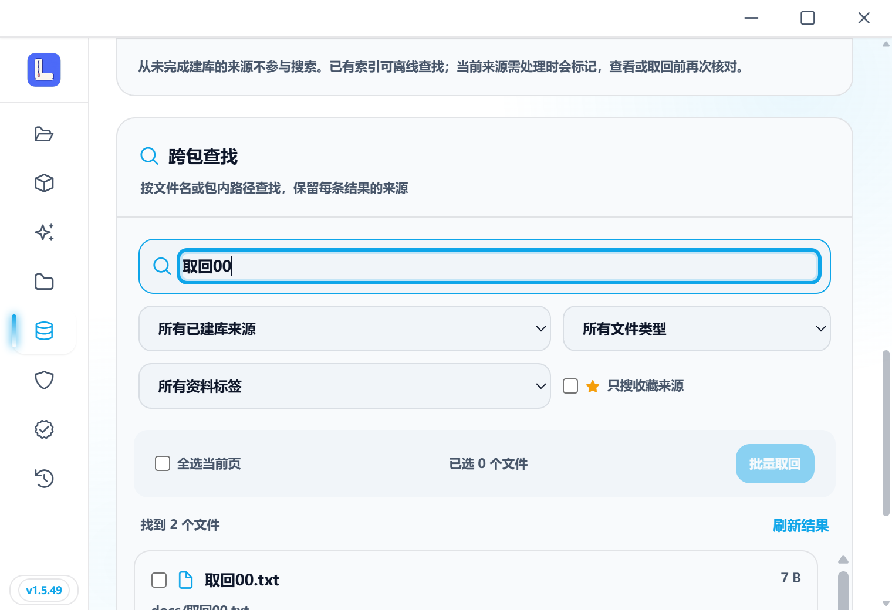
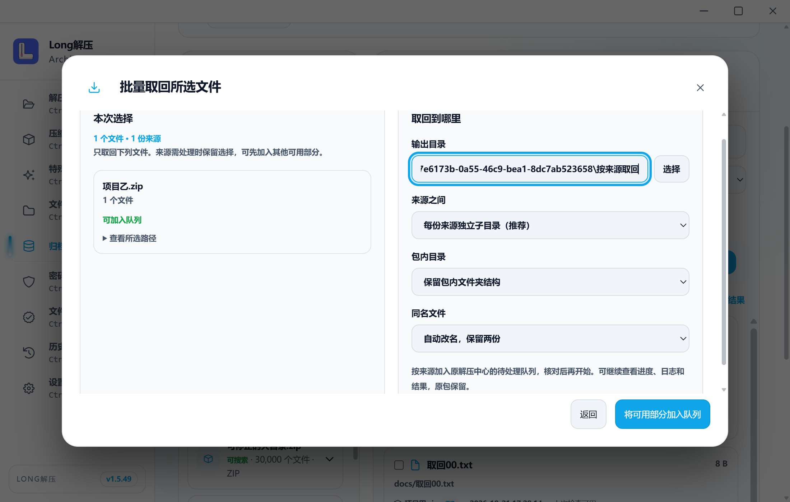
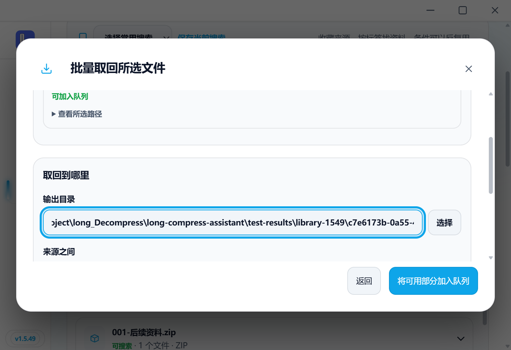
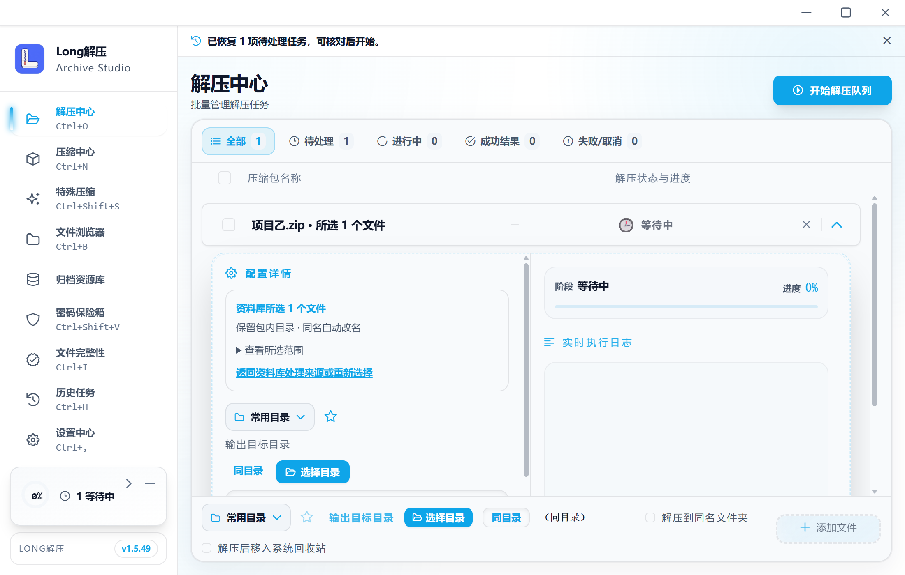
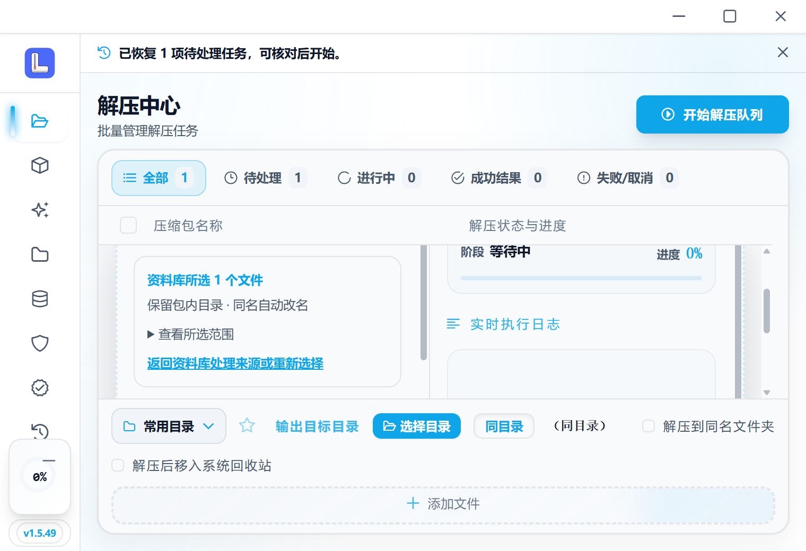

# v1.5.49 资料分类与跨包批量取回记录

[检查汇总](checks.json) · [原始桌面收据](desktop.json) · [封板](../../LIBRARY_RETRIEVAL_FREEZE_1.5.49.md)。

140 项不同前端、五项新增 Rust、四条实际桌面流程通过。独立测试库从 v1.5.48 的 schema 14 升级到 15，原 65 条项目索引保留；未访问个人资料库。标签/收藏/常用搜索、五项跨页选择、可用部分先入原队列、密码保险箱/离线纠正只继续剩余项、按来源/合并/平铺/改名/跳过、正常退出后恢复准确所选范围均有依据。

首批只取回三份所选文件，原同名文件保持；实际字节和所有来源哈希与 SQLite 任务收据见检查汇总。恢复后另一次明确启动只取回所选一个文件。未声称未启动任务已执行，未把离线文件内容当作缓存。

16 条宽窄布局无横向溢出，八张代表图已实看。最终只改结果/弹窗列表滚动以及“开始前取消仍保留范围”的历史生成；先前功能流程保留原程序身份，只补受影响项与第四条。截图步骤误找收起的详情、关闭后误找不需要的确认以及两次 WebView 就绪超时如实保留；后续同目录启动、恢复与提取通过，没有重做已完成取回或改运行时启动参数。每阶段程序身份见收据。

