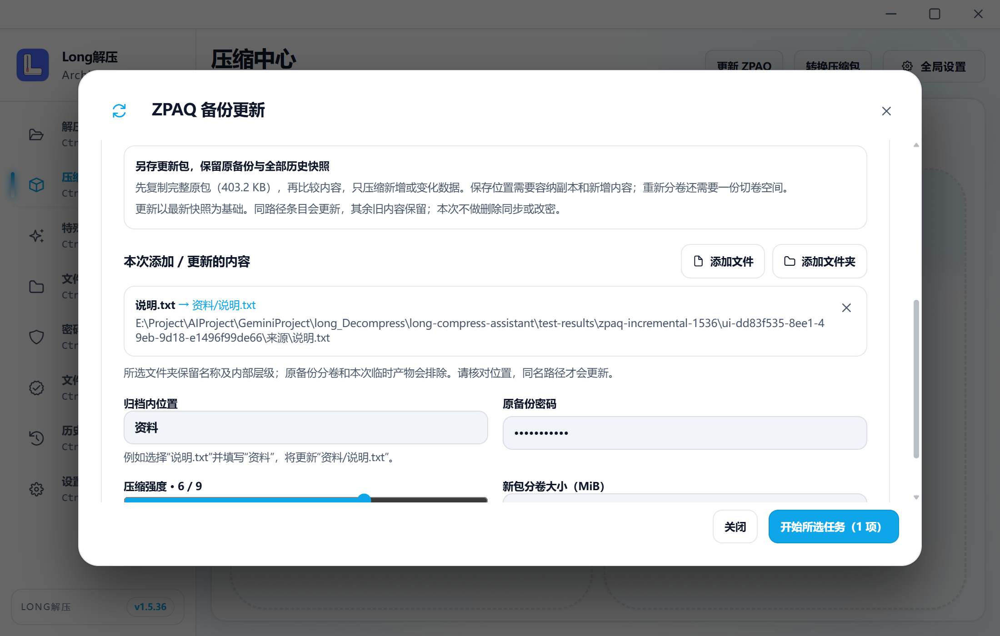
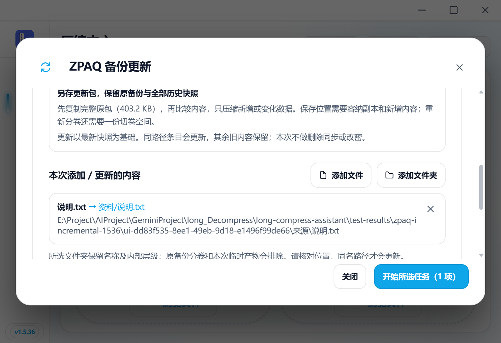
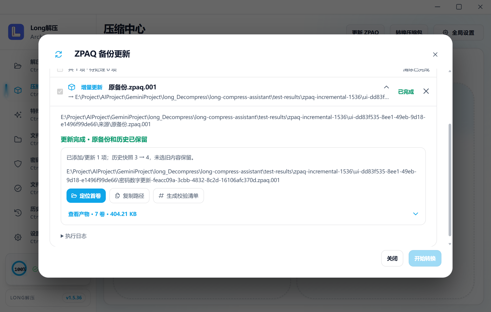
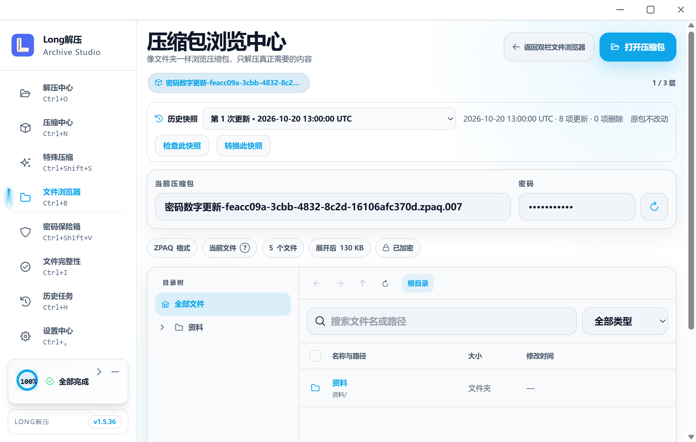
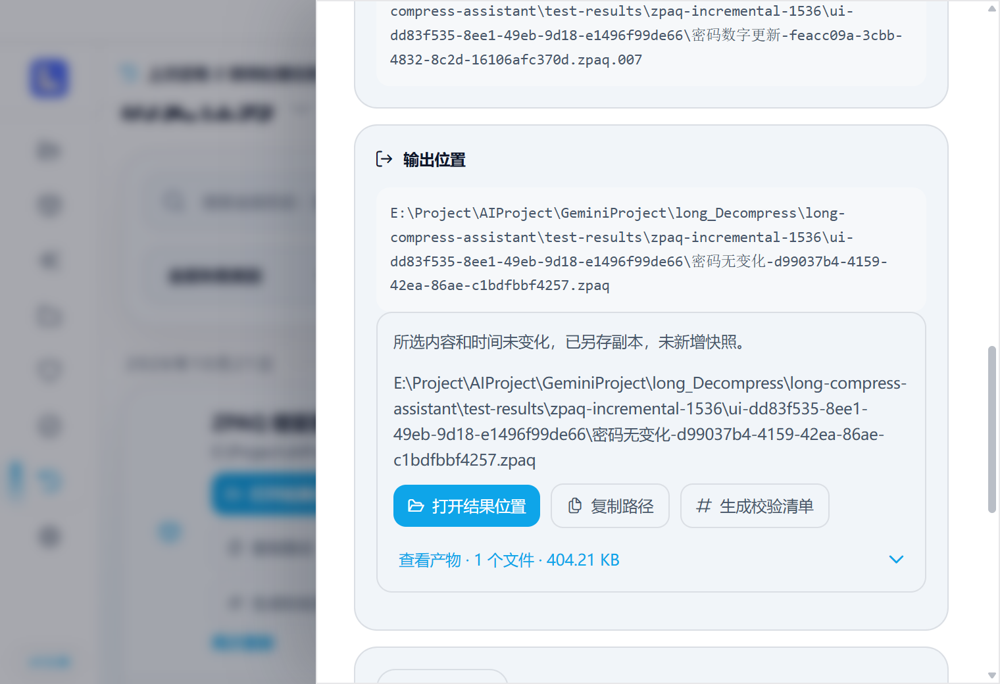
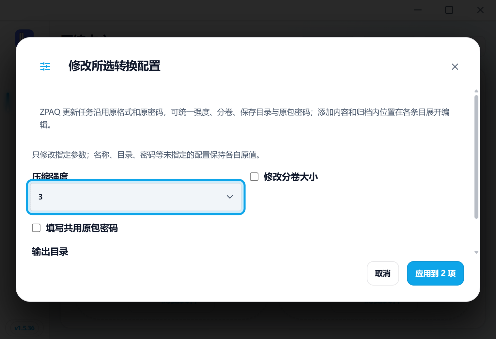
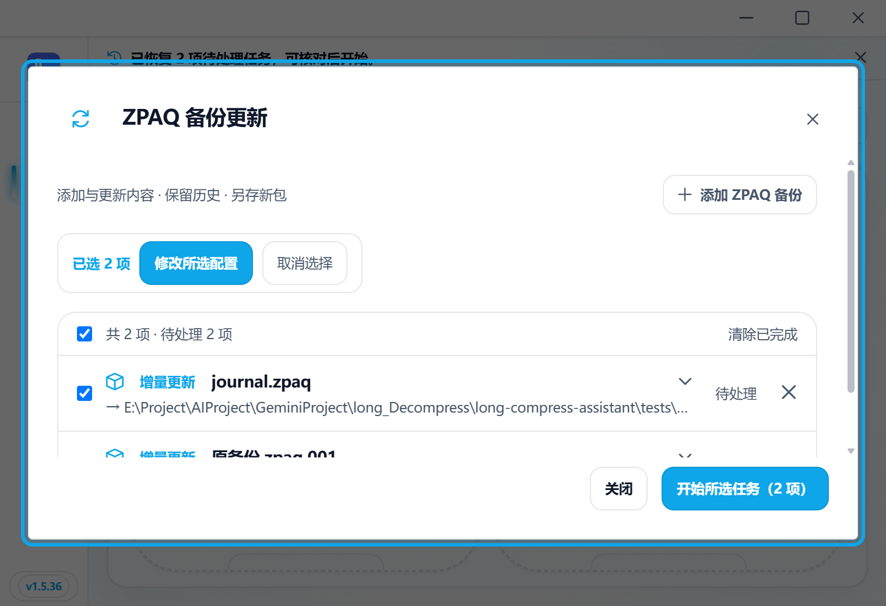

# v1.5.36 定向证据

六项不同Rust、七项新增前端、两条公共原生及五条实际UI通过，见checks.json。frontend-tests.log保留初次六项通过/一项草稿断言失败；指出缺失的具体文件名后，只续frontend-draft-fixed.log该项。其余旧用例均跳过。

engine-probe.json为加入进度行之前的独立适配器探测身份；正式进度版引擎由Rust和桌面链覆盖，不把两个二进制算成同一身份。rust.log的五项通过后，收尾修改父目录冲突索引与提示，新增mapping-check.log一项通过。

首桌面链源fe3e4cf3，包含公共普通/无变化、密码数字更新、独立旧/新回解、浏览提取/转换、失败纠正和暂停停止。草稿标题与隐式目录检查收尾后，程序源39e98f3e，只补受影响的多选/恢复链；desktop-progress.json逐条保留真实二进制身份和前一身份，没有重跑前面已通过链。

14个不同宽/窄截图，横向溢出均≤1px；这里保存七张已实际查看的代表图，完整截图位于本机test-results/desktop-e2e。保持原等宽布局，没有修改中心布局CSS。截图与native/UI记录均由实际WebView2程序产生，不使用预览假数据。

中间选择器失效、历史误选相似名称记录，以及测试旧未恢复草稿合并，都只修正检查器/隔离测试状态后接续；未当作产品新增功能或通过项反复重跑。新增入口恢复标题已修正。无变化截图最初滚动到较早已完成条目，保留原功能通过记录，仅在历史详情重新展示同一无变化结果并确认“未新增快照”，未重跑更新。正式候选与四附件身份另记本版PR，不额外提交触发打包。

